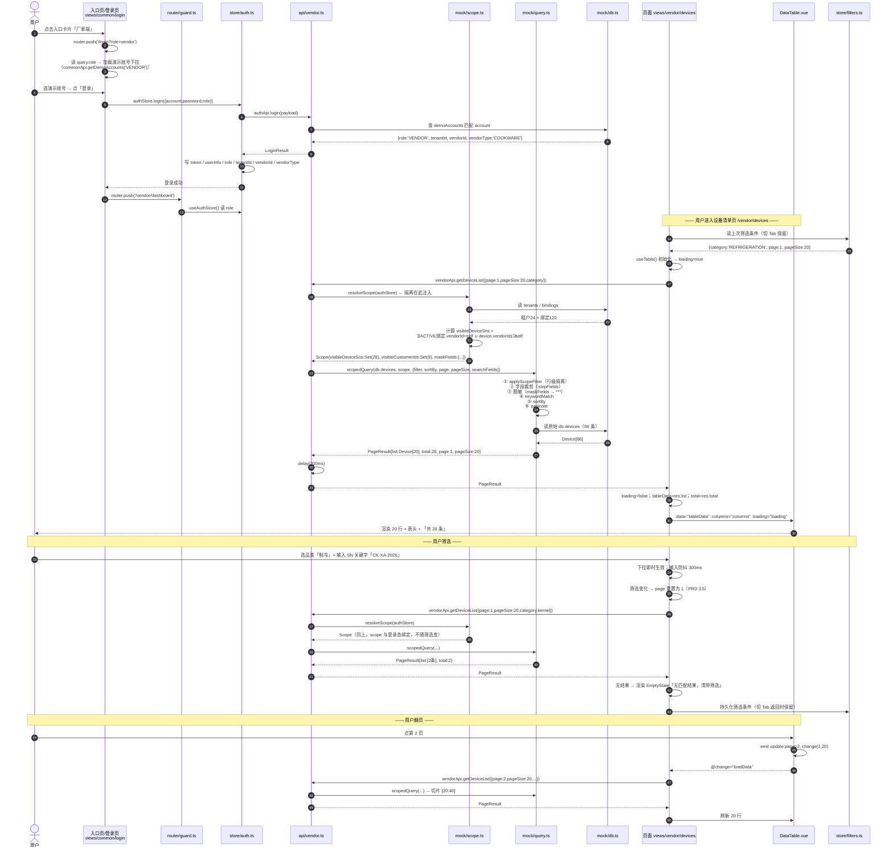
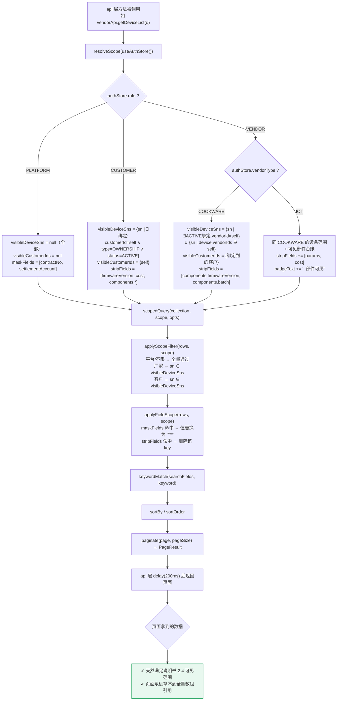
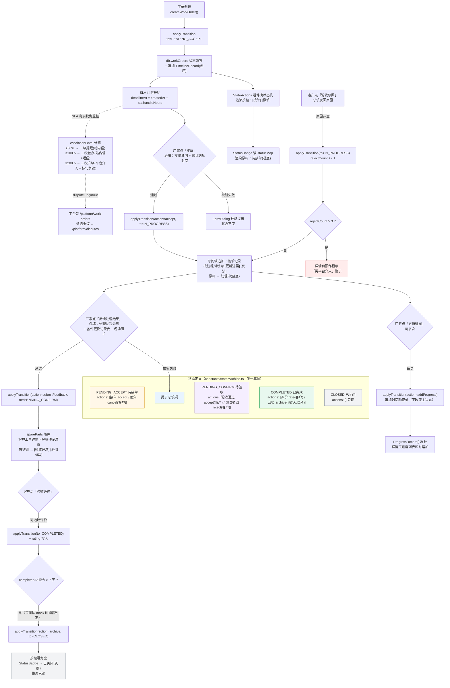
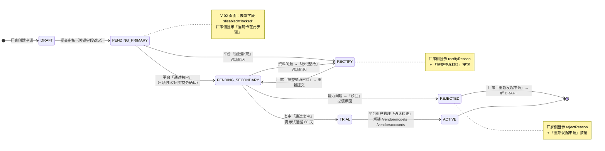
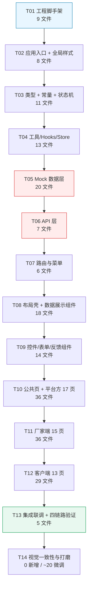

# 后厨管家 AIoT 双边服务平台 · 桌面端 Web 系统架构设计

| 项 | 内容 |
| --- | --- |
| 项目名称 | `aiot_bilateral_desktop` / 工程目录 `iot-desktop` |
| 文档版本 | V1.0（架构设计阶段） |
| 上游输入 | 《AIoT 桌面端 Web 静态页面 PRD》V1.0（`output/aiot-desktop-prd.md`） |
| 业务基线 | 《AIoT 双边服务平台业务逻辑设计说明书》V1.0（stage3，2026-10-13） |
| 本文档角色 | 给出精确到文件的实现地图、接口定义与任务分解，供工程师按编号顺序连续施工 |
| 语言 / 技术栈 | Vue 3.5 + TS + Vite 4 + Pinia + Element Plus 2.14 + SCSS + ECharts 5.6 |

---

## 目录

- [Part A · 系统设计](#part-a--系统设计)
  - [A1. 资产核实结论（实地勘验）](#a1-资产核实结论实地勘验)
  - [A2. 实施方案与框架选型](#a2-实施方案与框架选型)
  - [A3. 工程目录结构（完整文件树）](#a3-工程目录结构完整文件树)
  - [A4. 路由设计](#a4-路由设计)
  - [A5. 数据结构设计（TS 接口全量）](#a5-数据结构设计ts-接口全量)
  - [A6. 数据访问层设计（租户过滤重点）](#a6-数据访问层设计租户过滤重点)
  - [A7. 设计体系落地（SCSS 令牌）](#a7-设计体系落地scss-令牌)
  - [A8. 组件清单与复用裁决](#a8-组件清单与复用裁决)
  - [A9. 程序调用流程（Mermaid）](#a9-程序调用流程mermaid)
  - [A10. 不明确事项与假设](#a10-不明确事项与假设)
- [Part B · 任务分解](#part-b--任务分解)
  - [B1. 依赖清单](#b1-依赖清单)
  - [B2. 任务列表（14 个任务）](#b2-任务列表14-个任务)
  - [B3. 共享知识（跨文件约定）](#b3-共享知识跨文件约定)
  - [B4. 任务依赖图](#b4-任务依赖图)
  - [B5. 风险与待 Phil 拍板事项](#b5-风险与待-phil-拍板事项)

---

# Part A · 系统设计

## A1. 资产核实结论（实地勘验）

> 本节结论全部来自对 `/Users/phil/WorkBuddy/后厨管家AIoT平台/iot-cockpit/` 的实际读取，**不是假设**。PRD 中若干"直接复用"结论经核实后需要修正，下文逐条标注。

### A1.1 工程现状（实测）

| 项 | 实测值 |
| --- | --- |
| 包管理 | npm，Node v22.22.2 / npm 10.9.7（实测环境） |
| 声明依赖 | vue ^3.5.41、vue-router ^4.6.4、pinia ^4.0.3、element-plus ^2.14.4、echarts ^5.6.0、echarts-gl、echarts-liquidfill、video.js、@vueuse/core ^14.4.0、decimal.js |
| 实装版本 | vue 3.5.43、vue-router 4.6.4、pinia 4.0.3、element-plus **2.14.7**、vite **4.5.14**、vue 3.5.43、echarts 5.6.0、sass 1.62.0、typescript 5.6.3、@vitejs/plugin-vue 4.6.2、@vueuse/core 14.4.0 |
| 组件目录 | `src/components/` 共 **31 个**目录（含 `data-table` 与 `tree` 为多文件组件） |
| 全局样式 | `src/styles/index.scss`：`html/body/#app { overflow: hidden; background: #061230; color: #fff }` + `::-webkit-scrollbar { width:0; height:0 }`（**全局隐藏滚动条**） |
| 路由模式 | `createWebHistory`（**非 hash**），仅 2 条业务路由 |
| 布局 | `src/layouts/index.vue` 外层包 `<self-adaption>` 整屏缩放壳 |
| mock 层 | `src/api/iot.ts`（74 行，8 个方法，`delay()` 200ms）+ `src/views/iot-cockpit/data.ts`（307 行，`randInt/randFloat` 抖动生成器） |
| 地图资源 | `src/assets/map/china.json`（480KB，35 个省级 feature，DataV.GeoAtlas）、`china-outline.json`（126KB，国界单 feature）、`fujian.json`（114KB）；`standalone/china.geo.js`（480KB，`const CHINA_GEOJSON = {...}`） |
| 图标体系 | **无 svg-sprite-loader / 无虚拟模块**，仅有 9 个散落 svg 文件；`base-svg-icon` 依赖外部 sprite（`<use xlink:href>`），当前工程内**实际无法独立工作** |
| 交付物 | `dist/` + `standalone/后厨管家-IoT设备全景监控大屏.html`（1.6MB 单文件） |
| Element Plus 图标包 | `@element-plus/icons-vue@2.3.2` 已随 element-plus 装在 `node_modules/@element-plus/icons-vue`（**未在 package.json 显式声明**，新工程需显式声明） |

### A1.2 对 PRD「复用清单」的修正（重要）

PRD 0.2 把组件分为「直接复制复用 ~15 个 / 需改造 / 不复用」三档。实地阅读源码后，**这个分档过于乐观**，因为几乎所有复用组件的 `<style>` 里硬编码了深色背景（`#082747` / `#0b2b47` / `#051d34` / `#03142d`），且部分组件**逻辑上依赖大屏专属 store**。修正后的三档见 [A8](#a8-组件清单与复用裁决)，关键修正：

| 组件 | PRD 裁决 | 实际裁决 | 原因 |
| --- | --- | --- | --- |
| `base-chart` | 直接复制 | ✅ 直接复制 | `base-chart/index.vue` 本身无样式，但 `hooks/use-echarts` 顶部 `import { useResizeStore }` 且 `watch(() => resizeStore.scale)`——**必须剥离 resizeStore 依赖** |
| `hooks/use-echarts` | 未提及 | ⚠️ 复制后**必须改** | 删 `useResizeStore` 相关 3 处；`echarts-gl`/`echarts-liquidfill` 桌面端不需要，可不引入（减小体积）；`echarts.use([...])` 保留基础 8 图 + geo |
| `pagination` | 直接复制 | ⚠️ 复制后改样式 | 模板/逻辑可复用，但 SCSS 全深色（`#082747` 盒式选择器 + `!important` 覆盖全局 select），需整体换浅色 |
| `select` / `date-picker` / `cascader` / `tree-select` | 直接复制 | ⚠️ 复制后改样式 | 逻辑纯 `el-*` 封装无 store 依赖，可复用；SCSS 与 popper 类全深色，需换浅色 |
| `tree` | 直接复制 | ⚠️ 复制后改样式 | 递归组件，无外部依赖，仅样式需换 |
| `data-table` | 需改造 | ✅ 需改造（判断正确） | 模板与列配置逻辑（多级表头/树形/固定列/`render` 返回 VNode）完全可复用；SCSS 全深色需重写 |
| `dialog` | 需改造 | ⚠️ 改造量被低估 | 除浅色外，还 `import { useResizeStore }` 做 `transform: scale()` 补偿，**桌面端必须删掉这段** |
| `panel-card` | 需改造 | ❌ **不复用，新建** | 它内部强制套 `BorderBox13`（赛博边框）+ `PageWrapper` + `PanelTitle`，是深色大屏骨架，改造等于重写 |
| `nav-tab` | 直接复制 | ❌ **不复用** | 依赖 `tab-active.png`/`tab-inactive.png` 深色图片 + `font-title`，宽 449px 写死，桌面端状态 Tab 应用 `el-tabs` |
| `section-tab` | 直接复制 | ❌ **不复用** | 深色药丸底 `#0f2854`，尺寸写死小字号；桌面端用 `el-tabs` |
| `base-svg-icon` | 直接复制 | ❌ **不复用** | 依赖全局 svg sprite，桌面端改用 `@element-plus/icons-vue` |
| `num-with-unit` | 直接复制 | ❌ 不复用（并入 StatCard） | 依赖 `.font-digital` 全局类 + `v-thousand`；桌面端 KPI 卡需求不同（要 trend 箭头、点击跳转） |
| `name-value-item` | 直接复制 | ❌ 不复用 | 内部 `useAppStore().isGroupDashboard` 判断可点击，业务耦合 |
| `no-image-placeholder` | 直接复制 | ⚠️ 复制后改样式 | 结构可复用，底色 `#082747` 需换 |
| `loading` | 直接复制 | ✅ 直接复制 | 纯 SVG 动画 + 颜色可接受（`#02bcfe` 亮蓝在浅底上仍可见）；建议保留 |
| `gauge-chart` | 直接复制 | ❌ 不复用（桌面端无仪表盘需求） | PRD 页面清单无环形仪表场景；仅 dashboard 装饰性 KPI 可不用 |
| `self-adaption` / `border-box-13` / `liquid-chart` / `pie-3d-*` / `video-player` | 不复用 | ✅ 不复用（判断正确） | — |
| `china.geo.js`（登录页背景） | 复用 | ⚠️ **改用 `src/assets/map/china.json`** | `standalone/china.geo.js` 是 IIFE 包裹的 `const CHINA_GEOJSON`，Vite 无法直接 import；`src/assets/map/china.json` 是标准 GeoJSON，`resolveJsonModule` 已开，可直接 import |

**结论：真正"零改动直接复制"的只有 `base-chart/index.vue`、`loading/index.vue`、`utils/format.ts`、`utils/validate.ts`、`directives/thousand/index.ts`、`hooks/use-polling/index.ts` 6 个。其余需按 [A8](#a8-组件清单与复用裁决) 分档处理。**

### A1.3 对 PRD 已锁定结论的可行性评估

| PRD 结论 | 可行性 | 风险与缓解 |
| --- | --- | --- |
| ① 新建独立工程、复用依赖版本 | ✅ 完全可行 | `node_modules` 可通过 `cp -al`（硬链接）或直接 `npm i`（npm 缓存命中）。**注意 pinia 版本为 4.0.3**（非社区常见的 2.x），必须保持一致，勿降级 |
| ② 约 48 页（3+17+13+15） | ⚠️ 页数成立但**工作量被低估** | 见 [B2](#b2-任务列表14-个任务)：48 个路由 + 约 34 个页面内私有组件 ≈ **250+ 文件**。建议按 P0 优先交付（PRD 6. P0 覆盖 31 页），P1 页面可并行插单 |
| ③ 大屏不纳入，仅留外链 | ✅ 可行 | `/platform/screen` 为说明页，`window.open` 指向 `../iot-cockpit/standalone/后厨管家-IoT设备全景监控大屏.html`。**注意 file:// 协议下相对路径需实测**（见 B5-R4） |
| ④ mock 统一走 api 层按 authStore 注入租户过滤 | ✅ 可行 | 见 [A6](#a6-数据访问层设计租户过滤重点)。**关键设计：过滤发生在 `mock/db.ts` 的查询函数内，页面永远拿不到全量数组引用** |
| ⑤ `--color-primary-text: #0B7CAE` 供浅底文字 | ✅ 可行 | 已纳入 [A7](#a7-设计体系落地scss-令牌) 令牌表。同时把 EP 的 `--el-color-primary` 也映射到 `#41C0FF`，但 `--el-color-primary-light-9` 等衍生色阶需手工标定（见 B3 约定 6） |
| ⑥ 不做跨入口联动，最终态静态呈现 | ✅ 可行且**强烈建议保持** | 这是降低复杂度的最大杠杆。实现上= 每端 mock 实体独立副本？不——采用「**同一 mock 实体 + 内存态 store，跨端不联动**」：所有 api 读写同一份内存数据，但**页面不做跨端订阅**。厂家接单后客户页不会自动变（符合 PRD）。实现最简：内存态 + 无跨端 watch |
| ⑦ 演示账号一键切换 + 保留密码表单 | ✅ 可行 | 登录页 `?role=` + 演示账号下拉，选中即填入表单，点击登录走 mock 校验（任意非空密码通过） |

---

## A2. 实施方案与框架选型

### A2.1 核心技术难点与解法

| # | 难点 | 解法 | 复杂度来源 |
| --- | --- | --- | --- |
| N1 | **48 页 × 3 入口的重复劳动** | 抽 18 个业务组件（DataTable/FilterBar/StatusBadge/StatCard/ChartCard/TimelineSteps/FormDialog/DetailDrawer…）到 `src/components/`，页面只做「列配置 + 区块编排」。这是把 ~250 文件压到可控范围的关键 | 高 |
| N2 | **数据隔离"可被看见"（G2）** | 单份 mock 数据 + `api/` 层统一注入 `Scope` 过滤；过滤逻辑集中在 `mock/query.ts` 的 `scopeFilter(scope)` 泛型管道，页面零感知。顶栏再挂 `ScopeBadge` 显示当前范围 | 中 |
| N3 | **状态流转演示（工单 5 态 / 入驻 7 态 / 告警 4 态）** | 内存态 + 状态机常量：`constants/stateMachine.ts` 定义 `{ status, label, actions: Action[] }`，页面用 `<StateActions :order="o" />` 渲染按钮，`StatusBadge` 渲染徽标，**按钮组与徽标都由同一份状态机驱动**，改一处即全局同步（说明书 9.4「状态定义唯一」） | 中 |
| N4 | **三入口视觉一致** | 全局令牌 + 18 个共用组件 + 零页面级自定义配色。页面 SCSS 只允许出现布局尺寸（宽度/间距），不允许出现色值（lint 约束） | 低 |
| N5 | **mock 与将来真实后端零改动切换** | `api/*.ts` 方法签名即 REST 语义（`getDeviceList(params) → Promise<PageResult<Device>>`）。接后端时只替换方法体为 axios，页面不改。**必须在第一行写明这个约定**（沿用 iot-cockpit `api/iot.ts` 的注释风格） | 低 |
| N6 | **ECharts 在 48 页里的重复注册与内存** | 抽 `useEcharts`（剥离 resizeStore）+ `BaseChart` 组件 + `chartTheme.ts` 浅色主题常量。**禁止页面直接 `echarts.init`** | 中 |
| N7 | **深色残留污染** | 复制组件后必须逐个改 SCSS。缓解：新工程 SCSS 里 `:root` 只定义浅色令牌，全局不出现 `#061230`/`#082747` 等深色；代码评审时 grep 深色十六进制 | 低 |

### A2.2 框架选型（沿用 iot-cockpit 同栈）

| 层 | 选型 | 版本 | 决策理由 |
| --- | --- | --- | --- |
| 视图框架 | Vue | 3.5.43（`^3.5.41`） | 与 iot-cockpit 完全一致，`<script setup>` + `vite-plugin-vue-setup-extend`（组件 name 生效，keep-alive 依赖） |
| 构建 | Vite | 4.5.14（`^4.5.0`） | 与 iot-cockpit 一致；**不升级到 5**，避免 `sass` 1.62 与 Vite 5 的 `css.preprocessorOptions` 差异 |
| 语言 | TypeScript | 5.6.3（`~5.6.3`） | 一致 |
| 状态 | Pinia | **4.0.3（`^4.0.3`）** | ⚠️ 必须是 4.x。降级到 2.x 会导致 `defineStore` 写法与 devtools 行为变化 |
| 路由 | vue-router | 4.6.4（`^4.6.4`） | 一致；**改用 `createWebHashHistory`**（见 A4.1） |
| 组件库 | Element Plus | `^2.14.4`（实装 2.14.7） | 一致。**显式引入 `unplugin-auto-import` + `unplugin-vue-components`？→ 否**，为降低工程复杂度，直接 `app.use(ElementPlus)` 全量注册（与 iot-cockpit 一致），组件多了但原型阶段可接受 |
| 图标 | @element-plus/icons-vue | `^2.3.2` | **新增显式依赖**（iot-cockpit 未声明但已装）。用于替代 `base-svg-icon` |
| 图表 | echarts | `^5.6.0` | 一致。**不引入 `echarts-gl` / `echarts-liquidfill`**（3D/水球图，桌面端不需要） |
| 预 composable | @vueuse/core | `^14.4.0` | 一致。桌面端实际只用 `useElementSize`（被 use-echarts 依赖）与 `useDebounceFn`（筛选防抖 300ms） |
| 样式 | sass | 1.62.0（固定版本，不用 `^`） | 与 iot-cockpit 一致。⚠️ sass 1.62 对 `@use` 的处理需注意：全局注入用 `@use ... as *` |
| 精度运算 | decimal.js | `^10.6.0` | 保留。SLA 时限、在线率、MTBF 计算用 `accurateDivide` 等，避免浮点尾差 |
| 不引入 | video.js / echarts-gl / echarts-liquidfill / vite-plugin-svg-icon | — | 大屏专属或本工程不需要 |

### A2.3 目录规划决策：按入口分子目录

**决策：`src/views/` 下按 `platform/` / `vendor/` / `customer/` / `common/` / `demo/` 分子目录，`src/components/` 与 `src/api/`、`src/mock/` 保持扁平共享。**

| 方案 | 优点 | 缺点 | 结论 |
| --- | --- | --- | --- |
| **方案 A：按入口分子目录**（选中） | ① 三入口页面物理隔离，删一个入口不误伤；② 同名页面不会撞车（三端都有"设备列表/告警中心/工单列表/通知中心"，扁平必然重名，需加前缀）；③ 权限边界清晰，审查时能快速确认某入口没引用别端组件；④ 与路由表一一对应，路由文件里 import 路径可预测 | 跨端复用组件若放错位置容易被就近放到 `views/*/components`，演变成重复代码 → **缓解：约定页面私有组件只能放 `views/<entry>/components/`，跨端复用的一律在 `src/components/` 有且仅有一份，并在 [B3 约定 3](#b3-共享知识跨文件约定) 写明** | ✅ |
| 方案 B：扁平 `views/` | 文件少一层 | 48 个页面 + 34 个私有组件共 82 个文件平铺，重名冲突（每端 5~6 对同名），查找困难 | ❌ |
| 方案 C：扁平 + 文件名前缀（`vendor-device-list.vue`） | 无重名 | 目录仍平铺，82 文件混排；前缀冗长 | ❌ |

**关键点**：目录隔离的是**页面（views）**，不隔离**能力（api/mock/components）**。厂家端页面调用 `src/api/vendor.ts`，客户端调用 `src/api/customer.ts`，两者最终都读 `src/mock/db.ts` 同一份数据——这是 PRD ⑥「不做跨端联动但数据同源」得以低成本实现的关键。

### A2.4 Vite / tsconfig / SCSS 关键配置要点

**vite.config.ts 要点**

```ts
export default defineConfig({
  plugins: [vue(), vueSetupExtend()],          // ① vue-setup-extend 必留：组件 name 生效 → keep-alive by name 生效
  resolve: { alias: { '@': fileURLToPath(new URL('./src', import.meta.url)) } },
  css: {
    preprocessorOptions: {
      scss: {
        // ② 全局令牌自动注入：任何 .vue 的 <style lang="scss"> 都能直接用 $primary / @include ellipsis
        additionalData: `@use "@/styles/variables.scss" as *;\n@use "@/styles/mixins.scss" as *;\n`,
        // ③ 全局只用 @use，不混 @import，避免 sass 1.62 的 @import 弃用告警
      },
    },
  },
  server: { port: 9900, host: true },          // ④ 端口避开 iot-cockpit 的 9899
  build: {
    chunkSizeWarningLimit: 2000,
    rollupOptions: { output: { manualChunks: {
      echarts: ['echarts/core', 'echarts/charts', 'echarts/components', 'echarts/renderers'],
      vendor: ['vue', 'vue-router', 'pinia', 'element-plus', '@element-plus/icons-vue'],
    } } },
  },
});
```

**tsconfig.json 要点**（相对 iot-cockpit 的改动已标注）

| 配置 | 值 | 说明 |
| --- | --- | --- |
| `strict` | `true` | 沿用 |
| `noUnusedLocals` / `noUnusedParameters` | **新增 `true`** | ⚠️ 与 iot-cockpit 不同。`data-table` 的 `render` 有未使用参数，iots-cockpit 用 eslint-disable 注释绕过；新工程直接开 TS 检查更省事，但**页面里 `catch {}` 空块要写注释** |
| `paths` | `@/*: ["src/*"]` | 沿用 |
| `types` | `["node"]` | 沿用 |
| `include` | `["src/**/*.ts", "src/**/*.d.ts", "src/**/*.vue"]` | 沿用 |

**`src/env.d.ts` 要点**：沿用 iot-cockpit 全部内容，**追加 `declare module '*.json'`**（地图 GeoJSON 导入需要，iot-cockpit 已有，一并保留）。

**SCSS 组织方式**（三层，禁止跨层反向依赖）

```
src/styles/
├── variables.scss   ← 令牌层：CSS 变量声明 + SCSS 变量映射（改这里 = 全局换肤）
├── mixins.scss      ← 混入层：ellipsis / flex-center / card / scrollbar
├── element.scss     ← 第三方覆写：仅 --el-* CSS 变量覆盖 + 少量必要选择器
└── index.scss       ← 全局基础：reset + body 背景/字体 + 滚动条 + 工具类
```

**关键约束（与 iot-cockpit 相反）**：
```scss
// ❌ 绝对禁止（iot-cockpit 的做法，带进新工程即为污染）
html, body, #app { overflow: hidden; }   // 桌面端必须页面级滚动
::-webkit-scrollbar { width: 0; height: 0; }  // 桌面端必须保留滚动条

// ✅ 新工程要求
body { overflow: auto; background: var(--color-bg-page); color: var(--color-text-body); }
::-webkit-scrollbar { width: 8px; height: 8px; }  // 细滚动条
```

---

## A3. 工程目录结构（完整文件树）

> **图例**：`[复用]`=从 iot-cockpit 复制（`[改]`=复制后需改 SCSS/逻辑，`[纯]`=零改动）；`[新]`=全新编写。
> 路径前缀统一省略 `iot-desktop/`。**总计约 254 个文件**（统计见 [B2 汇总](#b2-任务列表14-个任务)）。

```
iot-desktop/
├── index.html                                  [新]  挂载 #app；标题「后厨管家 · AIoT 双边服务平台」；favicon 内联 SVG（深蓝底+主色环）
├── package.json                                [新]  见 B1 依赖清单
├── package-lock.json                           [新]  npm 生成
├── tsconfig.json                               [新]  见 A2.4
├── tsconfig.node.json                          [新]  沿用 iot-cockpit
├── vite.config.ts                              [新]  见 A2.4
├── .env                                        [新]  VITE_AUTH_MODE=mock / VITE_APP_TITLE / VITE_COCKPIT_URL
├── .gitignore                                  [新]  node_modules/ dist/ *.local .DS_Store
├── README.md                                   [新]  启动说明 + 演示账号清单 + 四条主链路演示脚本
├── public/
│   └── favicon.svg                             [新]  品牌图标（可选，index.html 用内联 dataURI 亦可）
└── src/
    ├── main.ts                                 [新]  createApp + Pinia + Router + ElementPlus(zhCn) + 全局 SCSS + 权限守卫
    ├── App.vue                                 [新]  <router-view />（同 iot-cockpit）
    ├── env.d.ts                                [复用·纯]  沿用 iot-cockpit src/env.d.ts
    ├── permission.ts                           [新]  全局 beforeEach：登录态 + 角色 + 面包屑写入
    │
    ├── api/                                    ← 全部 [新]，页面唯一取数入口
    │   ├── index.ts                            [新]  统一导出，装配 api 模块
    │   ├── auth.ts                             [新]  登录/登出/获取当前用户/演示账号列表
    │   ├── platform.ts                         [新]  17 个平台方页面所需（约 26 个方法）
    │   ├── vendor.ts                           [新]  15 个厂家端页面所需（约 22 个方法）
    │   ├── customer.ts                         [新]  13 个客户端页面所需（约 18 个方法）
    │   ├── common.ts                           [新]  三端共用：通知中心、数据范围、字典
    │   └── types.ts                            [新]  api 层出入参类型（PageResult / ListQuery / 局部 DTO）
    │
    ├── mock/                                   ← 全部 [新]
    │   ├── db.ts                               [新]  ★ 内存数据库：22 个集合的初始化 + 内存态读写（工单/绑定/入驻状态流转的落点）
    │   ├── scope.ts                            [新]  ★ 租户范围计算：resolveScope(authStore) → { tenantId, vendorId, visibleDeviceSns, visibleCustomerIds, maskFields }
    │   ├── query.ts                            [新]  泛型查询管道：filter/sort/paginate/select 组合器（所有 api 列表方法走它）
    │   ├── factories/
    │   │   ├── index.ts                        [新]  各工厂函数汇总导出 + 初始化编排 initDb()
    │   │   ├── random.ts                       [新]  带种子的确定性随机（seededRandom），保证刷新后 mock 稳定不跳变
    │   │   ├── tenants.ts                      [新]  M-01/M-02：24 租户 + 60 账号（含 8 学校食堂/5 酒店/4 团餐/3 经销商）
    │   │   ├── onboarding.ts                   [新]  M-03/M-04：9 入驻申请（7 状态全覆盖）+ 时间轴
    │   │   ├── catalog.ts                      [新]  M-05：14 产品型号
    │   │   ├── devices.ts                      [新]  M-06：86 设备（warrantyUntil 由型号策略计算）
    │   │   ├── components.ts                   [新]  M-07：60 部件（仅物联网厂家）
    │   │   ├── bindings.ts                     [新]  M-08/M-09：120 绑定 + 变更历史
    │   │   ├── alarms.ts                       [新]  M-10：140 告警 + 规则 M-17 + 客户阈值 M-22
    │   │   ├── work-orders.ts                  [新]  M-11/M-12/M-13：64 工单 + 流转 + 备件
    │   │   ├── metrics.ts                      [新]  M-14：deviceMetrics（每设备 48~168 点）
    │   │   ├── notifications.ts                [新]  M-15：30 站内信
    │   │   ├── audit.ts                        [新]  M-16：60 审计日志
    │   │   ├── disputes.ts                     [新]  M-19：6 争议
    │   │   ├── performance.ts                  [新]  M-20/M-21：履约统计 4×4 + 使用情况 86×7
    │   │   └── stories.ts                      [新]  ★ M-23「预设故事线」：ONB-0001/0003/0005/0007、ALM-0088、WO-0031/0025/0018/0009 定点覆盖
    │   └── delay.ts                            [新]  延迟工具 delay<T>(data, ms=200)（沿用 iot-cockpit api/iot.ts 写法）
    │
    ├── components/                             ← 三入口共用，全部 [新]（个别内部复制 iot-cockpit 纯逻辑）
    │   ├── layout/
    │   │   ├── AppLayout.vue                   [新]  ★ 布局壳：SideNav + TopBar + 内容区（滚动容器在内容区，不在 body）
    │   │   ├── SideNav.vue                     [新]  220px 深色 #1D2129 侧栏 / 可折叠 64px / 二级展开 / 底部「返回入口切换」
    │   │   ├── TopBar.vue                      [新]  56px 白底 / 面包屑 + ScopeBadge + 铃铛 + 角色下拉 + 头像
    │   │   ├── PageContainer.vue               [新]  内容区内边距 16/24 + 24 栅格 + max-width 1600 居中
    │   │   └── DemoTipBar.vue                  [新]  ★ 页面顶部「演示数据提示」条（PRD 3.5 要求）
    │   ├── data/
    │   │   ├── DataTable.vue                   [改·复用] ★ 改造 iot-cockpit data-table（模板+列配置复用，SCSS 重写为浅色）；新增 slots: `toolbar`/`empty`
    │   │   ├── TableColumn.vue                 [改·复用] 同上（render VNode 逻辑复用）
    │   │   ├── RenderContent.ts                [改·复用] 同上
    │   │   ├── Pagination.vue                  [改·复用] ★ 改造 iot-cockpit pagination（v-model:page/page-size/total/@change 不变，SCSS 换浅色，页数默认 20）
    │   │   ├── StatCard.vue                    [新]  ★ KPI 卡：label + 数值 + 单位 + 环比箭头 + 可点击跳模块
    │   │   ├── ChartCard.vue                   [新]  图表卡：标题 + 右侧筛选插槽 + 更多
    │   │   ├── StatusBadge.vue                 [新]  ★ 统一徽标：tone(success/warning/danger/info/purple/neutral) → 底/字色
    │   │   ├── ScopeBadge.vue                  [新]  ★ 数据范围徽标（「本厂家全部」/「本租户全部」/「全局（财务字段脱敏）」）
    │   │   ├── DetailDrawer.vue                [改·复用] ★ 改造 iot-cockpit dialog → 右侧抽屉 720px（删 resizeStore scale 段）
    │   │   ├── FormDialog.vue                  [改·复用] ★ 改造 dialog → 居中表单弹窗 640px（删 resizeStore scale 段）
    │   │   ├── TimelineSteps.vue               [新]  ★ 状态机时间轴（入驻 7 态/工单 5 态/告警 4 态共用）
    │   │   ├── EmptyState.vue                  [新]  空态：图形 + 文案 + 「清除筛选」按钮
    │   │   ├── DescList.vue                    [新]  详情描述列表（label: value 栅格，来自 name-value-item 思路重写）
    │   │   └── Loading.vue                     [复用·纯]  iot-cockpit loading/index.vue
    │   ├── form/
    │   │   ├── FilterBar.vue                   [新]  ★ 筛选区容器：默认展开 3 项 + 展开/收起 + 右侧批量/新增插槽
    │   │   ├── FormDialog.vue                  [新]  表单弹窗骨架：标题 + el-form + 底部取消/确定（确定走 loading）
    │   │   ├── UploadField.vue                 [新]  附件上传占位（点击选择 → 本地文件名列表，不真上传）
    │   │   ├── ThresholdInput.vue              [新]  阈值输入：数值 + 单位 + 范围校验 + 等级选择
    │   │   └── StepForm.vue                    [新]  ★ 分步表单（入驻申请 4 步用）：el-steps + 每步校验
    │   ├── control/
    │   │   ├── Select.vue                      [改·复用] ★ 改造 iot-cockpit select（label/options/clearable/filterable 不变，SCSS 换浅色）
    │   │   ├── DatePicker.vue                  [改·复用] ★ 改造 date-picker
    │   │   ├── Cascader.vue                    [改·复用] ★ 改造 cascader
    │   │   ├── TreeSelect.vue                  [改·复用] ★ 改造 tree-select
    │   │   └── Tree.vue                        [改·复用] ★ 改造 tree
    │   └── feedback/
    │       ├── ConfirmDialog.vue               [新]  ★ 危险操作二次确认：动宾标题 + 必填原因 + 默认焦点取消
    │       └── NoImagePlaceholder.vue          [改·复用] 改造 no-image-placeholder（换浅色底）
    │
    ├── constants/                              ← 全部 [新]，★ 「改一处要同步改多处」的集中地
    │   ├── index.ts                            [新]  统一导出
    │   ├── statusMap.ts                        [新]  ★★ 状态码 → 中文名 + badge tone（说明书 9.4 唯一来源；入驻7/工单5/告警4/绑定4/租户/设备/部件 共 30+ 条）
    │   ├── stateMachine.ts                     [新]  ★★ 状态机：{ status, label, actions[{key,label,tone,confirm,requiredFields}] }，按钮组与徽标的唯一来源
    │   ├── dict.ts                             [新]  设备品类、问题类型、告警类型、通知类型、绑定类型、产权来源、审计动作
    │   ├── sla.ts                              [新]  4 优先级 × 3 段时限默认值 + 三级升级阈值（80%/100%/200%）
    │   ├── menu.ts                             [新]  ★ 三入口菜单定义（标题/路径/图标/角色/所需厂家类型/排序）
    │   ├── demoAccounts.ts                     [新]  ★ 演示账号清单（平台 4 类/厂家 3 类×2 厂家类型/客户 3 类 → 共 ~13 个账号）
    │   └── chart.ts                            [新]  图表色板与浅色主题常量（复用 iot-cockpit constants/chart.ts 的 IOT_COLORS 思路，色值改浅色）
    │
    ├── hooks/
    │   ├── use-echarts.ts                      [改·复用] ★ 复制 iot-cockpit hooks/use-echarts，删 resizeStore 依赖与 echarts-gl/liquidfill
    │   ├── use-polling.ts                      [复用·纯]  iot-cockpit hooks/use-polling（实时告警流用）
    │   ├── use-table.ts                        [新]  ★★ 列表页统一逻辑：query 状态 + 分页 + 排序 + 筛选变化重置页码 + loading
    │   └── use-scope.ts                        [新]  页面读当前 scope（顶栏徽标、按钮权限用）
    │
    ├── store/                                  ← 全部 [新]
    │   ├── index.ts                            [新]  createPinia 实例
    │   ├── auth.ts                             [新]  ★★ token/userInfo/role/tenantId/vendorId/vendorType/isLoggedIn/login/logout/switchRole
    │   ├── app.ts                              [新]  侧栏折叠、页面标题、keepAlive 名列表（照抄 iot-cockpit store/app.ts 的 LRU 实现）
    │   └── filters.ts                          [新]  ★ 筛选条件持久化（切 Tab 保留，PRD 3.5）
    │
    ├── utils/                                  ← 全部 [新]/[复用]
    │   ├── format.ts                           [复用·纯]  iot-cockpit utils/format.ts（formatThousand/formatValue/tableSort）
    │   ├── validate.ts                         [复用·纯]  iot-cockpit utils/validate.ts
    │   ├── decimal.ts                          [复用·纯]  iot-cockpit utils/decimal.ts（accurateDivide 用于 SLA/在线率）
    │   ├── date.ts                             [新]  ★ formatDateTime / fromNow / 倒计时格式化（SLA 剩余、7 天自动生效倒计时）
    │   └── mask.ts                             [新]  ★ 脱敏工具（财务/合同字段 → `***`；按 scope.maskFields 驱动）
    │
    ├── types/                                  ← 全部 [新]，单一真源，避免循环依赖
    │   ├── index.ts                            [新]  统一 re-export（页面只 import from '@/types'）
    │   ├── entity.ts                           [新]  ★★ 22 个实体接口（见 A5）
    │   ├── enums.ts                            [新]  ★ 所有字面量联合类型（状态码/角色/类型）
    │   └── vo.ts                               [新]  页面用视图对象（StatCardData / ChartSeries / TableAction ...）
    │
    ├── directives/
    │   └── thousand.ts                         [复用·纯]  iot-cockpit directives/thousand
    │
    ├── styles/
    │   ├── index.scss                          [新]  ★ reset + body 浅色 + 可见滚动条 + 工具类
    │   ├── variables.scss                      [新]  ★★ 全套令牌（见 A7）
    │   ├── mixins.scss                         [新]  ellipsis / flex-center / card / page-scroll
    │   └── element.scss                        [新]  ★ --el-* 变量覆写 + EP 组件浅色微调
    │
    ├── router/
    │   ├── index.ts                            [新]  createRouter(hash) + 汇总 routes + afterEach(标题/keepAlive)
    │   ├── routes.common.ts                    [新]  / + /login + /demo/guide + /demo/isolation + /403 + /:pathMatch(.*)*
    │   ├── routes.platform.ts                  [新]  17 条平台方路由（含 3 个 Layout 子路由）
    │   ├── routes.vendor.ts                    [新]  15 条厂家端路由
    │   ├── routes.customer.ts                   [新]  13 条客户端路由
    │   └── guard.ts                            [新]  ★ 路由守卫（登录态 + 角色匹配 + 标题写入 + breadcrumb 写入）
    │
    ├── assets/
    │   ├── map/china.json                      [复用]  iot-cockpit src/assets/map/china.json（登录页深色地图，480KB）
    │   ├── images/logo.svg                     [复用]  iot-cockpit assets/images/headers/logo.svg
    │   └── images/empty.svg                    [新]  空态占位图
    │
    └── views/
        ├── common/                             ← 公共 3 页（+ 403）
        │   ├── entry/index.vue                 [新]  ★ P0-01 入口选择页（深色科技风 + 地图背景 + 三入口卡片）
        │   ├── login/index.vue                 [新]  ★ P0-02 登录页（深色地图背景 + ?role= + 演示账号切换器 + 密码表单）
        │   ├── demo-guide/index.vue            [新]  P1-01 演示导览（四条主链路一键跳转）
        │   ├── demo-isolation/index.vue        [新]  P1-02 数据隔离演示（三角色可见范围对照表）
        │   └── error/403.vue                   [新]  无权限页（角色不匹配落地）
        │
        ├── platform/                           ← 17 页
        │   ├── dashboard/index.vue             [新]  P-01 平台总览（6 KPI + 4 图 + 待办列表）
        │   ├── dashboard/components/            [新]  KpiGrid.vue / AlarmTrendChart.vue / AlarmLevelPie.vue / CategoryBar.vue / VendorRankBar.vue / TodoList.vue
        │   ├── review/application-list.vue      [新]  P-02 入驻申请列表
        │   ├── review/application-detail.vue   [新]  ★★ P-03 入驻审核详情（四维度 + 状态流转按钮组，最重页面之一）
        │   ├── review/components/              [新]  AuditChecklistCard.vue / MaterialPreview.vue / TechIntegrationForm.vue / BusinessTermsForm.vue / OnboardingTimeline.vue
        │   ├── tenants/tenant-list.vue         [新]  P-04 租户管理列表
        │   ├── tenants/tenant-detail.vue       [新]  P-05 租户详情
        │   ├── devices/device-list.vue         [新]  P-06 设备台账（全局，只读）
        │   ├── devices/components/DeviceDetailTabs.vue  [新]  P-07 设备详情抽屉（档案/部件/绑定/告警/工单 5 Tab）
        │   ├── bindings/binding-list.vue       [新]  P-08 绑定关系总览
        │   ├── bindings/components/BindingHistoryDrawer.vue  [新]  变更历史抽屉
        │   ├── alarms/alarm-center.vue         [新]  P-09 告警中心（实时滚动 + 历史表）
        │   ├── alarms/components/RealtimeAlarmStream.vue   [新]  hover 暂停滚动
        │   ├── alarms/components/AlarmDetailDrawer.vue    [新]  告警详情抽屉
        │   ├── work-orders/order-list.vue      [新]  P-10 工单管理（全局）
        │   ├── disputes/dispute-list.vue       [新]  P-11 争议仲裁
        │   ├── disputes/dispute-detail.vue     [新]  P-11 仲裁详情（举证区 + 判定表单）
        │   ├── vendor-performance/index.vue    [新]  P-12 履约考核
        │   ├── notifications/index.vue         [新]  P-13 通知中心
        │   ├── audit-logs/index.vue            [新]  P-14 审计日志
        │   ├── settings/alarm-rules.vue        [新]  P-15 告警规则配置
        │   ├── settings/sla-config.vue         [新]  P-16 SLA 时限配置
        │   └── screen/index.vue                [新]  P-17 大屏外链说明页
        │
        ├── vendor/                             ← 15 页
        │   ├── dashboard/index.vue             [新]  V-01 厂家工作台
        │   ├── dashboard/components/            [新]  VendorKpiGrid.vue / BindingOverview.vue / AlarmTrendChart.vue / OrderTodoCard.vue / VendorTodoList.vue
        │   ├── onboarding/index.vue            [新]  ★★ V-02 入驻申请（7 状态时间轴 + 4 步分步表单 + 锁定态）
        │   ├── onboarding/components/          [新]  OnboardingTimeline.vue / OnboardingStepForm.vue / RectifyNotice.vue
        │   ├── models/model-list.vue           [新]  V-03 产品型号档案
        │   ├── models/components/ModelFormDialog.vue     [新]
        │   ├── devices/device-list.vue         [新]  ★★ V-04 设备清单（批量导入 + 失败行回显 + 申报绑定）
        │   ├── devices/components/             [新]  ImportDialog.vue / ImportResultTable.vue / DeviceFormDialog.vue / DeclareBindingDialog.vue / UnbindDialog.vue
        │   ├── devices/device-detail.vue       [新]  V-05 设备详情（5 Tab）
        │   ├── bindings/binding-list.vue       [新]  V-06 绑定关系管理（申报 + 服务范围校验）
        │   ├── bindings/components/DeclareBindingDialog.vue [复用 vendor/devices 版本] / BindingHistoryDrawer.vue / ServiceScopeCheck.vue
        │   ├── usage/usage-analysis.vue        [新]  P1-03 设备使用情况（7 指标）
        │   ├── alarms/alarm-center.vue         [新]  V-08 告警中心
        │   ├── alarms/components/AlarmDetailDrawer.vue    [新]  含前后 30min 曲线 + 关联部件
        │   ├── alarm-stats/index.vue           [新]  P1-04 告警统计（6 类维度）
        │   ├── work-orders/order-list.vue      [新]  V-10 工单处理列表
        │   ├── work-orders/order-detail.vue    [新]  ★★ V-11 工单详情（接单/多次进展/反馈含备件登记）
        │   ├── work-orders/components/         [新]  AcceptDialog.vue / ProgressForm.vue / FeedbackForm.vue / SparePartTable.vue / SlaCountdown.vue / EscalationAlert.vue
        │   ├── components/component-list.vue  [新]  P1-05 V-12 部件台账（物联网厂家专属菜单）
        │   ├── accounts/account-list.vue       [新]  P1-08 V-13 子账号管理 + 待审批
        │   ├── notifications/index.vue         [新]  P1-10 V-14 通知中心
        │   └── performance/index.vue           [新]  V-15 履约画像（只读）
        │
        └── customer/                           ← 13 页
            ├── dashboard/index.vue             [新]  C-01 客户工作台（报修大按钮）
            ├── dashboard/components/            [新]  AssetOverviewCard.vue / CategoryPie.vue / TodayAlarmCard.vue / OrderProgressCard.vue / VendorScoreCard.vue
            ├── devices/device-list.vue         [新]  C-02 我的设备（聚合形态）
            ├── devices/device-detail.vue       [新]  C-03 设备详情（5 Tab）
            ├── devices/components/             [新]  DeviceMonitorTab.vue / MetricTrendChart.vue / DeviceAlarmTab.vue / DeviceOrderTab.vue / DeviceProfileTab.vue
            ├── alarms/alarm-center.vue         [新]  C-04 告警中心（列表/卡片视图切换）
            ├── alarms/alarm-detail.vue         [新]  C-05 告警详情
            ├── alarms/components/AlarmCardItem.vue        [新]
            ├── work-orders/order-list.vue      [新]  C-06 报修工单列表（状态 Tab）
            ├── work-orders/order-create.vue    [新]  ★ C-07 发起报修（自动带入 + SLA 预览）
            │   └── components/AutoFillSummary.vue         [新]  右侧「自动带入信息」摘要
            ├── work-orders/order-detail.vue    [新]  ★★ C-08 工单详情（备件记录 + 验收驳回 + 评价）
            ├── work-orders/components/        [新]  SparePartTable.vue / AcceptRejectPanel.vue / RatingPanel.vue / OrderTimeline.vue
            ├── bindings/binding-confirm.vue   [新]  ★ C-09 绑定确认（7 天倒计时卡片）
            ├── vendors/vendor-list.vue         [新]  P1-06 C-10 厂家服务评价
            ├── thresholds/threshold-list.vue  [新]  P1-06 C-11 阈值设置
            ├── accounts/account-list.vue       [新]  P1-08 C-12 子账号管理
            └── notifications/index.vue         [新]  P1-10 C-13 通知中心
```

**文件数统计**

| 区域 | 文件数 |
| --- | --- |
| 根配置 | 10 |
| `src/api` | 7 |
| `src/mock` + `mock/factories` | 19 |
| `src/components` | 32 |
| `src/constants` | 7 |
| `src/hooks` | 4 |
| `src/store` | 4 |
| `src/utils` | 5 |
| `src/types` | 4 |
| `src/directives` | 1 |
| `src/styles` | 4 |
| `src/router` | 6 |
| `src/assets` | 3 |
| `src/` 根（main/App/env/permission） | 4 |
| `views/common` | 5 |
| `views/platform` | 16 页面 + 15 子组件 = **31** |
| `views/vendor` | 15 页面 + 21 子组件 = **36** |
| `views/customer` | 13 页面 + 16 子组件 = **29** |
| **合计** | **254** |

---

## A4. 路由设计

### A4.1 路由模式：`createWebHashHistory`

**决策：hash 模式**（PRD Q12 建议采纳）。理由：交付形态可能是纯静态包（双击 `dist/index.html` 或丢到任意静态托管），hash 模式无需服务端 rewrite 配置。开发期用 `/demo/guide` 这类 hash 路由也不影响体验。**注意**：hash 模式下 `router.push({ query })` 依然可用（`#/login?role=vendor`），登录页 `?role=` 参数方案不受影响。

### A4.2 路由表（全量 51 条）

**公共（5 条）**

| path | name | 组件 | meta.title | meta.role | 布局 |
| --- | --- | --- | --- | --- | --- |
| `/` | `Entry` | `views/common/entry/index.vue` | 入口选择 | public | 无（深色全屏） |
| `/login` | `Login` | `views/common/login/index.vue` | 登录 | public | 无（深色全屏） |
| `/demo/guide` | `DemoGuide` | `views/common/demo-guide/index.vue` | 演示导览 | public | 无（简单居中页） |
| `/demo/isolation` | `DemoIsolation` | `views/common/demo-isolation/index.vue` | 数据隔离演示 | public | 无 |
| `/:pathMatch(.*)*` | `NotFound` | `views/common/error/404.vue` | 页面不存在 | public | 无 |

**平台方（17 条）** — 全部挂在 `AppLayout` 下，`meta.role = 'PLATFORM'`

| # | path | name | 组件 | meta.title |
| --- | --- | --- | --- | --- |
| P-01 | `/platform/dashboard` | `PlatformDashboard` | `platform/dashboard/index.vue` | 平台总览 |
| P-02 | `/platform/review/applications` | `PlatformApplications` | `platform/review/application-list.vue` | 入驻申请 |
| P-03 | `/platform/review/applications/:id` | `PlatformApplicationDetail` | `platform/review/application-detail.vue` | 入驻审核详情 |
| P-04 | `/platform/tenants` | `PlatformTenants` | `platform/tenants/tenant-list.vue` | 租户管理 |
| P-05 | `/platform/tenants/:id` | `PlatformTenantDetail` | `platform/tenants/tenant-detail.vue` | 租户详情 |
| P-06 | `/platform/devices` | `PlatformDevices` | `platform/devices/device-list.vue` | 设备台账 |
| P-08 | `/platform/bindings` | `PlatformBindings` | `platform/bindings/binding-list.vue` | 绑定关系 |
| P-09 | `/platform/alarms` | `PlatformAlarms` | `platform/alarms/alarm-center.vue` | 告警中心 |
| P-10 | `/platform/work-orders` | `PlatformWorkOrders` | `platform/work-orders/order-list.vue` | 工单管理 |
| P-11a | `/platform/disputes` | `PlatformDisputes` | `platform/disputes/dispute-list.vue` | 争议仲裁 |
| P-11b | `/platform/disputes/:id` | `PlatformDisputeDetail` | `platform/disputes/dispute-detail.vue` | 仲裁详情 |
| P-12 | `/platform/vendor-performance` | `PlatformPerformance` | `platform/vendor-performance/index.vue` | 履约考核 |
| P-13 | `/platform/notifications` | `PlatformNotifications` | `platform/notifications/index.vue` | 通知中心 |
| P-14 | `/platform/audit-logs` | `PlatformAuditLogs` | `platform/audit-logs/index.vue` | 审计日志 |
| P-15 | `/platform/settings/alarm-rules` | `PlatformAlarmRules` | `platform/settings/alarm-rules.vue` | 告警规则配置 |
| P-16 | `/platform/settings/sla` | `PlatformSla` | `platform/settings/sla-config.vue` | SLA 时限配置 |
| P-17 | `/platform/screen` | `PlatformScreen` | `platform/screen/index.vue` | 平台总览大屏 |

> P-07（设备详情抽屉）**不是独立路由**，是 `/platform/devices` 行点击唤起的 `DetailDrawer`。这与 PRD「同上抽屉」一致。

**厂家端（16 条）** — `meta.role = 'VENDOR'`

| # | path | name | 组件 | meta.title | 附加 meta |
| --- | --- | --- | --- | --- | --- |
| V-01 | `/vendor/dashboard` | `VendorDashboard` | `vendor/dashboard/index.vue` | 厂家工作台 | — |
| V-02 | `/vendor/onboarding` | `VendorOnboarding` | `vendor/onboarding/index.vue` | 入驻申请 | `public: true`（未入驻可访问） |
| V-03 | `/vendor/models` | `VendorModels` | `vendor/models/model-list.vue` | 产品型号档案 | `vendorType: 'COOKWARE'` |
| V-04 | `/vendor/devices` | `VendorDevices` | `vendor/devices/device-list.vue` | 设备清单 | — |
| V-05 | `/vendor/devices/:id` | `VendorDeviceDetail` | `vendor/devices/device-detail.vue` | 设备详情 | — |
| V-06 | `/vendor/bindings` | `VendorBindings` | `vendor/bindings/binding-list.vue` | 绑定关系 | — |
| V-07 | `/vendor/usage` | `VendorUsage` | `vendor/usage/usage-analysis.vue` | 设备使用情况 | — |
| V-08 | `/vendor/alarms` | `VendorAlarms` | `vendor/alarms/alarm-center.vue` | 告警中心 | — |
| V-08b | `/vendor/alarms/:id` | `VendorAlarmDetail` | `vendor/alarms/...DetailDrawer` 内路由态 | 告警详情 | 抽屉态 |
| V-09 | `/vendor/alarm-stats` | `VendorAlarmStats` | `vendor/alarm-stats/index.vue` | 告警统计 | — |
| V-10 | `/vendor/work-orders` | `VendorWorkOrders` | `vendor/work-orders/order-list.vue` | 工单处理 | — |
| V-11 | `/vendor/work-orders/:id` | `VendorWorkOrderDetail` | `vendor/work-orders/order-detail.vue` | 工单详情 | — |
| V-12 | `/vendor/components` | `VendorComponents` | `vendor/components/component-list.vue` | 部件台账 | `vendorType: 'IOT'` |
| V-13 | `/vendor/accounts` | `VendorAccounts` | `vendor/accounts/account-list.vue` | 子账号管理 | — |
| V-14 | `/vendor/notifications` | `VendorNotifications` | `vendor/notifications/index.vue` | 通知中心 | — |
| V-15 | `/vendor/performance` | `VendorPerformance` | `vendor/performance/index.vue` | 履约画像 | — |

**客户端（13 条）** — `meta.role = 'CUSTOMER'`

| # | path | name | 组件 | meta.title |
| --- | --- | --- | --- | --- |
| C-01 | `/customer/dashboard` | `CustomerDashboard` | `customer/dashboard/index.vue` | 工作台 |
| C-02 | `/customer/devices` | `CustomerDevices` | `customer/devices/device-list.vue` | 我的设备 |
| C-03 | `/customer/devices/:id` | `CustomerDeviceDetail` | `customer/devices/device-detail.vue` | 设备详情 |
| C-04 | `/customer/alarms` | `CustomerAlarms` | `customer/alarms/alarm-center.vue` | 告警中心 |
| C-05 | `/customer/alarms/:id` | `CustomerAlarmDetail` | `customer/alarms/alarm-detail.vue` | 告警详情 |
| C-06 | `/customer/work-orders` | `CustomerWorkOrders` | `customer/work-orders/order-list.vue` | 报修工单 |
| C-07 | `/customer/work-orders/create` | `CustomerWorkOrderCreate` | `customer/work-orders/order-create.vue` | 发起报修 |
| C-08 | `/customer/work-orders/:id` | `CustomerWorkOrderDetail` | `customer/work-orders/order-detail.vue` | 工单详情 |
| C-09 | `/customer/bindings` | `CustomerBindings` | `customer/bindings/binding-confirm.vue` | 绑定确认 |
| C-10 | `/customer/vendors` | `CustomerVendors` | `customer/vendors/vendor-list.vue` | 厂家服务评价 |
| C-11 | `/customer/thresholds` | `CustomerThresholds` | `customer/thresholds/threshold-list.vue` | 阈值设置 |
| C-12 | `/customer/accounts` | `CustomerAccounts` | `customer/accounts/account-list.vue` | 子账号管理 |
| C-13 | `/customer/notifications` | `CustomerNotifications` | `customer/notifications/index.vue` | 通知中心 |

> 合计 5 + 17 + 16 + 13 = **51 条路由**，对应 PRD「公共 3 + 平台 17 + 客户端 13 + 厂家 15 = 48 页」（3 条为详情页/抽屉态拆分，公共 3 + 403/404）。

### A4.3 `meta` 字段设计

```ts
declare module 'vue-router' {
  interface RouteMeta {
    /** 页面标题（document.title + 顶栏标题 + keep-alive 缓存键） */
    title: string;
    /** 允许访问的角色；'public' 表示免登录（入口页/登录页/演示页/错误页） */
    role?: 'PLATFORM' | 'VENDOR' | 'CUSTOMER' | 'public';
    /** 免登录即可访问（如 /vendor/onboarding 厂家未入驻也要能看） */
    public?: boolean;
    /** 是否在侧边栏菜单中显示 */
    menu?: boolean;
    /** 侧边栏菜单图标（@element-plus/icons-vue 组件名） */
    icon?: string;
    /** 需要的厂家类型；不设则两者都可见 */
    vendorType?: 'COOKWARE' | 'IOT';
    /** 面包屑父级 path（默认从菜单树推导） */
    parent?: string;
    /** 是否 keep-alive（列表页缓存，筛选条件由 store.filters 保留） */
    keepAlive?: boolean;
    /** 排序（菜单内，越小越靠前） */
    order?: number;
  }
}
```

### A4.4 三入口隔离：单 router + 模块拆分

**决策：单一 router 实例，路由表按入口拆 4 个模块文件，通过 `routes.common/platform/vendor/customer` 汇总。守卫集中一处做角色校验。**

| 方案 | 优点 | 缺点 | 结论 |
| --- | --- | --- | --- |
| **单 router + 模块拆分**（选中） | ① `permission.ts` 只写一份守卫；② 切换入口 = 登出再登出，不需要清空 router；③ `afterEach` 统一处理标题/keepAlive；④ 51 条路由在一个 `router.push` 体系内，跨端跳转（如客户确认绑定后回厂家列表）零成本 | 单文件 router 会长（约 500 行），但拆成 4 个模块文件后每个 ≤150 行，可接受 | ✅ |
| 三 router 实例 | 天然隔离 | 守卫要写 3 份；跨端跳转要 `window.location`；keep-alive 体系分裂 | ❌ |

**角色隔离实现**：

```ts
// router/guard.ts
router.beforeEach(async (to) => {
  const auth = useAuthStore();
  // ① 公共路由直通
  if (to.meta.public || to.meta.role === 'public') return true;
  // ② 未登录 → 跳登录页，带 redirect 与 role（从 to.path 首段推断）
  if (!auth.isLoggedIn) {
    return { path: '/login', query: { role: roleOfPath(to.path), redirect: to.fullPath } };
  }
  // ③ 已登录但角色不匹配 → 403
  if (to.meta.role && to.meta.role !== auth.role) return { path: '/403' };
  // ④ 厂家类型不匹配（如厨具厂家访问 /vendor/components）→ 跳该端 dashboard + Toast
  if (to.meta.vendorType && to.meta.vendorType !== auth.vendorType) {
    ElMessage.warning('该功能仅对物联网厂家开放');
    return { path: '/vendor/dashboard' };
  }
  return true;
});
```

### A4.5 菜单与登录态驱动

菜单来源：**`constants/menu.ts`（唯一真源）→ 过滤 → `SideNav` 渲染**。不重复维护第二份菜单。

```ts
// constants/menu.ts 结构（伪代码）
export const MENUS: MenuGroup[] = [
  { key:'platform', role:'PLATFORM', items:[ {path, title, icon, order}, ... ] },
  { key:'vendor',   role:'VENDOR',   items:[ ..., {path:'/vendor/components', vendorType:'IOT', order:90} ] },
  { key:'customer', role:'CUSTOMER', items:[ ... ] },
];
// SideNav 中：const groups = computed(() => MENUS.filter(g => g.role===auth.role)
//   .map(g => ({...g, items: g.items.filter(i => !i.vendorType || i.vendorType===auth.vendorType)
//   .filter(i => auth.hasPagePermission(i.path))})));
// 权限判定：authStore.isUnboundVendor → 只显示 /vendor/dashboard + /vendor/onboarding
//            authStore.isTrialVendor → 隐藏 /vendor/performance（未转正无考核数据）
```

**登录页与入口页跳转关系**

```
/ （入口选择页，深色）
 ├─ 点击「平台方运营」卡片 → /login?role=platform
 ├─ 点击「厂家端」卡片    → /login?role=vendor
 ├─ 点击「客户端」卡片    → /login?role=customer
 └─ 点击「演示导览」      → /demo/guide

/login?role=vendor（登录页，深色）
 ├─ 演示账号下拉选择「厨具厂家·福州华厨设备」→ 自动填入表单
 ├─ 点「登录」→ authStore.login() → 写 role=VENDOR, tenantId, vendorId, vendorType=COOKWARE
 │    ├─ 厨具厂家且已有 ACTIVE 申请 → /vendor/dashboard
 │    ├─ 物联网厂家且已有 ACTIVE 申请 → /vendor/dashboard
 │    ├─ 未入驻 / TRIAL（演示账号 D-03）→ /vendor/onboarding（PRD 明确）
 │    └─ 平台账号 → /platform/dashboard
 ├─ 点「返回入口选择」→ /
 └─ 已登录时直接访问 → 重定向到对应 dashboard（防重复登录）

登录后：AppLayout 渲染，菜单由 authStore.role + vendorType 过滤
顶栏「返回入口切换」/ 侧栏底部链接 → 登出（authStore.logout()）→ /
```

---

## A5. 数据结构设计（TS 接口全量）

> **单一真源**：所有实体类型定义在 `src/types/entity.ts`，页面、api、mock 三方都从这里 import。`types/index.ts` 做 re-export。**任何页面不得本地定义实体接口**（避免重复定义漂移）。
> 依赖方向：`types` ← `constants` ← `mock` ← `api` ← `views/components`。`types` 不 import 任何业务模块（这是防循环依赖的关键，见 [B3 约定 4](#b3-共享知识跨文件约定)）。

### A5.1 枚举（`src/types/enums.ts`）

```ts
/** 角色 */
export type Role = 'PLATFORM' | 'VENDOR' | 'CUSTOMER';
/** 厂家类型 */
export type VendorType = 'COOKWARE' | 'IOT';   // 厨具 | 物联网
/** 账号角色（说明书 2.3） */
export type AccountRole =
  | 'PLATFORM_ADMIN' | 'REVIEWER' | 'OPS' | 'DATA_OPS'
  | 'VENDOR_ADMIN' | 'VENDOR_ENGINEER' | 'VENDOR_VIEWER'
  | 'CUSTOMER_ADMIN' | 'CUSTOMER_OPERATOR' | 'CUSTOMER_VIEWER';

/** 入驻申请状态（说明书 2.2，7 态） */
export type OnboardingStatus =
  | 'DRAFT' | 'PENDING_PRIMARY' | 'PENDING_SECONDARY'
  | 'RECTIFY' | 'REJECTED' | 'TRIAL' | 'ACTIVE';
/** 绑定状态（4 态） */
export type BindingStatus = 'PENDING_CONFIRM' | 'ACTIVE' | 'PENDING_RELEASE' | 'RELEASED';
/** 绑定类型 */
export type BindingType = 'OWNERSHIP' | 'ASSEMBLY';
/** 绑定来源 */
export type BindingSource = 'VENDOR_DECLARE' | 'PLATFORM_IMPORT' | 'AUTO_CONFIRM';
/** 告警状态（4 态） */
export type AlarmStatus = 'UNCONFIRMED' | 'CONFIRMED' | 'PROCESSING' | 'RECOVERED';
/** 告警等级 */
export type AlarmLevel = 'URGENT' | 'IMPORTANT' | 'NORMAL';
/** 告警来源 */
export type AlarmSource = 'VENDOR_RULE' | 'PLATFORM_RULE' | 'CUSTOMER_RULE';
/** 工单状态（5 态） */
export type WorkOrderStatus =
  | 'PENDING_ACCEPT' | 'IN_PROGRESS' | 'PENDING_CONFIRM' | 'COMPLETED' | 'CLOSED';
/** 工单来源 */
export type WorkOrderSource = 'CUSTOMER_REPAIR' | 'ALARM_TRANSFER' | 'VENDOR_INITIATE';
/** 工单优先级 */
export type Priority = 'URGENT' | 'HIGH' | 'NORMAL' | 'LOW';
/** 问题类型 */
export type ProblemType = 'DEVICE_FAULT' | 'PART_FAULT' | 'PARAM_ABNORMAL' | 'CONSULT' | 'OTHER';
/** 设备状态 */
export type DeviceStatus = 'ONLINE' | 'OFFLINE' | 'ABNORMAL' | 'INACTIVE' | 'REPAIRING';
/** 设备品类 */
export type DeviceCategory = 'COOKING' | 'REFRIGERATION' | 'WASHING' | 'EXHAUST' | 'DISINFECTION';
/** 租户状态 */
export type TenantStatus = 'PENDING' | 'ACTIVE' | 'FROZEN' | 'EXPIRED';
/** 部件类型 */
export type ComponentType = 'TEMP_SENSOR' | 'GAS_SENSOR' | 'GATEWAY' | 'ACQUISITION' | 'VALVE';
/** 通知类型 */
export type NotifyType = 'SLA_TIMEOUT' | 'AUDIT_RESULT' | 'DISPUTE' | 'SYSTEM'
  | 'ORDER_PROGRESS' | 'BINDING_CONFIRM' | 'ALARM_REMIND';
/** 审计动作 */
export type AuditAction = 'ACCOUNT_MANAGE' | 'BINDING_CHANGE' | 'DATA_EXPORT' | 'ORDER_HANDLE';
/** 争议判定 */
export type DisputeVerdict = 'VENDOR_BREACH' | 'CUSTOMER_CAUSE' | 'NEGOTIATED';
/** SLA 升级级别 */
export type EscalationLevel = 0 | 1 | 2 | 3;
```

### A5.2 实体接口（`src/types/entity.ts`）

```ts
/* ============ M-01 租户 ============ */
export interface Tenant {
  id: string;
  name: string;
  /** 简写，用于表格与图表标签 */
  shortName: string;
  type: 'VENDOR' | 'CUSTOMER';
  /** 厂家类型（type==='VENDOR' 时有值） */
  vendorType?: VendorType;
  /** 行业分布（type==='CUSTOMER' 时有值） */
  industry?: 'SCHOOL' | 'HOTEL' | 'GROUP_MEAL' | 'DEALER';
  auditStatus: OnboardingStatus;
  status: TenantStatus;
  contact: string;
  contactPhone: string;
  serviceScope: string[];        // 服务范围内的客户 tenantId（仅厂家）
  /** 关联厂家数（仅客户） */
  vendorCount?: number;
  createdAt: string;
  validFrom: string;
  validTo: string;
  /** 合同/结算字段 —— 平台方可见但脱敏为 *** */
  contractNo?: string;
  settlementAccount?: string;
}

/* ============ M-02 账号 ============ */
export interface TenantAccount {
  id: string;
  tenantId: string;
  name: string;
  account: string;
  role: AccountRole;
  status: 'ACTIVE' | 'PENDING_APPROVE' | 'DISABLED';
  phone?: string;
  lastLoginAt?: string;
  createdAt: string;
}

/* ============ M-03 入驻申请 ============ */
export interface OnboardingApplication {
  id: string;                    // ONB-2026-0001
  vendorName: string;
  vendorType: VendorType;
  status: OnboardingStatus;
  submitTime?: string;
  stayDays: number;
  reviewer?: string;
  /** 主体资质 */
  legalEntity: string;
  licenseNo: string;
  legalPerson: string;
  registeredAddress: string;
  /** 产品能力 */
  productModels: ProductModel[];      // 提交时快照
  /** 售后能力 */
  engineerCount: number;
  serviceRadius: string;
  hasSpareWarehouse: boolean;
  /** 商务条件 */
  slaCommitment: SlaCommitment;
  /** 技术对接信息（复审阶段填写） */
  techIntegration?: {
    protocol: string;
    fieldMapping: Array<{ source: string; target: string }>;
    note?: string;
  };
  attachments: Attachment[];
  /** 驳回 / 整改原因 */
  rejectReason?: string;
  rectifyReason?: string;
}

/* ============ M-04 流程时间轴（入驻 + 工单共用结构） ============ */
export interface TimelineRecord {
  id: string;
  /** 关联单据 id（applicationId 或 orderCode） */
  bizId: string;
  action: string;
  operator: string;
  operatorRole?: AccountRole;
  time: string;
  remark?: string;
  /** 状态机路径（from → to），用于 TimelineSteps 渲染节点 */
  fromStatus?: string;
  toStatus?: string;
}

/* ============ M-05 产品型号 ============ */
export interface ProductModel {
  id: string;
  modelCode: string;             // CK-XA-2026
  name: string;
  category: DeviceCategory;
  params: Record<string, string | number>;   // 关键参数
  warrantyMonths: number;        // 质保期 → 设备 warrantyUntil 由此计算
  protocol: string;
  vendorId: string;
  status: 'ACTIVE' | 'DISABLED';
  createdAt: string;
}

/* ============ M-06 设备实例 ============ */
export interface Device {
  sn: string;                    // CK-XA-2026-0001
  name: string;
  modelCode: string;
  category: DeviceCategory;
  manufactureDate: string;
  /** 质保期至 —— 系统按型号 warrantyMonths 自动计算（PRD 4.2 步骤 4） */
  warrantyUntil: string;
  /** 产权归属客户（OWNERSHIP 绑定派生）；无绑定为 null */
  ownerCustomerId: string | null;
  /** 运行状态 */
  status: DeviceStatus;
  /** 关联厂家（装配绑定可能多家） */
  vendorIds: string[];
  location: string;
  /** 累计告警数 */
  alarmCount: number;
  lastReportAt: string;
}

/* ============ M-07 部件（物联网厂家） ============ */
export interface Component {
  id: string;
  componentSn: string;
  type: ComponentType;
  firmwareVersion: string;
  metricSet: string[];           // 采集指标集
  deviceSn: string;
  vendorId: string;
  batch: string;
  dataMissingRate: number;
}

/* ============ M-08 绑定关系 ============ */
export interface Binding {
  id: string;
  deviceSn: string;
  customerId: string;
  vendorId: string;
  type: BindingType;
  source: BindingSource;
  effectiveFrom: string;
  effectiveTo?: string;
  status: BindingStatus;
  operator: string;
  /** 是否超时自动确认（7 天） */
  autoConfirmed: boolean;
}

/* ============ M-09 绑定变更历史（append-only） ============ */
export interface BindingHistory {
  id: string;
  bindingId: string;
  version: number;
  action: string;
  operator: string;
  time: string;
  reason: string;
}

/* ============ M-10 告警 ============ */
export interface Alarm {
  id: string;                    // ALM-2026-0088
  deviceSn: string;
  customerId: string;
  vendorId: string;
  level: AlarmLevel;
  type: string;                  // 超温 / 燃气泄漏 / 断电 …
  source: AlarmSource;
  ruleId?: string;
  threshold: number;
  actualValue: number;
  unit: string;
  duration: number;              // 持续时长（秒）
  triggerTime: string;
  status: AlarmStatus;
  componentSn?: string;
  /** 关联工单（告警转单后回填） */
  orderId?: string;
  /** 客户自定义阈值触发时为 true —— 不计入厂家 SLA 考核（PRD Q9） */
  byCustomerThreshold?: boolean;
}

/* ============ M-11 工单 ============ */
export interface WorkOrder {
  code: string;                  // WO-2026-0031
  source: WorkOrderSource;
  deviceSn: string;
  alarmId?: string;
  vendorId: string;
  customerId: string;
  problemType: ProblemType;
  description: string;
  priority: Priority;
  /** SLA 三段时限（小时），从 constants/sla.ts 按优先级取默认值后写入快照 */
  sla: SlaCommitment;
  status: WorkOrderStatus;
  /** SLA 截止时间（由 createdAt + sla.handleHours 计算，页面不自己算） */
  deadlineAt: string;
  rejectCount: number;           // 验收驳回次数
  disputeFlag: boolean;
  rating?: { score: number; comment: string; ratedAt: string };
  createdAt: string;
  /** 三级升级提示 */
  escalationLevel: EscalationLevel;
}

/* ============ SlaCommitment ============ */
export interface SlaCommitment {
  acceptHours: number;           // 接单时限
  handleHours: number;           // 处理时限
  confirmHours: number;          // 待验收时限
}

/* ============ M-12 工单时间轴：复用 TimelineRecord（bizId = code） ============ */

/* ============ M-13 备件记录 ============ */
export interface SparePart {
  id: string;
  orderCode: string;
  name: string;
  spec: string;
  quantity: number;
  sn?: string;
  oldPartRecycled: boolean;
  oldPartDestination?: string;
  createdAt: string;
}

/* ============ M-14 设备监控数据 ============ */
export interface DeviceMetricPoint {
  deviceSn: string;
  metricKey: string;
  value: number;
  time: string;
}

/* ============ M-15 站内信 ============ */
export interface Notification {
  id: string;
  tenantId: string;
  type: NotifyType;
  title: string;
  content: string;
  isRead: boolean;
  /** 关联单据类型 + id，用于「跳转关联单据」 */
  refType?: 'ORDER' | 'ALARM' | 'APPLICATION' | 'BINDING' | 'DISPUTE';
  refId?: string;
  createdAt: string;
}

/* ============ M-16 审计日志 ============ */
export interface AuditLog {
  id: string;
  operator: string;
  tenantId: string;
  action: AuditAction;
  target: string;
  before: string;
  after: string;
  ip: string;
  time: string;
}

/* ============ M-17 告警规则 ============ */
export interface AlarmRule {
  id: string;
  name: string;
  category: DeviceCategory | 'ALL';
  metric: string;
  condition: 'GT' | 'GTE' | 'LT' | 'LTE' | 'EQ';
  threshold: number;
  level: AlarmLevel;
  notifyTargets: string[];
  enabled: boolean;
  updatedAt: string;
}

/* ============ M-18 SLA 配置 ============ */
export interface SlaConfigRow extends SlaCommitment {
  priority: Priority;
}

/* ============ M-19 争议 ============ */
export interface Dispute {
  id: string;
  orderCode: string;
  raisedBy: 'CUSTOMER' | 'VENDOR';
  type: string;
  evidence: Array<{ side: 'CUSTOMER' | 'VENDOR' | 'PLATFORM'; fileName: string; time: string }>;
  slaJudgement: string;
  verdict?: DisputeVerdict;
  verdictNote?: string;
  verdictTime?: string;
  operator?: string;
  createdAt: string;
}

/* ============ M-20 履约统计 ============ */
export interface VendorSlaStat {
  vendorId: string;
  quarter: string;               // 2026Q1
  onTimeAcceptRate: number;
  onTimeHandleRate: number;
  passRate: number;
  avgResponseHours: number;
  avgConfirmHours: number;
  breachCount: number;
}

/* ============ M-21 使用情况 ============ */
export interface UsageStat {
  deviceSn: string;
  onlineRate: number;
  runtimePerDay: number;
  startStopFreq: number;
  alarmFreq: number;
  mtbf: number;                  // 故障间隔（小时）
  activityLevel: 'HIGH' | 'NORMAL' | 'LOW' | 'ZOMBIE';
}

/* ============ M-22 客户自定义阈值 ============ */
export interface CustomerThreshold {
  id: string;
  tenantId: string;
  deviceSn: string;
  metricKey: string;
  threshold: number;
  level: AlarmLevel;
  enabled: boolean;
}

/* ============ 附件 ============ */
export interface Attachment {
  id: string;
  name: string;
  /** 占位：图片/PDF/现场照片 */
  category: 'LICENSE' | 'PRODUCT' | 'MATERIAL' | 'SITE_PHOTO' | 'OTHER';
  size: number;
}

/* ============ 视图对象（types/vo.ts） ============ */
export interface PageResult<T> { list: T[]; total: number; page: number; pageSize: number; }

export interface StatCardData {
  key: string;
  label: string;
  value: number | string;
  unit?: string;
  /** 环比，正=上升 */
  trend?: number;
  /** 语义色，默认中性 */
  tone?: 'primary' | 'success' | 'warning' | 'danger' | 'info' | 'purple';
  /** 点击跳转路径 */
  to?: string;
}

export interface ChartSeriesData {
  name: string;
  value: number;
  extra?: Record<string, unknown>;
}
```

### A5.3 mock 工厂模块与函数签名

```ts
// mock/factories/random.ts —— 确定性随机，保证刷新后演示数据稳定
export function createRandom(seed: number): {
  int(min: number, max: number): number;
  pick<T>(arr: readonly T[]): T;
  /** 按权重取样 */
  weighted<T>(items: Array<{ value: T; weight: number }>): T;
  bool(probability?: number): boolean;
  date(withinDays: number): string;
  pad(value: number, len?: number): string;
};

// mock/factories/tenants.ts
export function genTenants(r: Random): Tenant[];              // 24 条（4 厂家 + 20 客户）
export function genTenantAccounts(r: Random): TenantAccount[]; // 60 条

// mock/factories/onboarding.ts
export function genOnboardingApplications(r: Random): OnboardingApplication[]; // 9 条，7 态全覆盖
export function genOnboardingTimelines(r: Random): TimelineRecord[];         // 每申请 3~6 条

// mock/factories/catalog.ts
export function genProductModels(r: Random): ProductModel[];   // 14 条

// mock/factories/devices.ts
export function genDevices(r: Random): Device[];               // 86 条，warrantyUntil 由型号策略算
export function genComponents(r: Random): Component[];         // 60 条
/** 按型号质保策略计算质保期至 */
export function calcWarrantyUntil(manufactureDate: string, modelCode: string): string;

// mock/factories/bindings.ts
export function genBindings(r: Random): Binding[];             // 120 条
export function genBindingHistory(r: Random): BindingHistory[]; // 每绑定 1~4 条

// mock/factories/alarms.ts
export function genAlarms(r: Random): Alarm[];                 // 140 条
export function genAlarmRules(r: Random): AlarmRule[];         // 18 条
export function genCustomerThresholds(r: Random): CustomerThreshold[]; // 24 条

// mock/factories/work-orders.ts
export function genWorkOrders(r: Random): WorkOrder[];         // 64 条
export function genWorkOrderTimelines(r: Random): TimelineRecord[];
export function genSpareParts(r: Random): SparePart[];         // 40 条

// mock/factories/metrics.ts
export function genDeviceMetrics(r: Random): DeviceMetricPoint[]; // 每设备 48~168 点

// mock/factories/notifications.ts
export function genNotifications(r: Random): Notification[];   // 30 条

// mock/factories/audit.ts
export function genAuditLogs(r: Random): AuditLog[];           // 60 条
export function genDisputes(r: Random): Dispute[];             // 6 条

// mock/factories/performance.ts
export function genVendorSlaStats(r: Random): VendorSlaStat[]; // 4 厂家 × 4 季度
export function genUsageStats(r: Random): UsageStat[];          // 86 设备

// mock/factories/stories.ts —— ★ 预设故事线定点覆盖（PRD 5.3）
export function applyStoryLines(db: MockDb): void;              // 见下表

// mock/factories/index.ts
export function initDb(): MockDb;   // 一次性构建全库，单例（模块级 lazy init）
```

**故事线定点覆盖表（`stories.ts` 的硬编码约束）**

| 编号 | 实体 ID | 强制状态/字段 | 用途 |
| --- | --- | --- | --- |
| A 线 | `ONB-2026-0001` | `PENDING_PRIMARY`，厨具厂家 | 4.1 入驻起点（平台端「通过初审」入口） |
| A 线 | `ONB-2026-0003` | `RECTIFY` + `rectifyReason` 非空 | 演示整改分支 |
| A 线 | `ONB-2026-0005` | `REJECTED` + `rejectReason` | 演示驳回分支 |
| A 线 | `ONB-2026-0007` | `TRIAL` | 演示试运营 → 转正 |
| A 线 | `ONB-2026-0002/0004/0006` | `DRAFT` / `PENDING_SECONDARY` / `REJECTED` | 补齐 7 态各 ≥1 |
| B 线 | 设备 `CK-XA-2026-0001` | 厨具品类、**无生效绑定**、属某厨具厂家 | 4.2 厂家「单台新增 + 申报绑定」演示 |
| B 线 | 设备 `CK-XA-2026-0007` | 已存在 `PENDING_CONFIRM` 绑定，declaredAt = 3 天前 | 客户确认页 7 天倒计时 |
| C 线 | `ALM-2026-0088` | 紧急、3 号冷柜超温、已关联部件温度传感器 | 4.4 告警→工单 |
| C 线 | `WO-2026-0031` | `PENDING_ACCEPT`，源=告警转单，关联 `ALM-2026-0088` | 厂家接单入口 |
| C 线 | `WO-2026-0025` | `IN_PROGRESS` + 2 条进展 + 1 条备件记录 | 接单后环节演示 |
| C 线 | `WO-2026-0018` | `PENDING_CONFIRM` + 备件记录 + 现场照片 | 客户验收演示 |
| C 线 | `WO-2026-0009` | `COMPLETED` 且 completedAt 距今 > 7 天 | 自动归档 `CLOSED` 演示 |

### A5.4 api 层接口签名清单（全部返回 Promise，统一 200ms 延迟）

```ts
// api/types.ts —— 所有列表方法的统一契约
export interface ListQuery { page: number; pageSize: number; }
export interface PageQuery extends ListQuery { keyword?: string; sortBy?: string; sortOrder?: 'asc' | 'desc'; }

// api/auth.ts
export const authApi = {
  /** 演示账号列表（登录页下拉） */
  getDemoAccounts(role?: Role): Promise<DemoAccount[]>;
  /** 登录（mock：任意非空密码通过） */
  login(payload: { account: string; password: string; role: Role }): Promise<LoginResult>;
  logout(): Promise<void>;
  getCurrentUser(): Promise<SessionUser>;
};

// api/common.ts（三端共用）
export const commonApi = {
  /** 顶栏数据范围标识 */
  getScopeBadge(): Promise<{ label: string; tone: string }>;
  /** 铃铛未读数 */
  getUnreadCount(): Promise<number>;
  getNotificationList(q: PageQuery & { type?: NotifyType; isRead?: boolean }): Promise<PageResult<Notification>>;
  markNotificationRead(id: string): Promise<void>;
  markAllNotificationRead(): Promise<void>;
  /** 字典：设备品类/优先级/问题类型 */
  getDict(type: 'category' | 'priority' | 'problemType'): Promise<Array<{ label: string; value: string }>>;
  /** SLA 预览（发起报修页用） */
  previewSla(priority: Priority): Promise<SlaCommitment>;
};

// api/platform.ts（26 个方法，节选核心 + 全部签名）
export const platformApi = {
  getOverview(): Promise<{ kpis: StatCardData[]; todoList: TodoItem[] }>;
  getAlarmTrend(days: number): Promise<Array<{ date: string; count: number }>>;
  getAlarmLevelDist(): Promise<ChartSeriesData[]>;
  getCategoryDist(): Promise<ChartSeriesData[]>;
  getVendorSlaRank(quarter: string): Promise<Array<{ vendorId: string; vendorName: string; rate: number }>>;

  // 入驻审核
  getApplicationList(q: PageQuery & { status?: OnboardingStatus; vendorType?: VendorType; keyword?: string }): Promise<PageResult<OnboardingApplication>>;
  getApplicationDetail(id: string): Promise<{ application: OnboardingApplication; timeline: TimelineRecord[]; checklist: AuditChecklistItem[] }>;
  /** 状态流转：通过初审 / 退回补充 / 通过复审 / 驳回 / 标记整改 */
  transitionApplication(id: string, action: OnboardingAction, payload: { remark: string; techIntegration?: ...; slaCommitment?: ... }): Promise<OnboardingApplication>;

  // 租户
  getTenantList(q: PageQuery & { type?: string; status?: TenantStatus }): Promise<PageResult<Tenant>>;
  getTenantDetail(id: string): Promise<{ tenant: Tenant; accounts: TenantAccount[]; stats: {...} }>;
  createTenant(payload: Partial<Tenant>): Promise<Tenant>;
  updateTenant(id: string, payload: Partial<Tenant>): Promise<Tenant>;
  toggleTenantStatus(id: string, freeze: boolean): Promise<void>;

  // 设备（只读）
  getDeviceList(q: PageQuery & { category?; status?; modelCode?; vendorId?; ownerCustomerId? }): Promise<PageResult<Device>>;
  getDeviceDetail(sn: string): Promise<{ device: Device; components: Component[]; bindings: Binding[]; alarms: Alarm[]; workOrders: WorkOrder[] }>;

  // 绑定（只读）
  getBindingList(q: PageQuery & { type?; status? }): Promise<PageResult<Binding & { deviceName: string; customerName: string; vendorName: string }>>;
  getBindingHistory(bindingId: string): Promise<BindingHistory[]>;

  // 告警
  getAlarmList(q: PageQuery & { level?; status?; source?; deviceSn?; vendorId?; dateRange?: [string, string] }): Promise<PageResult<Alarm>>;
  getRealtimeAlarms(limit?: number): Promise<Alarm[]>;
  transitionAlarm(id: string, action: AlarmAction): Promise<Alarm>;

  // 工单（只读 + 争议标记）
  getWorkOrderList(q: PageQuery & { status?; priority?; slaTimeout?: boolean; vendorId? }): Promise<PageResult<WorkOrder>>;
  markDispute(orderCode: string, remark: string): Promise<void>;

  // 争议 / 考核 / 通知 / 审计 / 配置
  getDisputeList(q: PageQuery): Promise<PageResult<Dispute>>;
  getDisputeDetail(id: string): Promise<{ dispute: Dispute; order: WorkOrder }>;
  judgeDispute(id: string, payload: { verdict: DisputeVerdict; note: string }): Promise<Dispute>;
  getVendorPerformance(quarter: string): Promise<Array<VendorSlaStat & { vendorName: string; deviceCount: number }>>;
  getAuditLogList(q: PageQuery & { action?; operator?; dateRange? }): Promise<PageResult<AuditLog>>;
  getAlarmRuleList(): Promise<AlarmRule[]>;
  saveAlarmRule(rule: AlarmRule): Promise<AlarmRule>;
  toggleAlarmRule(id: string, enabled: boolean): Promise<void>;
  getSlaConfig(): Promise<SlaConfigRow[]>;
  saveSlaConfig(rows: SlaConfigRow[]): Promise<SlaConfigRow[]>;
};

// api/vendor.ts（22 个方法，节选核心）
export const vendorApi = {
  getDashboard(): Promise<{ kpis: StatCardData[]; todos: TodoItem[]; alarmTrend: ...; orderStats: ... }>;
  // 入驻
  getMyOnboarding(): Promise<OnboardingApplication | null>;
  saveOnboardingDraft(payload: Partial<OnboardingApplication>): Promise<OnboardingApplication>;   // DRAFT
  submitOnboarding(id: string): Promise<OnboardingApplication>;                                 // → PENDING_PRIMARY，字段锁定
  resubmitRectify(id: string, payload: Partial<OnboardingApplication>): Promise<OnboardingApplication>;
  // 型号
  getModelList(q: PageQuery): Promise<PageResult<ProductModel>>;
  saveModel(payload: Partial<ProductModel>): Promise<ProductModel>;
  toggleModel(id: string, status: 'ACTIVE' | 'DISABLED'): Promise<void>;
  // 设备
  getDeviceList(q: PageQuery & { category?; modelCode?; status?; ownership? }): Promise<PageResult<Device & { modelName: string; vendorName: string }>>;
  getDeviceDetail(sn: string): Promise<{ device: Device; components: Component[]; bindingHistory: BindingHistory[]; alarms: Alarm[]; workOrders: WorkOrder[] }>;
  createDevice(payload: Partial<Device>): Promise<Device>;
  updateDevice(sn: string, payload: Partial<Device>): Promise<Device>;
  /** 批量导入：返回成功/失败逐行原因（PRD 4.2 步骤 2~3） */
  batchImportDevices(file: ParsedRows): Promise<{ successCount: number; errors: ImportErrorRow[] }>;
  /** 申报绑定：系统校验「是否已有生效同类型绑定」「客户是否在服务范围内」 */
  declareBinding(payload: { deviceSn: string; customerId: string; type: BindingType }): Promise<{ ok: boolean; message?: string; binding: Binding }>;
  requestUnbind(bindingId: string, reason: string): Promise<void>;
  archiveDevice(sn: string): Promise<void>;
  // 绑定 / 使用情况 / 告警 / 工单
  getBindingList(q: PageQuery & { status?; type? }): Promise<PageResult<Binding & {...}>>;
  getPendingDeclarations(): Promise<Binding[]>;
  confirmCustomerBinding(bindingId: string, ok: boolean, reason?: string): Promise<Binding>;  // 厂家侧收到结果
  getUsageStats(q: { dimension: 'device' | 'model' | 'category'; sn?: string }): Promise<{ onlineRate: ...; runtime: ...; alarms: ...; mtbf: ...; activity: ...; componentHealth: ... }>;
  getAlarmList(q: PageQuery & {...}): Promise<PageResult<Alarm>>;
  getRealtimeAlarms(): Promise<Alarm[]>;
  getAlarmDetail(id: string): Promise<{ alarm: Alarm; before: DeviceMetricPoint[]; after: DeviceMetricPoint[]; component?: Component; timeline: TimelineRecord[] }>;
  transitionAlarm(id: string, action: AlarmAction): Promise<Alarm>;
  createWorkOrderFromAlarm(payload: { alarmId: string; problemType: ProblemType; description: string; priority: Priority }): Promise<WorkOrder>;
  getAlarmStats(q: { granularity: 'day' | 'week' | 'month'; dimension: string }): Promise<Record<string, ChartSeriesData[]>>;
  getWorkOrderList(q: PageQuery & { status?; slaTimeout?: boolean }): Promise<PageResult<WorkOrder & { deviceName: string; customerName: string }>>;
  getWorkOrderDetail(code: string): Promise<{ order: WorkOrder; timeline: TimelineRecord[]; device: Device; deviceAlarms: Alarm[]; progress: ProgressRecord[] }>;
  acceptWorkOrder(code: string, payload: { remark: string; etaAt: string }): Promise<WorkOrder>;
  addProgress(code: string, payload: { content: string; attachments: Attachment[] }): Promise<WorkOrder>;
  submitFeedback(code: string, payload: { content: string; spareParts: SparePart[]; attachments: Attachment[] }): Promise<WorkOrder>;
  // 部件 / 账号 / 通知 / 画像
  getComponentList(q: PageQuery): Promise<PageResult<Component & { deviceName: string }>>;
  saveComponent(payload: Partial<Component>): Promise<Component>;
  getAccountList(): Promise<TenantAccount[]>;
  inviteAccount(payload: Partial<TenantAccount>): Promise<TenantAccount>;
  approveAccount(id: string, ok: boolean): Promise<void>;
  getPerformance(quarter: string): Promise<VendorSlaStat>;
};

// api/customer.ts（18 个方法）
export const customerApi = {
  getDashboard(): Promise<{ assets: ...; categoryDist: ChartSeriesData[]; todayAlarms: ...; orderDist: ChartSeriesData[]; vendorScore: ... }>;
  getDeviceList(q: PageQuery & { category?; status?; alarmStatus?; vendorId?; keyword? }): Promise<PageResult<CustomerDeviceView>>;   // 聚合形态，无成本列
  getDeviceDetail(sn: string): Promise<{ device: Device; metrics: DeviceMetricPoint[]; alarms: Alarm[]; workOrders: WorkOrder[]; componentCount: number }>;
  exportDeviceMetrics(sn: string, range: [string, string]): Promise<void>;
  getAlarmList(q: PageQuery & {...}): Promise<PageResult<Alarm>>;
  getAlarmDetail(id: string): Promise<{ alarm: Alarm; metrics: DeviceMetricPoint[]; vendor: string; order?: WorkOrder }>;
  confirmAlarm(id: string): Promise<Alarm>;
  getWorkOrderList(q: PageQuery & { status? }): Promise<PageResult<WorkOrder & { deviceName: string; vendorName: string }>>;
  /** 发起报修：deviceSn/alarmId 可预填；责任厂家由产权绑定派生不可手选 */
  createWorkOrder(payload: { deviceSn: string; alarmId?: string; problemType: ProblemType; description: string; priority: Priority; attachments: Attachment[] }): Promise<WorkOrder>;
  cancelWorkOrder(code: string, reason: string): Promise<void>;   // 仅 PENDING_ACCEPT 可撤，必填原因
  acceptWorkOrder(code: string, payload: { pass: boolean; rejectReason?: string }): Promise<WorkOrder>;  // 驳回必填原因
  rateWorkOrder(code: string, payload: { score: number; comment: string }): Promise<void>;
  getPendingBindings(): Promise<Array<Binding & { deviceModel: string; vendorName: string; declaredBy: string; declaredAt: string; autoConfirmDeadline: string }>>;
  confirmBinding(bindingId: string, ok: boolean, reason?: string): Promise<Binding>;
  getBindingHistory(): Promise<Array<Binding & { deviceName: string; vendorName: string }>>;
  getVendorScores(): Promise<Array<{ vendorId: string; vendorName: string; avgResponse: number; onTimeRate: number; myOrderCount: number; myRating?: number }>>;
  submitVendorReview(vendorId: string, payload: { score: number; comment: string }): Promise<void>;
  getThresholds(): Promise<CustomerThreshold[]>;
  saveThreshold(payload: Partial<CustomerThreshold>): Promise<CustomerThreshold>;
  toggleThreshold(id: string, enabled: boolean): Promise<void>;
  // 账号 / 通知 走 commonApi + 自身 account 方法
};
```

---

## A6. 数据访问层设计（租户过滤重点）

> 这是本架构最关键的一节。PRD 硬约束：「页面永远不直接读全量数组，统一经 api 层按 authStore 注入范围条件」。**如果工程师在页面里 `import { devices } from '@/mock/factories'`，数据隔离立刻失效。** 下面的三层设计从物理上封死这条路径。

### A6.1 三层数据流

```
┌────────────────────────────────────────────────────────────────┐
│  views/*.vue  —— 只允许调用 @/api/*  与  @/mock/scope            │
│  ✗ 禁止 import @/mock/db 或 @/mock/factories                     │
└───────────────────────┬────────────────────────────────────────┘
                        │ ① 读 authStore（当前角色 + 租户）
                        ▼
┌────────────────────────────────────────────────────────────────┐
│  api/*.ts  —— 薄壳                                        │
│  a) const scope = useScope()          // 读 authStore 算范围      │
│  b) return delay(query(db.x, q, scope))                          │
│  c) 接后端时只替换方法体为 axios，签名不变                          │
└───────────────────────┬────────────────────────────────────────┘
                        │ ② 传 scope
                        ▼
┌────────────────────────────────────────────────────────────────┐
│  mock/query.ts  —— 泛型查询管道（隔离在此实现）                   │
│  applyScope(collection, scope) → 过滤 + 脱敏 + 字段裁剪           │
│  paginate / sortBy / keywordMatch                                │
└───────────────────────┬────────────────────────────────────────┘
                        │ ③ 读原始集合
                        ▼
┌────────────────────────────────────────────────────────────────┐
│  mock/db.ts  —— 内存数据库（唯一持有原始数组的地方）              │
│  ★ 只有 mock/query.ts 与 mock/factories/stories.ts 可以 import   │
└────────────────────────────────────────────────────────────────┘
```

### A6.2 `Scope` 定义

```ts
// mock/scope.ts
export interface Scope {
  role: Role;
  /** 平台方为 null；客户为自身 tenantId；厂家为自身 vendorId 对应的 tenantId */
  tenantId: string | null;
  /** 仅厂家 */
  vendorId: string | null;
  /** 仅厂家 —— 决定菜单差异与「部件台账」可见性 */
  vendorType: VendorType | null;

  /** 可见设备 SN 集合；null = 不限（平台方）。厂家 = 存在指向本厂有效绑定的设备 ∪ 本厂型号设备。客户 = OWNERSHIP 绑定到本租户的设备 */
  visibleDeviceSns: Set<string> | null;
  /** 可见客户 ID 集合；null = 不限。厂家 = 本厂设备绑定到的客户 */
  visibleCustomerIds: Set<string> | null;
  /** 可见厂家 ID 集合；null = 不限 */
  visibleVendorIds: Set<string> | null;

  /** 需要脱敏为 *** 的字段名（平台方：contractNo / settlementAccount；厂家：客户合同与财务字段） */
  maskFields: string[];
  /** 需完全裁剪的字段（如客户视角的固件版本、成本） */
  stripFields: string[];
  /** 顶栏数据范围文案 */
  badgeText: string;
}

/** 唯一入口：由 authStore 计算 Scope。组件与页面均可调用（顶栏徽标、按钮权限） */
export function resolveScope(auth: AuthStoreLike): Scope;

/** hooks/useScope.ts —— 组件侧包装（reactive） */
export function useScope(): ComputedRef<Scope>;
```

**三种角色的 scope 计算规则（说明书 2.4 硬约束）**

| 角色 | visibleDeviceSns | visibleCustomerIds | visibleVendorIds | maskFields | stripFields | badgeText |
| --- | --- | --- | --- | --- | --- | --- |
| **PLATFORM** | `null`（全部） | `null` | `null` | `['contractNo','settlementAccount']` | `[]` | 「全局（财务字段脱敏）」 |
| **VENDOR** | `{sn \| ∃ binding: binding.vendorId=self ∧ binding.status='ACTIVE'}` ∪ `{sn \| device.vendorIds ∋ self}` | `{b.customerId \| b.vendorId=self ∧ b.status='ACTIVE'}` | `{self}` | `['contractNo','settlementAccount']`（厂家看客户时） | 若 `vendorType==='COOKWARE'`：`['components.firmwareVersion','components.batch']` | 「本厂家全部设备」 |
| **CUSTOMER** | `{sn \| ∃ binding: binding.customerId=self ∧ binding.type='OWNERSHIP' ∧ binding.status='ACTIVE'}` | `{self}` | `{b.vendorId \| 对本租户生效的绑定}` | `[]` | `['firmwareVersion','cost','components.*']` | 「本租户全部数据」 |

**物联网厂家（`vendorType === 'IOT'`）额外规则**：不可见厨具本体的型号参数与成本 → `stripFields` 追加 `['params','cost']`，且设备详情页不渲染「型号参数」区块（由页面读 `scope.vendorType` 决定 Tab 结构）。

### A6.3 泛型查询管道

```ts
// mock/query.ts
/**
 * 统一查询管道：所有 api 列表方法必须经过此函数。
 * @param collection 原始集合（唯一来源 mock/db.ts）
 * @param scope      当前登录范围（由 resolveScope 产出）
 * @param opts       过滤条件与字段裁剪
 */
export function scopedQuery<T extends Record<string, any>>(
  collection: T[],
  scope: Scope,
  opts: {
    /** 行过滤：返回 true 保留 */
    filter?: (row: T) => boolean;
    /** 关键字模糊搜索的字段名列表 */
    searchFields?: Array<keyof T>;
    /** 排序字段与方向 */
    sortBy?: keyof T;
    sortOrder?: 'asc' | 'desc';
    /** 分页；不传则返回全量 */
    page?: number;
    pageSize?: number;
    /** 附加的关联字段裁剪（如客户视角不返回 firmwareVersion） */
    stripFields?: string[];
    /** 脱敏字段 */
    maskFields?: string[];
  } = {},
): PageResult<T>;

/** 内部：按 scope 做行级过滤（隔离硬约束的唯一实现点） */
function applyScopeFilter<T>(rows: T[], scope: Scope): T[];

/** 内部：字段脱敏（maskFields → '***'）与裁剪（stripFields → 删除 key） */
function applyFieldScope<T>(rows: T[], scope: Scope, extraStrip: string[]): T[];

/** 单条查询同样走 scope（P-07 设备详情抽屉必须过滤，否则可手输 sn 越权） */
export function scopedFind<T extends Record<string, any>>(
  collection: T[], idKey: keyof T, id: unknown, scope: Scope, stripFields?: string[],
): T | null;

/** 单条写入（状态流转）：先 scopedFind 校验可见性 → 不可见则抛错 → 再改 */
export function scopedMutate<T extends Record<string, any>>(
  collection: T[], idKey: keyof T, id: unknown, scope: Scope,
  mutator: (row: T) => void,
): T;
```

**越权防护（关键）**：`scopedFind` / `scopedMutate` 先做可见性校验再操作，杜绝「客户 A 手输 `/customer/devices/客户B的SN` 看到别人的设备」。这是 PRD 成功判定「客户 A 页面无法看到客户 B 的任何设备/工单」的技术底线。

### A6.4 写操作（内存态）

```ts
// mock/db.ts
export interface MockDb {
  tenants: Tenant[];
  tenantAccounts: TenantAccount[];
  onboardingApplications: OnboardingApplication[];
  onboardingTimelines: TimelineRecord[];
  productModels: ProductModel[];
  devices: Device[];
  components: Component[];
  bindings: Binding[];
  bindingHistory: BindingHistory[];
  alarms: Alarm[];
  workOrders: WorkOrder[];
  workOrderTimelines: TimelineRecord[];
  workOrderProgress: ProgressRecord[];
  spareParts: SparePart[];
  deviceMetrics: DeviceMetricPoint[];
  notifications: Notification[];
  auditLogs: AuditLog[];
  alarmRules: AlarmRule[];
  slaConfig: SlaConfigRow[];
  disputes: Dispute[];
  vendorSlaStats: VendorSlaStat[];
  usageStats: UsageStat[];
  customerThresholds: CustomerThreshold[];
}
/** 单例，模块级 lazy init —— 刷新页面回到初始态（PRD P2-04：不做持久化） */
export function getDb(): MockDb;
```

**状态流转统一入口**（工单/入驻/告警/绑定四类状态机全部走它，保证时间轴记录不被遗漏）：

```ts
// mock/db.ts
export function applyTransition<T extends { id?: string; code?: string }>(
  options: {
    collection: 'onboardingApplications' | 'workOrders' | 'alarms' | 'bindings';
    id: string;
    to: string;
    action: string;
    operator: string;
    operatorRole?: AccountRole;
    remark?: string;
    /** 额外字段补丁（如受理说明 + 预计到场时间） */
    patch?: Record<string, unknown>;
  },
): void;
/** 内部实现：
 *  1. 找到目标记录
 *  2. 校验 from → to 是否在 constants/stateMachine.ts 定义的合法迁移边内
 *  3. 改状态 + patch
 *  4. 追加一条 TimelineRecord（append-only，页面只读）
 *  5. 若是工单 → 重算 escalationLevel（按 SLA 剩余比例 80%/100%/200%）
 *  6. 若是告警被工单关联 → 回填 alarm.orderId 与 status='PROCESSING'
 */
```

> **注意（PRD ⑥ 不做跨端联动）**：`applyTransition` 只改内存数据与时间轴，**不做任何跨入口通知**。厂家接单后，客户工单列表不会自动刷新（除非客户页恰好重新调 api 拿到新值——这在 mock 单例下是"自然发生"的，但页面不做订阅推送，且刷新浏览器即回初始态）。工程师**不要**加 `watch` 做跨端联动。

### A6.5 顶部「数据范围」标识

`TopBar` 读 `scope.badgeText` 渲染 `ScopeBadge`。三端文案固定：
- 平台方：`全局（财务字段脱敏）`，tone = warning
- 厂家：`本厂家全部设备` / 物联网厂家追加 `· 部件可见`
- 客户：`本租户全部数据`

---

## A7. 设计体系落地（SCSS 令牌）

### A7.1 `src/styles/variables.scss`（令牌唯一真源）

```scss
// ============================================================
// 设计令牌 —— 三入口唯一真源。禁止在页面 SCSS 中出现任何色值字面量。
// ============================================================

/* ---------- 主色（品牌蓝） ---------- */
:root {
  --color-primary:        #41C0FF;  // 主按钮、选中态、图表主色
  --color-primary-hover:  #6ACFFF;
  --color-primary-active: #1FA8E0;
  --color-primary-text:   #0B7CAE;  // 浅底文字型主色（#41C0FF 白底对比度仅 1.9:1，不达 AA）
  --color-primary-bg:     #E8F6FF;  // 选中行底、标签底、hover 底
}

/* ---------- 语义色 ---------- */
:root {
  --color-success: #07C160;
  --color-warning: #FA8C16;
  --color-danger:  #FF4D4F;
  --color-info:    #41C0FF;
  --color-purple:  #B78FFF;
}

/* ---------- 中性色 ---------- */
:root {
  --color-text-title:     #1D2129;
  --color-text-body:      #4E5969;
  --color-text-secondary: #86909C;
  --color-text-disabled:  #C9CDD4;
  --color-border:         #E5E6EB;
  --color-border-light:   #F2F3F5;
  --color-bg-page:        #F5F6F8;
  --color-bg-container:   #FFFFFF;
  --color-fill-light:     #F2F3F5;  // 表头底、hover 底
  --color-sidebar-bg:     #1D2129;  // 侧边栏深色（唯一深色区块）
  --color-sidebar-text:   #C9CDD4;
  --color-sidebar-active: #41C0FF;
}

/* ---------- 深色场景（仅登录页 / 入口页） ---------- */
:root {
  --color-bg-dark:   #061230;
  --color-dark-line: #16507E;
  --color-dark-high: #37D4CF;
  --color-dark-text: #E6F1FF;
  --color-dark-dim:  #8FB3D9;
}

/* ---------- 布局尺寸 ---------- */
:root {
  --layout-sidebar-width:        220px;
  --layout-sidebar-width-folded: 64px;
  --layout-topbar-height:        56px;
  --layout-content-padding:      16px 24px;
  --layout-content-max-width:    1600px;
  --layout-card-gap:             16px;
  --layout-card-radius:          8px;
  --layout-card-shadow:          0 2px 8px rgba(0, 0, 0, .06);
  --layout-table-row-height:     44px;
}

/* ---------- 状态徽标矩阵（PRD 3.2，共 9 组） ---------- */
:root {
  /* 1 待接单/待初审/待复审/待整改 */
  --badge-waiting-bg:   #FFF7E8;  --badge-waiting-text:   #D48806;
  /* 2 试运营/待确认 */
  --badge-trial-bg:     #F0F5FF;  --badge-trial-text:     #2B5FD9;
  /* 3 正式入驻/生效中/已完成/在线/正常 */
  --badge-success-bg:   #E8F8EF;  --badge-success-text:   #05974A;
  /* 4 处理中 */
  --badge-processing-bg:#E8F4FF;  --badge-processing-text:#0B7CAE;
  /* 5 待验收 */
  --badge-confirm-bg:   #F5EEFF;  --badge-confirm-text:   #7C4DBE;
  /* 6 已关闭/已解除/离线/已归档 */
  --badge-closed-bg:    #F2F3F5;  --badge-closed-text:    #86909C;
  /* 7 已驳回/异常/严重/紧急 */
  --badge-reject-bg:    #FFECEC;  --badge-reject-text:    #D92D2F;
  /* 8 信息/进行中（等同主色系） */
  --badge-info-bg:      #E8F6FF;  --badge-info-text:      #0B7CAE;
  /* 9 提醒/促销等扩展 */
  --badge-notice-bg:    #FEF3E2;  --badge-notice-text:    #B25E09;
}
```

**SCSS 变量映射**（供 SCSS 中直接使用，避免 `var()` 在某些属性上的兼容问题）

```scss
$primary:        #41C0FF;
$primary-text:   #0B7CAE;
$success:        #07C160;
$warning:        #FA8C16;
$danger:         #FF4D4F;
$purple:         #B78FFF;
$text-title:     #1D2129;
$text-body:      #4E5969;
$text-secondary: #86909C;
$border:         #E5E6EB;
$bg-page:        #F5F6F8;
$bg-container:   #FFFFFF;

$sidebar-w:      220px;
$sidebar-w-fold: 64px;
$topbar-h:       56px;
```

### A7.2 `src/styles/mixins.scss`

```scss
@mixin ellipsis($lines: 1) {
  overflow: hidden;
  @if $lines == 1 {
    white-space: nowrap; text-overflow: ellipsis;
  } @else {
    display: -webkit-box; -webkit-line-clamp: $lines; -webkit-box-orient: vertical;
  }
}

@mixin flex-center { display: flex; align-items: center; justify-content: center; }
@mixin flex-between { display: flex; align-items: center; justify-content: space-between; }

@mixin card {
  background: var(--color-bg-container);
  border-radius: var(--layout-card-radius);
  box-shadow: var(--layout-card-shadow);
  padding: 16px;
}

/** 内容区滚动：布局壳的滚动容器必须挂这个，body 不滚动 */
@mixin page-scroll {
  height: 100%;
  overflow-y: auto;
  overflow-x: hidden;
}

@mixin thin-scrollbar {
  &::-webkit-scrollbar { width: 8px; height: 8px; }
  &::-webkit-scrollbar-thumb { background: #D0D3D9; border-radius: 4px; }
  &::-webkit-scrollbar-thumb:hover { background: #A9AEB8; }
  &::-webkit-scrollbar-track { background: transparent; }
}
```

### A7.3 `src/styles/element.scss`（EP 主题覆写）

```scss
:root {
  --el-color-primary: #41C0FF;
  --el-color-primary-light-3: #7BD2FF;
  --el-color-primary-light-5: #A5DFFF;
  --el-color-primary-light-7: #CDEFFF;
  --el-color-primary-light-8: #E0F5FF;
  --el-color-primary-light-9: #E8F6FF;   // 与 --color-primary-bg 对齐
  --el-color-primary-dark-2: #1FA8E0;
  --el-color-success: #07C160;
  --el-color-warning: #FA8C16;
  --el-color-danger:  #FF4D4F;
  --el-color-info:    #41C0FF;
  --el-text-color-primary:   #1D2129;
  --el-text-color-regular:   #4E5969;
  --el-text-color-secondary: #86909C;
  --el-border-color:        #E5E6EB;
  --el-border-color-light:  #F2F3F5;
  --el-fill-color-light:     #F2F3F5;
  --el-border-radius-base:   4px;
}
/* EP 表格：浅色细边框 + 表头底 */
.el-table {
  --el-table-border-color: var(--color-border);
  --el-table-header-bg-color: var(--color-fill-light);
  --el-table-header-text-color: var(--color-text-title);
  --el-table-row-hover-bg-color: var(--color-primary-bg);
}
/* EP 弹窗：圆角与阴影对齐卡片规范 */
.el-dialog { border-radius: var(--layout-card-radius); }
/* EP 分页右对齐由 HiPagination 自身 flex 控制，此处仅覆盖配色 */
```

---

## A8. 组件清单与复用裁决

### A8.1 复用裁决总表（修正 PRD 后的最终版）

| iot-cockpit 组件 | 裁决 | 落地形态 | 必须改动 |
| --- | --- | --- | --- |
| `components/base-chart/index.vue` | ✅ 零改动复制 | `components/data/BaseChart.vue` | 无（但它 import 的 `hooks/use-echarts` 必须改，见下） |
| `components/loading/index.vue` | ✅ 零改动复制 | `components/data/Loading.vue` | 无 |
| `hooks/use-polling/index.ts` | ✅ 零改动复制 | `hooks/use-polling.ts` | 无 |
| `utils/format.ts` | ✅ 零改动复制 | `utils/format.ts` | 无 |
| `utils/validate.ts` | ✅ 零改动复制 | `utils/validate.ts` | 无 |
| `utils/decimal.ts` | ✅ 零改动复制 | `utils/decimal.ts` | 无 |
| `directives/thousand/index.ts` | ✅ 零改动复制 | `directives/thousand.ts` | 无 |
| `hooks/use-echarts/index.ts` | ⚠️ 复制后**改逻辑** | `hooks/use-echarts.ts` | ① 删 `import { useResizeStore }` 与 `const resizeStore = useResizeStore()`；② 删 `watch(() => resizeStore.scale, ...)` 整块；③ 删 `import 'echarts-gl'` / `'echarts-liquidfill'`；④ `echarts.use([...])` 去掉 `LinesChart`/`RadarChart` 等不用项（保留 Bar/Line/Pie/Scatter/Gauge + Tooltip/Legend/Grid/Title/Toolbox/Dataset + CanvasRenderer） |
| `components/data-table/*`（3 文件） | ⚠️ 复制后**重写 SCSS** | `components/data/DataTable.vue` + `TableColumn.vue` + `RenderContent.ts` | 模板与 `<script setup>` 全保留；SCSS 整段重写为浅色（表头底 `--color-fill-light`、行高 44px、斑马纹改白/浅灰交替、固定列底色改 `--color-bg-container`）；删 `--data-table-fixed-underlay: #03142d` 等深色变量 |
| `components/pagination/index.vue` | ⚠️ 复制后**重写 SCSS** | `components/data/Pagination.vue` | 模板/逻辑（`v-model:page` / `v-model:pageSize` / `total` / `@change`）全保留；SCSS 与 `.hi-pagination-size-popper` 非 scoped 块全改浅色；**默认 pageSize 由 10 改 20** |
| `components/dialog/index.vue` | ⚠️ 复制后**改逻辑 + 重写 SCSS** | 拆为 `DetailDrawer.vue` + `FormDialog.vue` | ① 删 `import { useResizeStore }` 与 `panelStyle` 的 `transform: scale()` 补偿；② 模板从居中弹窗改抽屉（右滑 720px）与表单弹窗（640px）两种形态；③ SCSS 全改浅色；④ 删 `ic-accent.png` 装饰 |
| `components/select/index.vue` | ⚠️ 复制后**重写 SCSS** | `components/control/Select.vue` | 逻辑（`label`/`options`/`valueKey`/`labelKey`/`clearable`/`filterable`）全保留；SCSS + `hi-select-popper` 非 scoped 块改浅色 |
| `components/date-picker/index.vue` | ⚠️ 同上 | `components/control/DatePicker.vue` | 同上 |
| `components/cascader/index.vue` | ⚠️ 同上 | `components/control/Cascader.vue` | 同上 |
| `components/tree-select/index.vue` | ⚠️ 同上 | `components/control/TreeSelect.vue` | 同上 |
| `components/tree/*`（3 文件） | ⚠️ 复制后**重写 SCSS** | `components/control/Tree.vue` | 递归逻辑全保留，SCSS 换浅色 |
| `components/no-image-placeholder/index.vue` | ⚠️ 复制后**改样式** | `components/feedback/NoImagePlaceholder.vue` | 底色 `#082747`→`#F2F3F5`，边框 `#155074`→`#E5E6EB`，图标色→`#86909C` |
| `assets/map/china.json` | ✅ 直接复制 | `assets/map/china.json` | 无（`resolveJsonModule` 已开）。⚠️ 480KB 会进首屏 bundle → 用 `import('...')` 动态 import，登录页 onMounted 后加载 |
| `assets/images/headers/logo.svg` | ✅ 直接复制 | `assets/images/logo.svg` | 无 |
| `components/panel-card` | ❌ 不复用 | 新建 `components/data/ChartCard.vue` | 原组件强绑 `BorderBox13` + `PageWrapper` + `PanelTitle`（大屏骨架） |
| `components/page-wrapper` / `panel-title` / `card` / `sub-title` / `legend` / `border-box-13` | ❌ 不复用 | — | 大屏装饰件 |
| `components/nav-tab` | ❌ 不复用 | 用 EP `el-tabs` | 依赖深色 PNG + `font-title`，宽 449px 写死 |
| `components/section-tab` | ❌ 不复用 | 用 EP `el-tabs` | 深色药丸底 |
| `components/base-svg-icon` | ❌ 不复用 | 用 `@element-plus/icons-vue` | 依赖全局 svg sprite，新工程无 |
| `components/num-with-unit` / `name-value-item` | ❌ 不复用 | 合并为新建 `components/data/StatCard.vue` | 前者依赖 `.font-digital`+`v-thousand`；后者业务耦合 `isGroupDashboard` |
| `components/gauge-chart` | ❌ 不复用 | — | 48 页无环形仪表需求 |
| `components/screen-table` | ❌ 不复用 | — | 大屏表格 |
| `components/self-adaption` / `liquid-chart` / `pie-3d-chart` / `pie-3d-panel` / `pie-center-chart` / `video-player` | ❌ 不复用 | — | PRD 0.2 判断正确 |
| `api/iot.ts` | ⚠️ **仅参考写法** | 新写 `api/*` | 只借鉴 `delay()` 模式与注释风格（说明接后端步骤） |
| `views/iot-cockpit/data.ts` | ⚠️ **仅参考写法** | 新写 `mock/factories/*` | 借鉴「生成器 + 抖动」，但**改用确定性随机**（原型演示时数字乱跳会破坏可信度） |
| `store/app.ts` | ⚠️ **复制后精简** | `store/app.ts` | 保留 `keepAliveComponents` LRU 与 `pageTitle`；删 `isGroupDashboard` / `currentDate` |
| `store/resize.ts` | ❌ 不复用 | — | 大屏缩放专属 |
| `layouts/index.vue` | ❌ 不复用 | 新建 `components/layout/AppLayout.vue` | 外层包 `self-adaption` |
| `standalone/china.geo.js` | ❌ 不直接用 | 改用 `src/assets/map/china.json` | `.js` 是 IIFE 包裹的 `const CHINA_GEOJSON`，Vite 无法 import |
| `constants/chart.ts` | ⚠️ 参考 | 新写 `constants/chart.ts` | 借鉴 `IOT_COLORS` 命名结构，色值改浅色适合白底 |
| `constants/map.ts` | ❌ 不复用 | — | 省级行政区划，桌面端无地图下钻需求 |

**复用统计**：零改动复制 **7** 个 / 复制后改逻辑或样式 **11** 个 / 参考写法 **2** 个 / 不复用 **17** 个。

### A8.2 全新业务组件设计（13 个）

| 组件 | 关键 Props / Slots | 设计要点 |
| --- | --- | --- |
| `AppLayout` | — | 结构：`<SideNav/> <div class=main><TopBar/><div class=content><router-view/></div></div>`。**滚动容器是 `.content`**，body 不滚动（与 iot-cockpit 相反）。用 `keep-alive :include="appStore.keepAliveComponents"` |
| `SideNav` | `collapsed: boolean` | 220px/64px 折叠；`el-menu`；二级菜单 `el-sub-menu`；底部「← 返回入口切换」；菜单源 `constants/menu.ts` 按 `auth.role` + `vendorType` + 入驻状态过滤 |
| `TopBar` | — | 56px；左：`el-breadcrumb`；右：`ScopeBadge` + 铃铛(`el-badge`) + 角色 `el-dropdown`（切换演示账号）+ 头像 |
| `PageContainer` | `title?`, `desc?` | 24 栅格容器；`<template #extra>` 放页面级按钮 |
| `DemoTipBar` | `text?: string` | 页面顶部浅黄条：「本页为演示数据，状态变更仅在当前页面内存生效，刷新后复位」 |
| `StatCard` | `data: StatCardData`, `clickable?: boolean` | label + 大数值（千分位 + 单位）+ 环比箭头（↑绿↓红）+ 点击 emit `navigate(data.to)`；样式参考 `num-with-unit` 但重写 |
| `StatusBadge` | `status: string`, `size?: 'small'|'default'` | ★ 内部查 `constants/statusMap.ts` → `{ label, tone }` → `BadgeTone` 类名 → 令牌色。**页面禁止传色值** |
| `TimelineSteps` | `records: TimelineRecord[]`, `current: string`, `steps: Array<{status,label}>` | 入驻 7 态 / 工单 5 态 / 告警 4 态共用。已完成节点 success 色，当前节点 primary 色，未到达节点 closed 色；每节点 hover 显示 `operator/time/remark` |
| `DetailDrawer` | `v-model`, `title`, `width?: number`(720) | 基于 EP `el-drawer`；`#extra` 头部右侧动作；`#footer` 底部动作；`destroy-on-close` |
| `FormDialog` | `v-model`, `title`, `width?`(640), `loading?` | 基于 EP `el-dialog`；含 `#footer` 确定/取消；确定按钮 loading 防重复提交 |
| `ConfirmDialog` | `v-model`, `title`(动宾), `message`, `requireReason?: boolean`, `reasonLabel?`, `tone?: 'danger'|'warning'` | 危险操作二次确认；`requireReason` 时显示必填原因 textarea，**默认焦点在取消按钮** |
| `FilterBar` | `v-model`(筛选对象), `collapsedCount?: number`(默认 3) | 插槽 `#fields` 放筛选项；`#actions` 放批量/新增；含「展开/收起」与「清除筛选」 |
| `ThresholdInput` | `v-model`(number), `unit`, `min?`, `max?`, `level` | 数值输入 + 单位后缀 + 超范围红框 + 等级下拉 |
| `StepForm` | `steps: Array<{key,title,fields}>`, `v-model` | 入驻 4 步；每步 `el-form` 独立校验；`DRAFT`/`PENDING_PRIMARY` 后字段 `:disabled="locked"` |
| `UploadField` | `v-model:files`, `accept`, `max` | 点击选择文件 → 只存 `{name, size}`；已选列表可删除；**不做真实上传** |
| `ScopeBadge` | — | 读 `useScope()` 渲染 `badgeText`；平台方 tone=warning 显示「财务字段脱敏」子提示 |

### A8.3 `DataTable` 改造规格（唯一需要精细改造的复用组件）

| 项 | 要求 |
| --- | --- |
| Props（保持 iot-cockpit 不变） | `data`、`columns`、`rowClassName`、`height`、`maxHeight`、`defaultSort`、`rowKey`、`treeProps`、`defaultExpandAll`、`expandRowKeys` |
| 新增 Props | `loading?: boolean`（透传 `v-loading`）、`emptyText?: string`、`stripe?: boolean`(默认 true) |
| 新增 Slots | `toolbar`（表格上方工具条）、`empty`（自定义空态）、`expand`（行展开内容） |
| `columns[].render` 签名（**不变**） | `(row, rowIndex, scope) => VNode \| string \| number` |
| SCSS 必须改的变量 | `--data-table-cell-padding: 12px`（保留）、`--data-table-row-height: 44px`（PRD 规范，原 48px）、`--data-table-fixed-underlay: #FFFFFF`（原 `#03142d`） |
| SCSS 必须改的规则 | 表头 `background: #F2F3F5 !important; color: #1D2129`；偶数行 `#FFFFFF` / 奇数行 `#FAFBFC`；hover `rgba(65,192,255,.08)`；`.cell` 字号 14px（原 16px）；竖向分割线 `#EBEDF0` |
| 禁留的深色值 | `#082747` `#155074` `#0b2b47` `#051d34` `#03142d` `#f0fbff` `#88acc5` `#0fb8ff` `#066dad` |
| 新增能力 | 操作列统一用 `columns[].fixed='right'` + `render` 返回 `h('div', {style:{display:'flex',gap:'12px'}}, [...h('el-button'...)])` |

---

## A9. 程序调用流程（Mermaid）

### A9.1 登录 → 拉取租户数据 → 渲染列表 → 筛选 → 分页 完整链路



### A9.2 租户过滤决策流程



### A9.3 工单状态流转（mock 内存态驱动按钮与徽标）



### A9.4 入驻申请 7 状态流转（P-03 / V-02 核心链路）



### A9.5 类图（核心类与依赖方向）

```mermaid
classDiagram
    direction LR

    class AuthStore {
        +token: string
        +userInfo: SessionUser
        +role: Role
        +tenantId: string
        +vendorId: string
        +vendorType: VendorType
        +isLoggedIn: boolean
        +login(payload) Promise~LoginResult~
        +logout() Promise~void~
        +switchRole(role) void
    }

    class Scope {
        +role: Role
        +tenantId: string
        +vendorId: string
        +vendorType: VendorType
        +visibleDeviceSns: Set~string~
        +visibleCustomerIds: Set~string~
        +visibleVendorIds: Set~string~
        +maskFields: string[]
        +stripFields: string[]
        +badgeText: string
    }

    class MockDb {
        +tenants: Tenant[]
        +tenantAccounts: TenantAccount[]
        +onboardingApplications: OnboardingApplication[]
        +productModels: ProductModel[]
        +devices: Device[]
        +components: Component[]
        +bindings: Binding[]
        +alarms: Alarm[]
        +workOrders: WorkOrder[]
        +workOrderTimelines: TimelineRecord[]
        +spareParts: SparePart[]
        +deviceMetrics: DeviceMetricPoint[]
        +notifications: Notification[]
        +auditLogs: AuditLog[]
        +alarmRules: AlarmRule[]
        +slaConfig: SlaConfigRow[]
        +disputes: Dispute[]
        +vendorSlaStats: VendorSlaStat[]
        +usageStats: UsageStat[]
        +customerThresholds: CustomerThreshold[]
        +getDb() MockDb$
        +applyTransition(options) void$
    }

    class VendorApi {
        +getDeviceList(q) Promise~PageResult~
        +getDeviceDetail(sn) Promise~DeviceDetail~
        +batchImportDevices(rows) Promise~ImportResult~
        +declareBinding(payload) Promise~DeclareResult~
        +getWorkOrderList(q) Promise~PageResult~
        +acceptWorkOrder(code, payload) Promise~WorkOrder~
        +addProgress(code, payload) Promise~WorkOrder~
        +submitFeedback(code, payload) Promise~WorkOrder~
    }

    class PlatformApi {
        +getOverview() Promise~Overview~
        +getApplicationList(q) Promise~PageResult~
        +getApplicationDetail(id) Promise~ApplicationDetail~
        +transitionApplication(id, action, payload) Promise~OnboardingApplication~
        +getTenantList(q) Promise~PageResult~
        +getAlarmList(q) Promise~PageResult~
        +transitionAlarm(id, action) Promise~Alarm~
        +judgeDispute(id, payload) Promise~Dispute~
    }

    class CustomerApi {
        +getDeviceList(q) Promise~PageResult~
        +createWorkOrder(payload) Promise~WorkOrder~
        +cancelWorkOrder(code, reason) Promise~void~
        +acceptWorkOrder(code, payload) Promise~WorkOrder~
        +confirmBinding(bindingId, ok, reason) Promise~Binding~
        +confirmAlarm(id) Promise~Alarm~
    }

    class ScopedQuery {
        +scopedQuery(collection, scope, opts)$ PageResult
        +scopedFind(collection, idKey, id, scope, strip)$ T
        +scopedMutate(collection, idKey, id, scope, mutator)$ T
        -applyScopeFilter(rows, scope)$ T[]
        -applyFieldScope(rows, scope, extraStrip)$ T[]
    }

    class StateMachine {
        +WORK_ORDER: Record~
        +ONBOARDING: Record~
        +ALARM: Record~
        +BINDING: Record~
        +canTransition(from, to)$ boolean
        +actionsOf(status)$ Action[]
    }

    class StatusMap {
        +LABEL: Record~string,string~
        +TONE: Record~string,Tone~
        +labelOf(status)$ string
        +toneOf(status)$ Tone
    }

    class Menu {
        +MENUS: MenuGroup[]
        +visibleMenus(role, vendorType, bound)$ MenuItem[]
    }

    class DeviceListPage {
        -useTable(query)
        -columns: DataTableColumn[]
        +onMounted() void
        +loadData() Promise~void~
        +handleSearch() void
        +handlePageChange() void
    }

    class DataTable {
        -data: Record[]
        -columns: DataTableColumn[]
        -loading: boolean
        +emptyText: string
    }

    class StatusBadge {
        +status: string
        +size: string
    }

    class StateActions {
        +order: WorkOrder
        -machine: Record
    }

    AuthStore ..> Scope : resolveScope() 读取
    VendorApi ..> Scope : 注入
    PlatformApi ..> Scope : 注入
    CustomerApi ..> Scope : 注入
    VendorApi ..> ScopedQuery : 调用
    PlatformApi ..> ScopedQuery : 调用
    CustomerApi ..> ScopedQuery : 调用
    ScopedQuery ..> MockDb : 读原始集合
    ScopedQuery ..> Scope : 依赖
    MockDb ..> StateMachine : applyTransition 校验迁移合法性
    StateMachine ..> StatusMap : 引用 label
    AuthStore ..> Menu : 驱动菜单过滤
    DeviceListPage ..> VendorApi : 调用
    DeviceListPage ..> DataTable : 组合
    DeviceListPage ..> StatusBadge : 组合
    VendorWorkOrderDetail ..> StateActions : 组合
    StateActions ..> StateMachine : 读 actions

    class Tenant {
        +id: string
        +name: string
        +type: string
        +vendorType: VendorType
        +auditStatus: OnboardingStatus
        +status: TenantStatus
        +serviceScope: string[]
        +contractNo: string
    }
    class Device {
        +sn: string
        +modelCode: string
        +category: DeviceCategory
        +warrantyUntil: string
        +ownerCustomerId: string
        +vendorIds: string[]
        +status: DeviceStatus
    }
    class Binding {
        +id: string
        +deviceSn: string
        +customerId: string
        +vendorId: string
        +type: BindingType
        +status: BindingStatus
        +autoConfirmed: boolean
    }
    class WorkOrder {
        +code: string
        +source: WorkOrderSource
        +deviceSn: string
        +vendorId: string
        +customerId: string
        +priority: Priority
        +sla: SlaCommitment
        +status: WorkOrderStatus
        +rejectCount: number
        +escalationLevel: EscalationLevel
    }
    class Alarm {
        +id: string
        +deviceSn: string
        +level: AlarmLevel
        +status: AlarmStatus
        +source: AlarmSource
        +orderId: string
    }

    MockDb "1" *-- "many" Device
    MockDb "1" *-- "many" Binding
    MockDb "1" *-- "many" WorkOrder
    MockDb "1" *-- "many" Alarm
    MockDb "1" *-- "24" Tenant
    Device ..> Binding : sn 被绑定
    Device ..> Alarm : sn 产生
    Binding ..> Tenant : customerId / vendorId
    Alarm ..> WorkOrder : orderId 回填
    WorkOrder ..> Alarm : alarmId 来源
```



---

## A10. 不明确事项与假设

> 以下是我在评审 PRD 时发现的问题与做出的假设。**标注 ⚠️ 的项需要 Phil 确认**，其余按我的假设推进并在页面标注。

### A10.1 对 PRD 的补充与修正

| # | 事项 | 我的处理 |
| --- | --- | --- |
| S1 | PRD 0.2 复用分档过于乐观（实测 11 个组件需改样式，2 个组件逻辑上依赖大屏 store） | 按 [A8.1](#a81-复用裁决总表修正-prd-后的最终版) 的修正版执行 |
| S2 | PRD 未明确 `data-table` 之外页面级组件的归属 | 明确：页面私有组件只能放 `views/<entry>/components/`，跨端复用的只在 `src/components/` 有且仅有一份 |
| S3 | PRD 未定义列表筛选条件的持久化范围 | 假设：按 `route.path` 作为 key 存 `store/filters`，切 Tab 返回时恢复，切换入口时清空 |
| S4 | PRD 未定义「演示账号切换器」在顶栏的行为 | 假设：顶栏角色下拉可切换演示账号，切换 = 清登录态 + 带 role 跳 `/login`（不静默切换，避免评审时数据范围突然变化） |
| S5 | PRD 未说明 `/demo/guide`、`/demo/isolation` 是否需登录 | 假设：**免登录**（`meta.public = true`），因为它们是给 Phil 演示用的自查工具 |
| S6 | PRD 未提「客户不可见其他厂家工单流转明细」的具体字段 | 假设：客户视角 `TimelineSteps` 过滤掉 `operatorRole ∈ {VENDOR_ADMIN, VENDOR_ENGINEER, PLATFORM_*}` 且 `remark` 含内部标记的记录；仅展示 `接单/进展/反馈/验收` 四类面向客户的动作 |
| S7 | PRD 未提 400/404 页面 | 假设：补 403（角色不匹配）与 404（路径不存在），各 1 个简单页面 |
| S8 | PRD 未定义「图表高级下钻」边界（P2-06 延后） | 假设：`vendor/usage` 页（P1-03）保留**一级下钻**（设备→型号→品类维度切换），不做时间轴缩放/多指标叠加 |
| S9 | PRD 未说明 Element Plus 是否全量引入 | 假设：全量 `app.use(ElementPlus)`（与 iot-cockpit 一致），接受 bundle 偏大，换取零配置简单 |
| S10 | PRD 未提 403 时的角色切换入口 | 假设：403 页提供「返回我的工作台」「返回入口选择」两个按钮 |

### A10.2 ⚠️ 需 Phil 确认（阻塞或需拍板）

| # | 问题 | 阻塞程度 | 我的建议默认值 |
| --- | --- | --- | --- |
| **Q-A1** | **路由用 hash 还是 history？** PRD Q12 建议 hash（利于静态分发），但 hash 路由 URL 形如 `/#/platform/devices`，若 Phil 习惯 `/platform/devices` 会觉得"不干净" | 🟡 不阻塞开发，但影响第一印象 | **hash**（PRD 建议）。若 Phil 坚持 history，需 vite preview + 部署端 rewrite 配置 |
| **Q-A2** | **iot-cockpit 的 `node_modules` 如何复用？** `cp -al`（硬链接，秒级，但耦合两份目录）、`rsync --link-dest`、还是直接 `npm i`（慢 3~5 分钟但干净） | 🟡 影响 T01 耗时 | 直接 `npm i`（npm 缓存已命中，实测约 2~4 分钟）。**不推荐硬链接**，两工程共享 inode 后续 npm 操作会互相污染 |
| **Q-A3** | **48 页是否一次全做？** PRD P0 覆盖 31 页、P1 覆盖 17 页。全做约 254 文件 | 🔴 **这是最大的进度风险** | 建议 **T14 之前先交付 P0 的 31 页 + 平台/厂家/客户三端骨架**，P1 的 17 页（demo-guide、demo-isolation、vendor/usage、vendor/alarm-stats、vendor/components、customer/vendors、customer/thresholds、三端 accounts、三端 notifications、platform/disputes-detail、platform/vendor-performance、platform/audit-logs、platform/settings×2）作为第二批 |
| **Q-A4** | **`standalone/后厨管家-IoT设备全景监控大屏.html` 的外链路径？** 新工程与 iot-cockpit 是同级目录，`file://` 协议下相对路径 `../iot-cockpit/standalone/xxx.html` 可能被浏览器拦截 | 🟢 有兜底（失败显示提示文案） | 相对路径 + `.env` 的 `VITE_COCKPIT_URL` 可覆盖 |
| **Q-A5** | **登录页深色地图背景是否必须？** `china.json` 有 480KB，即使动态 import 也会让登录页首屏变慢 | 🟡 影响登录体验 | 动态 import + 显示期间用纯深色渐变兜底。若 Phil 觉得慢，可换成 `china-outline.json`（126KB，国界轮廓，效果同样好看） |
| **Q-A6** | **20 个客户租户的行业分布（PRD Q10）** 我按 8 学校食堂 / 5 酒店 / 4 团餐 / 3 经销商构造 | 🟢 不阻塞，先按此构造，页面标注「演示数据」 | 建议 Phil 提供真实客户名单后替换 |
| **Q-A7** | **SLA 时限默认值（PRD 说明书 6.6）** 说明书给了建议值但 Phil 未确认具体数字 | 🟡 影响 SLA 预览与倒计时文案 | 假设：紧急 接单0.5h/处理4h/验收24h；高 2h/8h/48h；中 8h/24h/72h；低 24h/72h/168h。在 `constants/sla.ts` 集中定义，改一处即全局生效 |
| **Q-A8** | **试运营期 60 天（PRD Q7）** | 🟢 不阻塞 | 按 60 天写文案，页面标注「待确认」 |
| **Q-A9** | **pinia 4.0.3 是刻意选择还是历史遗留？** 社区主流是 2.x/3.x | 🟡 若 Phil 要求"稳"，可能想降到 2.x | **保持 4.0.3**（与 iot-cockpit 一致，避免两套 API 写法）。若 Phil 要求降级，需同步改 iot-cockpit 或接受两套写法 |
| **Q-A10** | **是否需要 i18n？** PRD P2-09 明确延后 | 🟢 | 不做。文案直接中文硬编码（原型阶段最快） |

### A10.3 已明确的假设（不阻塞，按此推进）

| # | 假设 | 依据 |
| --- | --- | --- |
| A-1 | mock 数据用**确定性随机**（`createRandom(20261013)` 固定种子），刷新页面数字不变 | 演示时数字乱跳会破坏可信度；iot-cockpit 的抖动写法适合大屏"活着"的感觉，不适合需要反复讲解的原型 |
| A-2 | 内存态**不做 localStorage 持久化**，刷新回初始态 | PRD P2-04 明确 |
| A-3 | 工单"已完成满 7 天自动归档"在页面上**按 mock 时间戳判定**（`Date.now() - completedAt > 7d`），不实现定时器 | 原型无需真实定时器 |
| A-4 | SLA 倒计时按 `deadlineAt` 与 `Date.now()` 计算，**每 60s 刷新一次显示**（不每秒跳动，避免视觉噪音，也避免大屏式高频 re-render） | 性能与可读性 |
| A-5 | 上传字段（材料/现场照片/附件）**只存文件名与大小**，不做真实上传与预览 | 原型无后端 |
| A-6 | 导出按钮（设备批量导出、审计日志导出、履约报表导出）只弹 Toast「演示环境不生成真实文件」 | PRD P2-07 明确 |
| A-7 | 大屏外链页 `/platform/screen` 标注 P2，提供按钮 + 说明文案，不做内嵌 | PRD 0.3 明确 |
| A-8 | 三端的"通知中心"共用 `commonApi.getNotificationList`，但按 `tenantId` 过滤 | 同源不同租户 |
| A-9 | `useTable()` 统一处理：筛选变化重置页码、`loading` 防抖、`keyword` 300ms 防抖、切换 `pageSize` 回第 1 页 | PRD 3.5 |
| A-10 | 图表颜色统一走 `constants/chart.ts` 的浅色色板；**图表内文字色用 `--color-text-body`**（深色主题下写死的浅色文字在白底会看不见） | 常见移植坑 |

---

# Part B · 任务分解

## B1. 依赖清单

```jsonc
// package.json —— 版本与 iot-cockpit 保持一致（保证 npm 缓存命中 + 两工程行为一致）
{
  "name": "aiot-bilateral-desktop",
  "private": true,
  "version": "1.0.0",
  "type": "module",
  "scripts": {
    "dev": "vite",
    "build": "vue-tsc --noEmit && vite build",
    "preview": "vite preview",
    "type-check": "vue-tsc --noEmit"
  },
  "dependencies": {
    "@element-plus/icons-vue": "^2.3.2",   // 新增显式声明（iot-cockpit 未声明但已装）
    "@vueuse/core": "^14.4.0",
    "decimal.js": "^10.6.0",               // SLA/在线率/MTBF 精度运算
    "echarts": "^5.6.0",                  // 不引入 echarts-gl / echarts-liquidfill
    "element-plus": "^2.14.4",
    "pinia": "^4.0.3",                    // ⚠️ 必须 4.x，与 iot-cockpit 一致
    "vue": "^3.5.41",
    "vue-router": "^4.6.4"
  },
  "devDependencies": {
    "@types/node": "^18.19.34",
    "@vitejs/plugin-vue": "^4.4.0",
    "sass": "1.62.0",                     // 固定版本，不用 ^
    "typescript": "~5.6.3",
    "vite": "^4.5.0",                     // 不升 5
    "vite-plugin-vue-setup-extend": "^0.4.0",
    "vue-tsc": "^2.1.10"
  },
  "engines": { "node": ">=18" }          // 实测 node 22
}
```

**需要的第三方包清单**

| 包 | 版本 | 用途 | 备注 |
| --- | --- | --- | --- |
| vue | ^3.5.41 | 视图框架 | 与 iot-cockpit 同 |
| vue-router | ^4.6.4 | 路由 | 用 `createWebHashHistory` |
| pinia | ^4.0.3 | 状态管理 | ⚠️ 4.x |
| element-plus | ^2.14.4 | 组件库 | 全量注册 |
| @element-plus/icons-vue | ^2.3.2 | 图标 | 替代 base-svg-icon |
| echarts | ^5.6.0 | 图表 | 按需引入 |
| @vueuse/core | ^14.4.0 | `useElementSize` / `useDebounceFn` | |
| decimal.js | ^10.6.0 | 精度运算 | |
| vite | ^4.5.0 | 构建 | |
| sass | 1.62.0 | 预处理器 | |
| typescript | ~5.6.3 | 类型 | |
| vue-tsc | ^2.1.10 | 类型检查 | |
| vite-plugin-vue-setup-extend | ^0.4.0 | `<script setup name>` 生效 | keep-alive 依赖 |
| ~~echarts-gl~~ | — | — | 不引入 |
| ~~echarts-liquidfill~~ | — | — | 不引入 |
| ~~video.js~~ | — | — | 不引入 |

## B2. 任务列表（14 个任务）

> **排序原则**：基础设施 → 设计体系 → 类型与常量 → 数据层 → 组件层 → 公共页 → 平台方 → 厂家端 → 客户端 → 集成。
> 每个任务给出**精确产出文件**、**依赖任务号**、**验收标准**。工程师按 T01→T14 顺序施工，**无需回头返工**（T03 之前不写任何页面；T07 之前不写任何业务页面）。

---

### **T01 · 工程脚手架与依赖安装**
- **产出文件（9 个）**：`iot-desktop/package.json`、`package-lock.json`、`tsconfig.json`、`tsconfig.node.json`、`vite.config.ts`、`index.html`、`.env`、`.gitignore`、`README.md`
- **依赖任务**：无（首个任务）
- **工作量**：9 文件
- **关键内容**：
  - `package.json` 按 [B1](#b1-依赖清单) 抄写
  - `vite.config.ts` 按 [A2.4](#a24-vite--tsconfig--scss-关键配置要点) 配置：`@` alias、`additionalData` 注入 tokens、port 9900、`manualChunks`
  - `tsconfig.json` 在 iot-cockpit 基础上**加** `noUnusedLocals` / `noUnusedParameters`
  - `.env`：`VITE_AUTH_MODE=mock`、`VITE_APP_TITLE=后厨管家 · AIoT 双边服务平台`、`VITE_COCKPIT_URL=../iot-cockpit/standalone/后厨管家-IoT设备全景监控大屏.html`
- **验收标准**：
  1. `npm i` 成功，无 peer dep 报错
  2. `npm run dev` 启动，`http://localhost:9900` 可访问（显示空白页 + 无控制台报错）
  3. `src/` 尚不存在但 `npm run dev` 不报错（T02 才建 src）
  4. `grep -rn "overflow: hidden" src/styles/` 无结果（若 T02 已建 styles）

---

### **T02 · 应用入口与全局样式体系**
- **产出文件（8 个）**：`src/main.ts`、`src/App.vue`、`src/env.d.ts`、`src/permission.ts`、`src/styles/index.scss`、`src/styles/variables.scss`、`src/styles/mixins.scss`、`src/styles/element.scss`
- **依赖任务**：T01
- **工作量**：8 文件
- **关键内容**：
  - `variables.scss`：**完整照抄 [A7.1](#a71-srcstylesvariablesscss令牌唯一真源) 的全部令牌**（主色 5 + 语义色 5 + 中性色 11 + 深色场景 5 + 布局尺寸 10 + **徽标矩阵 9 组 × 2 色 = 18 个变量**），缺一不可
  - `mixins.scss`：照抄 [A7.2](#a72-srcstylesmixinsscss) 的 7 个 mixin
  - `element.scss`：照抄 [A7.3](#a73-srcstyleselementscssep-主题覆写)，含 `--el-*` 覆写 + `.el-table` 覆写
  - `index.scss`：`* { margin:0; padding:0; box-sizing:border-box }` + `html/body/#app { height:100% }` + `body { background: var(--color-bg-page); color: var(--color-text-body); overflow: auto; font-family: 'PingFang SC','Microsoft YaHei',... }` + **可见细滚动条**（8px，**禁止 `width:0`**）+ 工具类 `.flex-between` / `.flex-center` / `.card` / `.ellipsis`
  - `main.ts`：`createApp(App).use(createPinia()).use(router).use(ElementPlus, {locale: zhCn}).directive('thousand', thousand)`，import `'element-plus/dist/index.css'` + `'./styles/index.scss'`，import `./permission`
  - `env.d.ts`：从 iot-cockpit 复制（含 `*.json` 声明）
- **验收标准**：
  1. 创建一个临时 `App.vue` 显示「令牌测试」页，页面上能看到正常浅色底（`#F5F6F8`）与**可见滚动条**
  2. `grep -c "badge-" src/styles/variables.scss` ≥ 18（9 组 × bg/text）
  3. `grep -rn "061230\|082747\|051d34\|03142d\|0b2b47" src/styles/` **无结果**
  4. `html, body, #app` **没有** `overflow: hidden`
  5. 全局滚动条**未被隐藏**（可用 `::-webkit-scrollbar` 规则验证）
  6. 删除临时测试页后 `npm run dev` 无报错

---

### **T03 · 类型定义、常量与状态机**
- **产出文件（11 个）**：`src/types/enums.ts`、`src/types/entity.ts`、`src/types/vo.ts`、`src/types/index.ts`、`src/constants/statusMap.ts`、`src/constants/stateMachine.ts`、`src/constants/dict.ts`、`src/constants/sla.ts`、`src/constants/menu.ts`、`src/constants/demoAccounts.ts`、`src/constants/chart.ts`
- **依赖任务**：T02
- **工作量**：11 文件（其中 statusMap/stateMachine 是全项目最重要的两个文件）
- **关键内容**：
  - `enums.ts`：**照抄 [A5.1](#a51-枚举srctypesenumsts) 的 20 个联合类型**
  - `entity.ts`：**照抄 [A5.2](#a52-实体接口srctypesentityts) 的 22 个实体接口**（字段完整，不许省略）
  - `statusMap.ts`：导出 `StatusTone`（`'waiting'|'trial'|'success'|'processing'|'confirm'|'closed'|'reject'|'info'|'notice'`）+ `LABEL: Record<string,string>` + `TONE: Record<string,StatusTone>` + `labelOf(s)` + `toneOf(s)`。**必须覆盖 30+ 状态码**：
    - 入驻 7：`DRAFT`(info) / `PENDING_PRIMARY`(waiting) / `PENDING_SECONDARY`(waiting) / `RECTIFY`(waiting) / `REJECTED`(reject) / `TRIAL`(trial) / `ACTIVE`(success)
    - 工单 5：`PENDING_ACCEPT`(waiting) / `IN_PROGRESS`(processing) / `PENDING_CONFIRM`(confirm) / `COMPLETED`(success) / `CLOSED`(closed)
    - 告警 4：`UNCONFIRMED`(waiting) / `CONFIRMED`(info) / `PROCESSING`(processing) / `RECOVERED`(success)
    - 绑定 4：`PENDING_CONFIRM`(waiting) / `ACTIVE`(success) / `PENDING_RELEASE`(notice) / `RELEASED`(closed)
    - 租户 4：`PENDING`(waiting) / `ACTIVE`(success) / `FROZEN`(reject) / `EXPIRED`(closed)
    - 设备 5：`ONLINE`(success) / `OFFLINE`(closed) / `ABNORMAL`(reject) / `INACTIVE`(closed) / `REPAIRING`(notice)
    - 告警等级 3：`URGENT`(reject) / `IMPORTANT`(waiting) / `NORMAL`(info)
    - 优先级 4：`URGENT`(reject) / `HIGH`(notice) / `NORMAL`(info) / `LOW`(closed)
    - 账号状态 3 / 型号状态 2 / 争议判定 3 等
  - `stateMachine.ts`：导出 `WORK_ORDER_MACHINE` / `ONBOARDING_MACHINE` / `ALARM_MACHINE` / `BINDING_MACHINE`，每个是 `Record<Status, { label: string; actions: Array<{key,label,tone:'primary'|'success'|'danger'|'warning', confirm?: {title:string; requireReason:boolean}, roles: Role[]}> }>` + `canTransition(from,to)` + `actionsOf(machine, status, role)`。迁移边必须与 [A9.3](#a93-工单状态流转mock-内存态驱动按钮与徽标) / [A9.4](#a94-入驻申请-7-状态流转p-03--v-02-核心链路) 图一致
  - `sla.ts`：`SLA_DEFAULT: Record<Priority, SlaCommitment>`（按 [A10.2 Q-A7](#a102--需-phil-确认阻塞或需拍板) 假设值）+ `ESCALATION_THRESHOLD = { L1: 0.8, L2: 1.0, L3: 2.0 }` + `TRIAL_DAYS = 60` + `BINDING_AUTO_CONFIRM_DAYS = 7` + `ORDER_ARCHIVE_DAYS = 7`
  - `menu.ts`：导出 `MENUS: MenuGroup[]`，含**平台 17 / 厂家 15 / 客户 13** 条目（与路由表一一对应），含 `icon`（EP 图标组件名）、`order`、`vendorType`（`/vendor/models` 标 `COOKWARE`，`/vendor/components` 标 `IOT`）
  - `demoAccounts.ts`：13 个演示账号（平台 4 类 + 厂家 3 类 × 2 类型 + 客户 3 类），每项含 `{ account, password, role, accountRole, tenantId, vendorId?, vendorType?, displayName, onboardingStatus? }`。⚠️ 厂家账号中必须有一个 `onboardingStatus: 'TRIAL'`（演示 4.1 步骤 9 的 TRIAL 视图）和一个未入驻（演示创建申请）
  - `dict.ts`：设备品类（5 + 显示名）、问题类型（5）、告警类型（12 种中文）、通知类型（7）、绑定类型、绑定来源、审计动作、争议类型
  - `chart.ts`：浅色色板 `CHART_COLORS`（≥ 8 色，**在白底上可区分**）+ `AXIS_STYLE` / `TEXT_STYLE`（`color: '#4E5969'`）
- **验收标准**：
  1. `npx vue-tsc --noEmit` 通过
  2. 写一段临时脚本打印 `Object.keys(STATUS_LABEL).length` ≥ 30，且 `toneOf('PENDING_ACCEPT') === 'waiting'`、`toneOf('CLOSED') === 'closed'`、`toneOf('REJECTED') === 'reject'`
  3. `canTransition('PENDING_ACCEPT','COMPLETED') === false`；`canTransition('PENDING_ACCEPT','IN_PROGRESS') === true`
  4. `WORK_ORDER_MACHINE.PENDING_ACCEPT.actions` 含 `accept` 与 `cancel`（cancel 带 `requireReason: true`）
  5. `MENUS` 中 `role:'VENDOR'` 分组的 items 数量 = 15，其中 `/vendor/components` 的 `vendorType === 'IOT'`，`/vendor/models` 的 `vendorType === 'COOKWARE'`
  6. `demoAccounts.ts` 导出账号数 = 13，`role` 三类齐全
  7. 临时脚本验证后删除

---

### **T04 · 工具函数、Hooks 与 Store**
- **产出文件（13 个）**：`src/utils/format.ts`(复制)、`src/utils/validate.ts`(复制)、`src/utils/decimal.ts`(复制)、`src/utils/date.ts`(新)、`src/utils/mask.ts`(新)、`src/directives/thousand.ts`(复制)、`src/hooks/use-polling.ts`(复制)、`src/hooks/use-echarts.ts`(改造)、`src/store/index.ts`、`src/store/auth.ts`、`src/store/app.ts`、`src/store/filters.ts`、`src/store/types.ts`
- **依赖任务**：T03
- **工作量**：13 文件（5 个零改动复制）
- **关键内容**：
  - 4 个复制文件：**从 iot-cockpit 逐字节复制**，仅改 import 路径别名（`@/utils/format` 不变）
  - `utils/date.ts`：`formatDateTime(iso, fmt?)`、`formatDate`、`fromNow(iso)`（如「3 天前」）、`formatCountdown(deadlineIso)`（返回 `{ text: '还剩 2 小时 15 分' | '已超时 1 小时', isTimeout: boolean, ratio: number }`）、`daysBetween`
  - `utils/mask.ts`：`maskFields(obj, fields)` → 命中字段值替换 `'***'`；`stripFields(obj, fields)` → 删除字段（支持 `'components.*'` 通配）
  - `hooks/use-echarts.ts`：**复制 iot-cockpit `hooks/use-echarts/index.ts` 后按 [A8.1](#a81-复用裁决总表修正-prd-后的最终版) 改 4 处** —— 删 `useResizeStore` import、删 `const resizeStore = useResizeStore()`、删 `watch(() => resizeStore.scale, ...)` 整块、删 `echarts-gl`/`echarts-liquidfill` import 与 `echarts.use` 中的 `LinesChart`/`RadarChart`/`EffectScatterChart`
  - `store/auth.ts`：state `{ token, userInfo, role, tenantId, vendorId, vendorType, onboardingStatus }` + getters `{ isLoggedIn, isBoundVendor, isTrialVendor, isUnboundVendor }` + actions `{ login, logout, switchRole }`。`login` 调 `authApi.login`
  - `store/app.ts`：从 iot-cockpit `store/app.ts` 复制，**删** `isGroupDashboard` / `currentDate`，**保留** `keepAliveComponents` LRU / `pageTitle` / `collapsed`
  - `store/filters.ts`：`Record<routePath, FilterState>`，`getFilters(path)` / `setFilters(path, state)` / `clearAll()`（切换入口时调用）
  - `store/types.ts`：`AuthStoreLike`（供 `mock/scope.ts` 依赖，避免 scope 直接依赖 store 形成循环）
- **验收标准**：
  1. `npx vue-tsc --noEmit` 通过
  2. `grep -n "useResizeStore\|echarts-gl\|echarts-liquidfill\|resizeStore" src/hooks/use-echarts.ts` **无结果**
  3. `grep -rn "isGroupDashboard" src/store/` **无结果**
  4. `formatCountdown(new Date(Date.now()+7200e3).toISOString())` 返回 `isTimeout: false` 且 text 含「小时」
  5. `maskFields({a:1,contractNo:'HT-001'},['contractNo'])` → `{a:1, contractNo:'***'}`
  6. `useTable` 尚未实现（T05 属 T06），此任务只保证 store 与 utils 可用

---

### **T05 · Mock 数据层（22 集合 + 隔离管道）**
- **产出文件（20 个）**：`src/mock/delay.ts`、`src/mock/random-factory.ts`、`src/mock/db.ts`、`src/mock/scope.ts`、`src/mock/query.ts`、`src/mock/factories/index.ts`、`factories/random.ts`、`factories/tenants.ts`、`factories/onboarding.ts`、`factories/catalog.ts`、`factories/devices.ts`、`factories/bindings.ts`、`factories/alarms.ts`、`factories/work-orders.ts`、`factories/metrics.ts`、`factories/notifications.ts`、`factories/audit.ts`、`factories/performance.ts`、`factories/stories.ts`、`src/mock/fixtures.ts`
- **依赖任务**：T04
- **工作量**：20 文件（本项目**技术难度最高**的任务）
- **关键内容**：
  - `factories/random.ts`：`createRandom(seed)` 返回 `{int, pick, weighted, bool, date, pad}`，用 **mulberry32** 算法保证确定性
  - 各 factory 函数签名**严格照抄 [A5.3](#a53-mock-工厂模块与函数签名)**
  - `factories/tenants.ts`：24 租户 = 4 厂家 + 20 客户（8 学校食堂 / 5 酒店 / 4 团餐 / 3 经销商，⚠️ 按 [A10.2 Q-A6](#a102--需-phil-确认阻塞或需拍板) 假设）+ 60 账号
  - `factories/devices.ts`：86 设备；`calcWarrantyUntil(manufactureDate, modelCode)` **从 productModels 查 warrantyMonths 计算**（PRD 4.2 步骤 4 标注为「系统计算」）
  - `factories/stories.ts`：**严格按 [A5.3 故事线定点覆盖表](#故事线定点覆盖表stories-ts-的硬编码约束) 硬编码 12 条记录的状态与关键字段**
  - `db.ts`：`MockDb` 接口（**照抄 [A6.4](#a64-写操作内存态) 的 22 个字段**）+ `getDb()` 模块级 lazy 单例 + `applyTransition(options)`（内部校验 `canTransition` → 改状态 → 追加 `TimelineRecord` → 重算 `escalationLevel` → 告警回填 `orderId`）
  - `scope.ts`：`Scope` 接口（**照抄 [A6.2](#a62-scope-定义)**）+ `resolveScope(auth)`，**三种角色的计算规则必须严格实现**（PLATFORM 全 null / VENDOR 按绑定 ∪ 本厂设备 / CUSTOMER 按 OWNERSHIP 生效绑定）
  - `query.ts`：`scopedQuery` / `scopedFind` / `scopedMutate` + 私有 `applyScopeFilter` / `applyFieldScope` / `keywordMatch`，**照抄 [A6.3](#a63-泛型查询管道) 的 6 步管道**
  - `fixtures.ts`：导出 4 个账号的 `visibleDeviceSns` 预期条数，供 T13 验收脚本用
- **验收标准（**必须写临时脚本验证，这是数据隔离的底线**）**：
  1. `initDb()` 后各集合条数：tenants=24、tenantAccounts=60、onboardingApplications=9、productModels=14、devices=86、components=60、bindings=120、alarms=140、workOrders=64、spareParts=40、notifications=30、auditLogs=60、alarmRules=18、disputes=6、vendorSlaStats=16、usageStats=86、customerThresholds=24、deviceMetrics 在 4000~14000 之间
  2. **入驻 7 状态全覆盖**：9 条申请中 `DRAFT/PENDING_PRIMARY/PENDING_SECONDARY/RECTIFY/REJECTED/TRIAL/ACTIVE` 每个 ≥1 条
  3. **工单 5 状态全覆盖**：64 条中 `PENDING_ACCEPT/IN_PROGRESS/PENDING_CONFIRM/COMPLETED/CLOSED` 每个 ≥8 条
  4. **告警 4 状态全覆盖**：140 条中每个 ≥15 条
  5. **故事线**：`ONB-2026-0001.status==='PENDING_PRIMARY'`；`ONB-2026-0003.status==='RECTIFY'` 且 `rectifyReason` 非空；`ONB-2026-0005.status==='REJECTED'`；`ONB-2026-0007.status==='TRIAL'`；`WO-2026-0031.status==='PENDING_ACCEPT'` 且 `alarmId` 指向存在的 `ALM-2026-0088`；`WO-2026-0018.status==='PENDING_CONFIRM'` 且其 `spareParts.length >= 1`；`WO-2026-0009.status==='COMPLETED'` 且 `completedAt` 距今 > 7 天
  6. **隔离（核心）**：
     - `resolveScope(平台账号)` → `visibleDeviceSns === null`，`scopedQuery(devices, 平台scope, {})` 返回 86 条
     - `resolveScope(厨具厂家账号)` → `scopedQuery(devices, 厂家scope, {})` 返回条数 **< 86 且 > 0**
     - `resolveScope(客户A账号)` → `scopedQuery(devices, 客户scope, {})` 返回的每一条 `ownerCustomerId === 客户A`
     - **越权防护**：`scopedFind(devices,'sn','<客户B的设备SN>', 客户A的scope)` → **`null`**
     - **客户看不到固件**：`scopedQuery(devices, 客户scope, {stripFields:['firmwareVersion']})` 的结果项 **不含 `firmwareVersion` 键**
     - **平台脱敏**：`scopedQuery(tenants, 平台scope, {})` 中任一租户的 `contractNo === '***'`
     - **交叉不可见**：厂家 A scope 下 `visibleCustomerIds` **不含**厂家 B 关联的任何客户
  7. **确定性**：连续两次 `initDb()`（同一 seed）生成的 `devices[0].sn` 与 `workOrders[0].code` 完全相同
  8. `applyTransition({collection:'workOrders', id:'WO-2026-0031', to:'IN_PROGRESS', action:'accept', operator:'测试', remark:'接单'})` 后：状态变为 `IN_PROGRESS`、时间数组长度 +1、`scopedFind` 时间轴最后一条 `action==='accept'`
  9. `applyTransition` 非法迁移（`to:'CLOSED'` 从 `PENDING_ACCEPT`）**被拒绝且不修改数据**
  10. 验证脚本通过后**保留为 `src/mock/__verify.ts` 的 `npm run verify:mock` 脚本**（不删，便于后续回归），加入 `package.json` scripts

---

### **T06 · API 层（三入口 + 公共）**
- **产出文件（7 个）**：`src/api/types.ts`、`src/api/index.ts`、`src/api/auth.ts`、`src/api/common.ts`、`src/api/platform.ts`、`src/api/vendor.ts`、`src/api/customer.ts`
- **依赖任务**：T05
- **工作量**：7 文件
- **关键内容**：
  - 每个方法体统一三行范式：
    ```ts
    getDeviceList(q: PageQuery & {...}): Promise<PageResult<Device>> {
      return delay(scopedQuery(getDb().devices, resolveScope(useAuthStore()), { ...q, filter, searchFields, stripFields }));
    }
    ```
  - `resolveScope(useAuthStore())` **每个方法都要调**（不缓存 Scope，因为同一页可能切换演示账号）
  - 写操作走 `scopedMutate`（先校验可见性再改）
  - `vendorApi.batchImportDevices` 要模拟 3 类错误：SN 重复 / 型号不存在 / 必填为空
  - `vendorApi.declareBinding` 要实现 2 类校验：客户不在服务范围（阻断）/ 已有生效同类型绑定（冲突提示）
  - `commonApi.getScopeBadge` 读 `resolveScope().badgeText`
  - `authApi.getDemoAccounts` 读 `constants/demoAccounts`
  - **每个文件头部必须保留注释**（沿用 iot-cockpit `api/iot.ts` 风格）：
    ```ts
    /**
     * XXX API 层（当前为 mock 实现）
     * 接入真实后端：1) 安装 axios 并在 vite.config 打开 /api 代理；
     *              2) 将各方法体替换为真实请求；3) 返回结构保持不变，上层页面零改动。
     */
    ```
- **验收标准**：
  1. `npx vue-tsc --noEmit` 通过
  2. 临时脚本：设 `authStore.role='VENDOR'`（用 T05 演示账号）→ `await vendorApi.getDeviceList({page:1,pageSize:20})` 返回 `{list: 20条, total: <86, page:1, pageSize:20}`
  3. 临时脚本：`await vendorApi.getDeviceList(...)` 返回的每条 `vendorIds` 含当前厂家 id
  4. 临时脚本：`await customerApi.getDeviceList(...)` 返回项 **无** `firmwareVersion` 键
  5. 临时脚本：`await vendorApi.batchImportDevices(模拟 5 行，其中 2 行错误)` → `{successCount:3, errors:[2条，每条含 rowNo/reason/reasonCode]}`
  6. `await vendorApi.declareBinding({deviceSn:'CK-XA-2026-0001', customerId:'<不在服务范围的客户>', type:'OWNERSHIP'})` → `{ok:false, message: expect.stringContaining('服务范围')}`
  7. 每个 api 方法返回值均为 Promise（`instanceof Promise` 为 true）
  8. 验证后删除临时脚本

---

### **T07 · 路由与菜单系统**
- **产出文件（6 个）**：`src/router/index.ts`、`src/router/routes.common.ts`、`src/router/routes.platform.ts`、`src/router/routes.vendor.ts`、`src/router/routes.customer.ts`、`src/router/guard.ts`
- **依赖任务**：T06
- **工作量**：6 文件（约 500 行）
- **关键内容**：
  - `routes.*.ts`：**逐条照抄 [A4.2](#a42-路由表全量-51-条) 的 51 条路由**（含 path / name / component / meta）
  - `meta` 类型声明用 `declare module 'vue-router'` 扩展（照抄 [A4.3](#a43-meta-字段设计) 的 10 个字段）
  - 平台/厂家/客户路由的父级用 `AppLayout`（`component: AppLayout`，`children: [...]`）
  - `routes.common.ts`：5 条公共路由（`/`、`/login`、`/demo/guide`、`/demo/isolation`、`/:pathMatch(.*)*`），均 `meta: { public: true }`
  - `guard.ts`：严格实现 [A4.4](#a44-三入口隔离单-router--模块拆分) 的 4 步守卫（公共直通 → 未登录跳登录带 redirect+role → 角色不匹配 403 → 厂家类型不匹配 Toast+跳 dashboard）
  - `index.ts`：`createRouter({ history: createWebHashHistory(import.meta.env.BASE_URL), routes: [...] })` + `afterEach` 写 `document.title` 与 `appStore.pageTitle` + `keepAlive` 注册
- **验收标准**：
  1. `npm run dev` 后 `http://localhost:9900/#/` 可访问（此时 T08 未做，页面为临时占位）
  2. 打印 `router.getRoutes().length === 51`
  3. 未登录直接访问 `/#/vendor/devices` → 重定向到 `/#/login?role=vendor&redirect=/vendor/devices`
  4. 登录厨具厂家后访问 `/#/vendor/components` → 跳 `/#/vendor/dashboard` 且 Toast「该功能仅对物联网厂家开放」
  5. 登录厂家后访问 `/#/platform/dashboard` → 跳 `/#/403`
  6. `grep -c "createWebHistory" src/router/index.ts` = 0，用的是 `createWebHashHistory`
  7. 路由名唯一（无重复 name）

---

### **T08 · 布局壳与共用组件（第一梯队：布局与数据展示）**
- **产出文件（18 个）**：`src/components/layout/AppLayout.vue`、`SideNav.vue`、`TopBar.vue`、`PageContainer.vue`、`DemoTipBar.vue`、`src/components/data/BaseChart.vue`(复制)、`ChartCard.vue`、`StatCard.vue`、`StatusBadge.vue`、`ScopeBadge.vue`、`TimelineSteps.vue`、`EmptyState.vue`、`DescList.vue`、`Loading.vue`(复制)、`src/components/data/DataTable.vue`(改造)、`TableColumn.vue`(改造)、`RenderContent.ts`(改造)
- **依赖任务**：T07
- **工作量**：18 文件（5 个复用改造）
- **关键内容**：
  - `AppLayout.vue`：`SideNav` + `TopBar` + `<div class="content"><router-view/></div>`，**滚动容器是 `.content`（`@include page-scroll`），body 不滚动**；`keep-alive :include="appStore.keepAliveComponents"`
  - `SideNav.vue`：`el-menu`，菜单源 `constants/menu.ts` 按 `auth.role` + `vendorType` + `isBoundVendor` 过滤（未入驻厂家只显示 dashboard + onboarding）；底部「← 返回入口切换」→ `authStore.logout()` + 跳 `/`
  - `TopBar.vue`：`el-breadcrumb`（从 route meta 推导）+ `ScopeBadge` + `el-badge` 铃铛（未读数取 `commonApi.getUnreadCount`）+ 角色 `el-dropdown` + 头像
  - `DataTable.vue` / `TableColumn.vue` / `RenderContent.ts`：**从 iot-cockpit `components/data-table/` 复制 3 个文件**，按 [A8.3](#a83-datatable-改造规格唯一需要精细改造的复用组件) 的规格表改造：模板与 `<script setup>` 保留、SCSS 整段重写、`--data-table-row-height` 改 44px、`--data-table-fixed-underlay` 改 `#FFF`、字号 16px→14px、新增 `loading` prop 与 `toolbar`/`empty` slots
  - `BaseChart.vue`：复制 iot-cockpit `components/base-chart/index.vue`，改 import 路径指向 `@/hooks/use-echarts`
  - `StatusBadge.vue`：props `{ status: string; size?: 'small'|'default' }`，内部 `toneOf(status)` → class `hi-badge--${tone}` → SCSS 消费 [A7.1](#a71-srcstylesvariablesscss令牌唯一真源) 的 18 个徽标变量
  - `TimelineSteps.vue`：props `{ records: TimelineRecord[]; current: string; steps: Array<{status,label}> }`
- **验收标准**：
  1. `/#/vendor/dashboard`（临时占位页）能看到完整壳：深色 220px 侧栏 + 白底 56px 顶栏 + 浅灰内容区
  2. 侧栏菜单项数量：`PLATFORM`=17 / `VENDOR`(厨具)=14（隐藏 `/vendor/components`）/ `VENDOR`(物联网)=14（隐藏 `/vendor/models`）/ `CUSTOMER`=13
  3. 未入驻厂家账号登录，侧栏只显示 2 项（dashboard + onboarding）
  4. 顶栏 `ScopeBadge` 文案正确：平台方=「全局（财务字段脱敏）」、厂家=「本厂家全部设备」、物联网厂家=「…· 部件可见」、客户=「本租户全部数据」
  5. 内容区可滚动，顶栏与侧栏**不随滚动移动**
  6. `grep -rn "061230\|082747\|051d34\|03142d\|0b2b47\|f0fbff\|88acc5" src/components/` **无结果**
  7. `grep -rn "self-adaption\|selfAdaption\|useResizeStore" src/` **无结果**
  8. `DataTable` 传 100 行数据、表头底色为 `#F2F3F5`、行高 44px、右侧操作列固定且滚动时底色不透
  9. `StatusBadge` 传 `'CLOSED'` 显示「已关闭」灰底；传 `'REJECTED'` 显示「已驳回」红底
  10. `TimelineSteps` 传 5 个节点的工单时间轴，当前节点为蓝色、已完成绿色、未到达灰色

---

### **T09 · 共用组件（第二梯队：控件、表单、反馈）**
- **产出文件（13 个）**：`src/components/control/Select.vue`(改造)、`DatePicker.vue`(改造)、`Cascader.vue`(改造)、`TreeSelect.vue`(改造)、`Tree.vue`(改造)、`src/components/form/FilterBar.vue`、`FormDialog.vue`、`UploadField.vue`、`ThresholdInput.vue`、`StepForm.vue`、`src/components/feedback/ConfirmDialog.vue`、`NoImagePlaceholder.vue`(改造)、`Pagination` → 移入 `src/components/data/Pagination.vue`(改造)
- **依赖任务**：T08
- **工作量**：13 文件（6 个复用改造）
- **关键内容**：
  - 5 个 control 组件 + `Pagination.vue`：从 iot-cockpit 对应目录复制，**逻辑（props/emits/slots）100% 保留**，SCSS 与 popper 非 scoped 块**全部改浅色**。`Pagination` 默认 `pageSize` 由 10 改 **20**，`pageSizes` 默认 `[10,20,50,100]`
  - `FilterBar.vue`：props `{ modelValue: Record<string,any>; collapsedCount?: number(3) }`，slots `#fields` / `#actions`，含「展开/收起」与「清除筛选」
  - `FormDialog.vue`：基于 `el-dialog`，`width` 默认 640，确定按钮支持 `loading`
  - `ConfirmDialog.vue`：props `{ title（动宾结构）; message; requireReason?: boolean; reasonLabel?: string; tone?: 'danger'|'warning' }`，`requireReason` 时 textarea 必填且**校验不通过则确定按钮 disabled**，**默认焦点在取消按钮**
  - `StepForm.vue`：props `{ steps: Array<{key,title}>; modelValue; locked: boolean }`，`locked` 时所有表单项 `:disabled`
  - `ThresholdInput.vue`：props `{ modelValue: number; unit; min?; max?; level }`，超范围显示红框 + 错误文案
  - `UploadField.vue`：props `{ modelValue: Attachment[]; accept?; max? }`，点击选择后只存 `{name,size}`，**不真实上传**
- **验收标准**：
  1. `grep -rn "hi-select-popper\|hi-date-picker-popper\|hi-cascader-popper\|hi-tree-select-popper" src/components/control/` 存在，但对应 SCSS **全部为浅色**（底 `#FFF`、字 `#1D2129`）
  2. `grep -rn "082747\|0f2854\|1b3465\|155074" src/components/control/ src/components/data/Pagination.vue` **无结果**
  3. `Pagination` 默认显示 20 条/页，可切 10/20/50/100，切 50 时自动回第 1 页
  4. `ConfirmDialog` 设 `requireReason=true` 且不填原因 → 确定按钮 disabled；填「原因」后恢复
  5. `StepForm` 设 `locked=true` → 4 步表单所有输入框置灰不可编辑
  6. `UploadField` 选 2 个文件后可单个删除，列表显示文件名与 KB
  7. `Select` / `DatePicker` / `Cascader` / `TreeSelect` / `Tree` 渲染在**白色底**上正常，无深色残留
  8. `FilterBar` 放 5 个筛选项 → 默认显示 3 个 + 「展开」按钮

---

### **T10 · 公共页 + 平台方页面（17 页）**
- **产出文件（36 个）**：
  - 公共 5 页（5）：`views/common/entry/index.vue`、`login/index.vue`、`demo-guide/index.vue`、`demo-isolation/index.vue`、`error/403.vue`（另需 `error/404.vue`，共 6）
  - 平台 17 页（30）：`platform/dashboard/index.vue` + 6 子组件、`review/application-list.vue`、`review/application-detail.vue` + 5 子组件、`tenants/tenant-list.vue`、`tenants/tenant-detail.vue`、`devices/device-list.vue` + 1 子组件、`bindings/binding-list.vue` + 1 子组件、`alarms/alarm-center.vue` + 2 子组件、`work-orders/order-list.vue`、`disputes/dispute-list.vue`、`disputes/dispute-detail.vue`、`vendor-performance/index.vue`、`notifications/index.vue`、`audit-logs/index.vue`、`settings/alarm-rules.vue`、`settings/sla-config.vue`、`screen/index.vue`
- **依赖任务**：T09
- **工作量**：36 文件
- **关键内容**：
  - **入口页**：`/`，深色（`--color-bg-dark`）+ 动态 `import('@/assets/map/china.json')` 渲染背景地图（加载期纯渐变兜底）+ 三入口卡片（跳 `?role=`）+ 演示说明 + 大屏外链
  - **登录页**：`/login?role=`，深色地图背景 + 演示账号下拉（`authApi.getDemoAccounts(role)`）+ 账号密码表单（任意非空密码通过）+ 「返回入口选择」+ 已登录时重定向
  - **P-03 入驻审核详情**：本页是平台方最重页面。4 个维度卡（`AuditChecklistCard`）+ 材料预览 + 技术对接表单 + 商务确认表单 + `TimelineSteps`（7 状态）+ **按钮组由 `ONBOARDING_MACHINE` 驱动**（通过初审/退回补充/通过复审/驳回/标记整改），点击弹 `ConfirmDialog`（驳回与标记整改 `requireReason: true`）→ 调 `platformApi.transitionApplication` → Toast + 时间轴刷新 + 徽标刷新 + `DemoTipBar`
  - **P-06 设备台账**：**只读**，无新增/编辑/删除按钮；行点击开 `DetailDrawer`（5 Tab：档案/部件/绑定/告警/工单）
  - **P-10 工单管理**：**只读**（PRD Q6 明确平台不代替厂家/客户执行动作），仅「标记争议」+「导出」按钮
  - 全部 30 个平台文件用 `PageContainer` + `FilterBar` + `DataTable` + `StatusBadge` 组合，页面 SCSS **只写布局尺寸不写色值**
- **验收标准**：
  1. `/` → 点「平台方运营」→ `/login?role=platform`；选演示账号 → 登录 → `/platform/dashboard`
  2. `/platform/dashboard` 6 张 KPI 卡 + 4 张图表 + 待办列表均渲染，KPI 卡可点击跳转对应模块
  3. `/platform/review/applications` 列表 9 条，状态筛选下拉可按 7 态过滤，「待初审」筛出 ≥1 条
  4. `/platform/review/applications/ONB-2026-0001` → 点「通过初审」→ 必填意见弹窗 → 确认后：徽标变「待复审」、时间轴新增一条记录、列表返回后该行状态已变
  5. 同一页面点「标记整改」→ **不填原因无法提交**
  6. `/platform/devices` 86 条，**页面无「新增」「删除」按钮**；点行开抽屉，5 个 Tab 可切换
  7. `/platform/tenants/xxx` 合同/结算字段显示 `***`
  8. 顶栏显示「全局（财务字段脱敏）」
  9. `/platform/work-orders` **只有「标记争议」「导出」两个操作**，无「接单」按钮
  10. `grep -rn "#[0-9A-Fa-f]\{6\}" src/views/platform/ src/views/common/` 的命中项全部在「允许色值白名单」内（仅 `constants/chart.ts` 引用处，或直接为 0 命中）
  11. 全部页面无横向滚动条（PRD 3.3 禁用项）
  12. 侧栏 17 项全部可点击且不 404（详情页用演示数据 id 直接访问验证）

---

### **T11 · 厂家端页面（15 页）**
- **产出文件（36 个）**：15 个页面 + 21 个私有子组件（清单见 [A3](#a3-工程目录结构完整文件树) 的 `views/vendor/` 段）
- **依赖任务**：T10
- **工作量**：36 文件
- **关键内容**：
  - **V-02 入驻申请**：未入驻时显示「创建入驻申请」；`StepForm` 4 步（主体资质→产品能力→售后能力→商务条件）；提交后 → `PENDING_PRIMARY` 且表单 `locked`；`RECTIFY` 时显示 `RectifyNotice` + 「提交整改材料」；`REJECTED` 时显示原因 + 「重新发起申请」；`TRIAL`/`ACTIVE` 时显示 `TimelineSteps`
  - **V-04 设备清单**：批量导入弹窗（模板下载占位 → 选择文件 → `ImportResultTable` 显示成功 N 行 / 失败 M 行 + 逐行原因 + 「修正后重新导入」）；单台新增（`warrantyUntil` 由型号策略自动计算并置灰不可编辑）；「申报绑定」弹窗含 2 类系统校验；「解绑申请」二次确认；「下线归档」二次确认
  - **V-11 工单详情**：`SlaCountdown`（用 `formatCountdown`）+ `EscalationAlert`（三级升级提示）+ 设备台账与历史告警速览 + 接单 `Dialog`（必填接单说明 + 预计到场时间）+ **多次**「更新进展」+ 反馈表单（必填处理过程说明 + `SparePartTable` 备件登记含旧件回收/去向 + 现场照片 `UploadField`）
  - **V-12 部件台账**：菜单项仅 `vendorType==='IOT'` 可见（由 T07 守卫 + T08 SideNav 双保险）
  - **V-07 设备使用情况**：7 指标 + 维度切换（设备/型号/品类）+ 页面标注「平台统一口径，保证横向可比」
- **验收标准**：
  1. 未入驻厂家账号登录 → 落地 `/vendor/onboarding`，侧栏只有 2 项
  2. 完整走一遍创建 → 提交 → `PENDING_PRIMARY`，**表单关键字段变灰不可编辑**
  3. `/vendor/devices` 批量导入：模拟含 3 类错误的文件 → 显示「成功 N 行 / 失败 M 行」+ 逐行错误原因（SN 重复 / 型号不存在 / 必填为空）
  4. 单台新增设备 → 表格出现该行，`质保期至` 自动算出且置灰
  5. 申报绑定时选「不在服务范围的客户」→ **阻断并提示**；选已有生效同类型绑定的客户 → **提示冲突**
  6. `/vendor/work-orders/xxx` 接单 → 必填校验生效 → 状态变「处理中」、按钮组变 `[更新进展][反馈]`、时间轴 +1
  7. 点「更新进展」3 次 → 进度列表 3 条记录
  8. 反馈表单不填「处理过程说明」无法提交；填了 + 登记 1 条备件 → 状态变「待验收」，`spareParts` 落库
  9. 厨具厂家侧栏**无**「部件台账」，物联网厂家侧栏**无**「产品型号档案」
  10. SLA 倒计时显示「还剩 X 小时 Y 分」，超时后显示「已超时 X 小时」+ 升级提示
  11. `/vendor/usage` 7 个指标卡 + 图表渲染，维度切换生效
  12. 厂家页面看不到其他厂家任何设备（表格里无非本厂 SN）

---

### **T12 · 客户端页面（13 页）**
- **产出文件（29 个）**：13 个页面 + 16 个私有子组件（清单见 [A3](#a3-工程目录结构完整文件树) 的 `views/customer/` 段）
- **依赖任务**：T11
- **工作量**：29 文件
- **关键内容**：
  - **C-01 客户工作台**：资产总览卡 + 品类分布 + 今日告警卡 + 工单进度 + 厂家服务评价 + **报修大按钮**
  - **C-02 我的设备**：**聚合形态**——SN/位置/责任厂家/综合状态/告警状态/累计告警数/最近上报可见；**无固件版本列、无成本列、无部件列**
  - **C-03 设备详情**：5 Tab（实时数据/趋势曲线/历史告警/相关工单/设备档案）；`components` 只显示**数量**，不含固件/成本
  - **C-04 告警中心**：列表/卡片视图切换（`AlarmCardItem`）
  - **C-07 发起报修**：设备与关联告警**自动带入**（从 `/customer/devices` 或 `/customer/alarms/:id` 跳转时带 query）；**责任厂家由产权绑定派生、只读不可手选**；右侧 `AutoFillSummary`（设备信息 + 责任厂家派生 + SLA 时限预览）；提交后生成 `WO-` 编号跳详情
  - **C-08 工单详情**：`SparePartTable` + 现场照片 + 验收区（通过/驳回）+ 满意度评价（仅 `COMPLETED` 后）
  - **C-09 绑定确认**：待确认卡片（含**7 天自动生效倒计时**）+ 确认/拒绝（拒绝必填原因）+ 历史记录
- **验收标准**：
  1. 客户账号登录 → `/customer/dashboard`，报修大按钮醒目
  2. `/customer/devices` **列中无**固件版本/成本；设备总数 < 86（隔离生效）
  3. 点某设备「发起报修」→ 跳 `/customer/work-orders/create?deviceSn=xxx` → **设备与责任厂家自动带入且责任厂家不可改**
  4. 填完提交 → 跳 `/customer/work-orders/WO-xxxx`，编号以 `WO-` 开头
  5. SLA 预览显示「紧急：接单 30 分钟 / 处理 4 小时 / 待验收 24 小时」
  6. `/customer/work-orders` 状态 Tab（全部/待接单/处理中/待验收/已完成/已关闭）可切换，「待接单」项显示撤单按钮
  7. 撤单**必填原因**；非「待接单」状态无撤单按钮
  8. `/customer/work-orders/:id`（`PENDING_CONFIRM` 状态）→ 可见备件记录表 + 现场照片；点「验收驳回」**不填原因无法提交**；驳回后工单状态回到「处理中」且详情显示返回次数 +1；`>3` 次显示「需平台介入」
  9. `/customer/bindings` 待确认卡片显示**倒计时**（如「还剩 4 天」）；点「确认绑定」→ 状态变「生效中」；另一条点「拒绝」不填原因无法提交
  10. `/customer/alarms` 列表/卡片视图切换正常；从告警点「发起报修」→ `create` 页自动带入 `alarmId`
  11. `/customer/devices/:id` 部件只显示数量（如「12 个部件」），无固件版本
  12. 客户端**看不到**其他客户任何设备（改 URL 访问客户 B 的设备 sn → 404/空态）

---

### **T13 · 集成联调与四链路端到端验证**
- **产出文件（5 个）**：`src/mock/__verify.ts`（T05 已建，此处扩展为完整验收脚本）、`scripts/verify-flows.cjs`（可选：node 侧数据一致性检查）、`README.md`（更新：演示账号表 + 四链路脚本）、`docs/DEMO.md`（演示脚本）、`.env.example`
- **依赖任务**：T12
- **工作量**：5 文件（其中 3 个是文档/脚本）
- **关键内容**：
  - `__verify.ts` 扩展：跑通 **T05 的 10 条验收断言** + 路由完整性（51 条）+ 状态机一致性（`stateMachine` 迁移边 ⊆ `statusMap` 有 label）+ 菜单与路由一一对应（菜单里每条 path 都有对应路由，反之亦然）
  - `README.md`：启动步骤 + 13 个演示账号清单（账号/密码/角色/登录后落地页）+ 常见问题
  - `docs/DEMO.md`：四条主链路**逐步点击脚本**（照抄 PRD [4.1](#41-厂家入驻申请--平台审核) / [4.2](#42-设备台账--绑定申报--客户确认) / [4.3](#43-告警查看--报修工单--厂家接单--处理反馈含备件--客户验收--关闭) / [4.4](#44-告警转工单补充链路说明书-73) 的验收表，逐条写「点哪里 → 看什么」）
- **验收标准（对应 PRD 1.2 的 7 条成功判定）**：
  1. **三入口结构完整**：17+15+13 路由全部可访问，无空白页
  2. **数据隔离可被看见**：`/#/demo/isolation` 页面对照表与实际行为一致；顶栏 `ScopeBadge` 三端不同；越权访问返回空态
  3. **入驻链路**：按 `docs/DEMO.md` 脚本 1 走完 7 状态（含驳回分支）
  4. **绑定链路**：按脚本 2 走完「厂家导入台账 → 申报产权绑定 → 客户确认 → 绑定生效 → 设备出现在客户资产视图」
  5. **工单链路**：按脚本 3 走完「待接单 → 处理中 → 待验收 → 已完成 → 已关闭」，备件记录/驳回原因/SLA 计时均可见
  6. **一致性**：刷新页面回到初始态（内存态，符合 PRD P2-04）
  7. **构建**：`npm run build` 成功产出 `dist/`；`npm run preview` 可打开 hash 路由无 404
  8. `npm run verify:mock` 全绿
  9. **交付形态**：产出 `dist/` 静态包，`index.html` 可双击打开（hash 路由适配）

---

### **T14 · 视觉一致性与交付打磨**
- **产出文件（0 新增，改造既有文件）**：全局 SCSS 微调 + `styles/element.scss` 微调 + 组件细节修正
- **依赖任务**：T13
- **工作量**：约 20 文件微调（不新增文件）
- **关键内容**：
  - **响应式**：≥1600 三列 KPI；1280–1600 两列；<1280 一列 + 侧边栏自动折叠到 64px（`SideNav` 加 `window.matchMedia('(max-width: 1280px)')` 监听）
  - **空状态与骨架屏**：所有列表提供空态；`DataTable` 加 `v-loading`
  - **筛选无结果提示**：空态显示「无匹配结果，清除筛选」+ 一键清除按钮
  - **批量操作条**：勾选后顶部出现「已选 N 项」+ 批量按钮，**必须二次确认**，结果 Toast + 列表刷新（平台端入驻申请批量分配审核员、设备批量导出）
  - **表单校验**：失焦即校验（`el-form` `trigger: 'blur'`）+ 提交全量校验；SN 唯一性/型号必须存在等业务校验在 api 层模拟并回显
  - **状态流转反馈统一化**：任何状态变更后 = 目标列表徽标即时更新 + Toast + 时间轴追加 + `DemoTipBar` 常驻
  - **三端视觉并排比对**：同一状态（如工单列表）在三端截图对比，间距/表格/徽标/弹窗一致
  - **全局色值审计**：`grep -rn "#[0-9A-Fa-f]\{6\}" src/views/` 必须**零命中**（色值只允许出现在 `styles/variables.scss` / `constants/chart.ts` / `StatusBadge.vue`）
- **验收标准**：
  1. PRD 1.2 第 7 条：三入口同屏截图并排对比，配色/间距/表格/弹窗/状态徽标**视觉一致**
  2. PRD 3.3 响应式三档均正确
  3. PRD 3.5 全条交互规范落地（分页 20 条/页、筛选防抖 300ms、批量二次确认、弹窗宽度 640/720、权限按钮隐藏而非置灰、数据范围常驻徽标）
  4. `grep -rn "#[0-9A-Fa-f]\{6\}" src/views/` 零命中
  5. PRD 3.3 禁用项全部通过：无页面级横向滚动、无 `html/body overflow:hidden`
  6. `npm run build && npm run preview` 通过，无控制台报错

---

## B3. 共享知识（跨文件约定）

> 以下是「改一处要同步改多处」的全部清单。工程师开工前通读一遍。

### 约定 1 · 命名规范

| 对象 | 规范 | 示例 |
| --- | --- | --- |
| 文件名（页面/组件/工具） | **kebab-case** | `application-detail.vue`、`use-table.ts`、`status-map.ts` |
| 组件名（`name` 选项） | **PascalCase** | `DataTable`、`StatusBadge`、`AppLayout`（keep-alive 按 name 缓存，name 必须与路由 name 对应） |
| 路由 `name` | **PascalCase + 角色前缀**（全局唯一） | `PlatformDashboard`、`VendorDeviceDetail`、`CustomerWorkOrders` |
| 路由 `path` | **全小写 kebab-case**，详情用 `:id` / `:sn` / `:code` | `/vendor/work-orders/:id` |
| 类型/接口 | **PascalCase**，不加 `I` 前缀 | `Device`、`WorkOrder`、`TimelineRecord` |
| 枚举值 | **全大写下划线**（SCREAMING_SNAKE） | `PENDING_PRIMARY`、`OWNERSHIP`、`IN_PROGRESS` |
| 常量文件 | **kebab-case.ts**，导出的常量名 PascalCase | `statusMap.ts` → `STATUS_LABEL`、`TONE_MAP` |
| 函数 | **camelCase**，use* 前缀表示组合式 | `resolveScope`、`scopedQuery`、`useTable` |
| 状态变量 | `ref`/`reactive` 用 `xxxRef` 或直接语义名 | `tableData`、`loading`、`total` |
| CSS 类 | **BEM 简化为 `hi-<block>__<element>--<modifier>`**（沿用 iot-cockpit 的 `hi-` 前缀） | `.hi-badge--waiting`、`.hi-sidenav__item` |
| SCSS 变量 | **kebab-case `$`** | `$primary-text`、`$layout-topbar-h` |

### 约定 2 · 类型定义统一位置与循环依赖防范

```
依赖方向（严格单向，禁止反向 import）：

  types/enums.ts ──► types/entity.ts ──► types/vo.ts ──► types/index.ts
        │                                    ▲
        │                                    └── constants/* 只 import types，不被 types import
        ▼
  constants/{statusMap,stateMachine,dict,sla,menu,demoAccounts,chart}
        ▲
        │
  mock/{db,scope,query} ◄──── 只 import constants + types
        ▲
        │
  api/*  ◄──── 只 import mock + store + types
        ▲
        │
  store/*  ◄──── 只 import api + types + constants
        ▲
        │
  components/hooks  ◄──── 可 import store/api/constants/types
        ▲
        │
  views/*  ◄──── 可 import 全部
```

**硬性规则**：
1. `types/**` **不 import 任何业务模块**（只 `import type`）。`types/index.ts` 只做 `export * from './xxx'`
2. `constants/**` **只 import `@/types`**，不 import mock / api / store / components
3. `mock/scope.ts` 依赖的 store 类型用 `mock/scope.ts` 内定义的 `AuthStoreLike` 接口（**结构化类型**，见 T04 的 `store/types.ts`），**不 import `store/auth.ts`** → 彻底断开 mock→store 的反向依赖
4. `store/auth.ts` import `api/auth.ts`；`api/*` **不 import store 的具体 store，只在函数体内 `useAuthStore()`**（函数内调用不产生模块级循环）
5. `components/**` **不 import `@/views/**`**
6. `api/**` **不 import `@/components/**`**

### 约定 3 · 组件归属判定

| 场景 | 放哪 |
| --- | --- |
| 只被一个入口的一个页面用 | `views/<entry>/components/<kebab>.vue` |
| 只被一个入口的 2+ 页面用 | **提升**到 `views/<entry>/components/`（仍不放 `src/components/`） |
| 被 2+ 入口使用 | `src/components/<group>/<Pascal>.vue`（**有且仅有一份**） |
| 封装 Element Plus 的样式差异 | `src/components/control/` |
| 纯样式 mixin / 令牌 | `src/styles/` |

### 约定 4 · SCSS 组织与使用

| 规则 | 说明 |
| --- | --- |
| 令牌只在 `variables.scss` 定义 | 页面/组件 **禁止**出现色值字面量（`grep -rn "#[0-9A-Fa-f]{6}" src/views/` 应零命中） |
| 图表色值例外 | 只允许在 `constants/chart.ts` 中定义，页面通过 `CHART_COLORS[i]` 引用 |
| `@use` 而非 `@import` | sass 1.62；`vite.config` 的 `additionalData` 已自动注入 `variables` + `mixins` |
| 令牌用 `var(--x)` 还是 `$x` | **布局尺寸与需要运行时切换的用 `var(--x)`**；**组件内一次性读取的用 `$x`**（避免大量 `var()` 拼接） |
| 页面 SCSS 只写布局 | 页面 `<style scoped>` 内只允许出现 `width/height/margin/padding/gap/grid/flex`，不允许出现 `color/background/border-color` |
| 深度选择器 | 用 `:deep()`，禁止 `::v-deep`（Vite 4 下 `:deep()` 更稳） |
| 深度组件用 BEM 修饰类 | `StatusBadge.vue` 的 `.hi-badge--waiting` 内部消费 `var(--badge-waiting-bg)` |

### 约定 5 · mock 数据约定

| 项 | 约定 |
| --- | --- |
| 随机种子 | `createRandom(20261013)`（固定，保证演示稳定） |
| id 格式 | 租户 `TEN-0001`；账号 `ACC-0001`；入驻 `ONB-2026-0001`；型号 `CK-XA-2026`（厨具）/`IOT-GW-2026`（物联网）；设备 `CK-XA-2026-0001` / `IOT-CG-2026-0001`；部件 `CMP-0001`；绑定 `BD-0001`；告警 `ALM-2026-0001`；工单 `WO-2026-0001`；通知 `NTF-0001`；审计 `LOG-0001`；规则 `RULE-0001`；争议 `DSP-0001`；阈值 `THR-0001` |
| 日期格式 | 存储：`YYYY-MM-DDTHH:mm:ss`（ISO 8601，本地时区）；展示用 `utils/date.ts` 的 `formatDateTime`（默认 `YYYY-MM-DD HH:mm`） |
| 设备 SN 规则 | 厨具 `CK-{品类缩写}-{年}-{4 位序号}`；物联网 `IOT-{类型缩写}-{年}-{4 位序号}`。**故事线设备 `CK-XA-2026-0001` 与 `CK-XA-2026-0007` 为硬编码，不可被随机覆盖** |
| 质保期计算 | `calcWarrantyUntil(manufactureDate, modelCode)` —— 从 `productModels` 查 `warrantyMonths` 加到出厂日期。**页面不自己算，api 返回的就是最终值** |
| SLA deadline | `deadlineAt = createdAt + sla.handleHours`。**页面不自己算，api 返回最终值**；页面只用 `formatCountdown(deadlineAt)` 渲染 |
| append-only 表 | `TimelineRecord[]`、`BindingHistory[]` **只增不改**。UI 不提供编辑入口 |
| 内存态生命周期 | 模块级单例，浏览器刷新即重置。**禁止** `localStorage` / `sessionStorage` 持久化 |
| 数据量 | 见 [A5.3](#a53-mock-工厂模块与函数签名) 与 T05 验收第 1 条 |

### 约定 6 · 「改一处要同步改多处」清单（⚠️ 重点）

| # | 改什么 | 必须同步改哪里 | 漏改后果 |
| --- | --- | --- | --- |
| **S1** | 新增/重命名一个状态码 | ① `types/enums.ts` 的联合类型 → ② `constants/statusMap.ts` 的 `LABEL` + `TONE_MAP` → ③ 若属业务状态机，`constants/stateMachine.ts` 的机器定义 + 迁移边 → ④ `mock/factories/*` 的分布覆盖（T05 验收第 2~4 条会失败） | 页面显示 `undefined` 或徽标无色 |
| **S2** | 新增一个页面路由 | ① `router/routes.<entry>.ts` → ② `constants/menu.ts` 的 `MENUS`（若需菜单） → ③ T13 验收「菜单与路由一一对应」 | 页面能访问但菜单无入口，或菜单有入口但 404 |
| **S3** | 改主色/语义色 | ① `styles/variables.scss` 的 `:root` CSS 变量 → ② 同文件的 SCSS 变量 → ③ `styles/element.scss` 的 `--el-color-*`（含 3/5/7/8/9 五个 light 阶） → ④ `constants/chart.ts` 的 `CHART_COLORS` | 页面与 EP 组件色不一致；图表与 UI 脱节 |
| **S4** | 改徽标色 | ① `styles/variables.scss` 的 9 组 `--badge-*-bg/text` → ② `constants/statusMap.ts` 的 `TONE` 值（若某状态换 tone） | 徽标色与设计规范不符 |
| **S5** | 改 SLA 时限 | ① `constants/sla.ts` 的 `SLA_DEFAULT` → ② `mock/factories/sla*` 无需改（api 运行时读 `SLA_DEFAULT`） → ③ `docs/DEMO.md` 的演示文案 | 倒计时与预览文案不一致 |
| **S6** | 改数据隔离规则 | ① `mock/scope.ts` 的 `resolveScope` 三个分支 → ② `mock/query.ts` 的 `applyScopeFilter`/`applyFieldScope` → ③ `utils/mask.ts` 的通配规则 → ④ `ScopeBadge` 的 `badgeText` | **数据越权**（最严重） |
| **S7** | 加一个新 mock 集合 | ① `types/entity.ts` 接口 → ② `mock/db.ts` 的 `MockDb` 字段 + `initDb` → ③ `mock/factories/` 新文件 + 在 `factories/index.ts` 注册 → ④ `mock/factories/stories.ts`（若需故事线） | `getDb()` 返回的对象缺字段 |
| **S8** | 改布局尺寸（侧栏宽/顶栏高/内容区内边距） | ① `styles/variables.scss` 的布局段 → ② `components/layout/SideNav.vue` / `TopBar.vue` / `PageContainer.vue` 的 SCSS | 布局错位 |
| **S9** | 改 `DataTableColumn` 类型 | ① `components/data/DataTable.vue` 的 `DataTableColumn` 接口 → ② `TableColumn.vue` → ③ 所有页面的 `columns` 配置（TS 报错会暴露，但要跑 `vue-tsc`） | 表格列渲染异常 |
| **S10** | 改 demo 账号清单 | ① `constants/demoAccounts.ts` → ② `mock/factories/tenants.ts` 的租户/账号数据保持 id 一致 → ③ `README.md` 账号表 | 登录页下拉与实际租户不匹配 |
| **S11** | 改 EP 主题 | `styles/element.scss` 的 `--el-*` → 全局生效；但**组件内若有硬编码色值需同步改**（改造组件时留下的） | 局部色不一致 |
| **S12** | 改状态机迁移边 | ① `constants/stateMachine.ts` → ② `mock/db.ts` 的 `applyTransition`（若新增副作用） → ③ 涉及按钮组的页面（工单详情 V-11/C-08、入驻详情 P-03、V-02） | 按钮组与实际可执行迁移不符 |

### 约定 7 · API 层注释规范

每个 `api/*.ts` 文件头必须写：
```ts
/**
 * <模块名> API 层（当前为 mock 实现，延迟 200ms）
 *
 * 接入真实后端三步：
 *   1. 安装 axios，在 vite.config.ts 打开 /api 代理；
 *   2. 将下方各方法体替换为真实请求（如 GET /api/vendors/devices）；
 *   3. 返回数据结构保持不变，上层页面零改动。
 *
 * 数据隔离：所有列表方法必须经 resolveScope(useAuthStore()) 注入范围，
 * 禁止在方法体内直接返回 getDb().xxx 全量数组。
 */
```

### 约定 8 · 页面编写模板（每个列表页统一此结构）

```vue
<template>
  <PageContainer title="设备清单" desc="...">
    <DemoTipBar />
    <FilterBar v-model="filters">
      <template #fields>
        <Select v-model="filters.category" label="品类" :options="categoryOptions" clearable />
        <DatePicker v-model="filters.dateRange" label="提交时间" type="daterange" />
      </template>
      <template #actions>
        <el-button type="primary">新增</el-button>
      </template>
    </FilterBar>

    <div class="card">
      <DataTable :data="tableData" :columns="columns" :loading="loading" row-key="sn">
        <template #empty><EmptyState /></template>
      </DataTable>
      <Pagination v-model:page="query.page" v-model:page-size="query.pageSize"
                  :total="total" :page-sizes="[10,20,50,100]" @change="loadData" />
    </div>
  </PageContainer>
</template>

<script setup lang="ts" name="VendorDevices">
import { onMounted, reactive, ref } from 'vue';
import { vendorApi } from '@/api';
import { useTable } from '@/hooks/use-table';
import { useFilterStore } from '@/store/filters';
// ... 组件与常量导入

const filterStore = useFilterStore();
const filters = filterStore.getFilters('/vendor/devices');   // 切 Tab 保留
const columns: DataTableColumn[] = [ /* 配置列 */ ];

const { query, tableData, total, loading, loadData } = useTable(
  filters,
  () => vendorApi.getDeviceList({ ...query.value, ...filters }),
);
onMounted(loadData);
</script>

<style scoped lang="scss">
/* 只写布局尺寸，禁止色值 */
.data-card { margin-top: 16px; }
</style>
```

> **注**：`useTable` 在 T06 之后、T10 之前需要补建（属 T09 范围更合适）。为避免任务编号歧义，**`hooks/use-table.ts` 归入 T09**，T09 文件数由 13 增至 **14**。

### 约定 9 · 演示与评审约定

| 项 | 约定 |
| --- | --- |
| 「演示数据提示」 | 所有含状态流转的页面顶部常驻 `DemoTipBar`（PRD 3.5 要求） |
| 不做跨端联动 | 厂家接单后**客户页面不会自动变化**；客户列表以 mock 最终态静态呈现。页面与 `DEMO.md` 均需说明此约定 |
| 权限按钮 | 无权限的操作按钮**隐藏**（不置灰），并在 `/demo/isolation` 说明原因 |
| 导出/上传 | 导出只 Toast；上传只存文件名 |
| 大屏 | 只外链，不内嵌 |

## B4. 任务依赖图



**串行依赖说明**：本项目采用**严格串行**（`T01 → T14`），不设并行分支。理由：
1. 后一任务的每一个文件都 import 前一任务的产物（types → constants → mock → api → components → views），拆并行会产生大量中途编译不过的状态
2. 前 9 个任务（T01~T09，共 106 文件）是「地基」，完成后三端页面可任意顺序施工，**工程师可在 T09 完成后自行决定 T10/T11/T12 的先后**（本图按平台→厂家→客户的顺序是因为平台方依赖最少）
3. **T10/T11/T12 三个页面任务之间无依赖，可由 3 人并行**（若多人协作）。此时 T13 需等三个都完成

## B5. 风险与待 Phil 拍板事项

### B5.1 阻塞开发的风险（🔴 必须先解决）

| # | 风险 | 影响 | 缓解方案 |
| --- | --- | --- | --- |
| **R1** | **⚠️ 工作量评估：254 个文件、48 页、14 个任务**。若按「一个人 3 周」排期，实际可能需要 4~6 周（页面组件的样式细节与联调调试会持续消耗时间） | 进度失控 | 强烈建议**分两批交付**：<br/>**第一批（P0）**：T01~T10 + T12 客户端 + T11 厂家端 P0 子集（V-01/V-02/V-04/V-05/V-06/V-08/V-10/V-11）+ T13 ≈ **36 页 / 约 180 文件**<br/>**第二批（P1）**：剩余 12 页（demo×2、vendor/usage、vendor/alarm-stats、vendor/components、vendor/accounts、customer/vendors、customer/thresholds、三端 accounts/notifications、platform/disputes-detail、platform/vendor-performance、platform/audit-logs、platform/settings×2）≈ **74 文件**<br/>第一批即可支撑 Phil 亲自点通四条主链路 |
| **R2** | **数据隔离被绕过**：工程师在页面里直接 `import { devices } from '@/mock/factories'`，导致客户 A 看到客户 B 的设备 → **直接失败 PRD 成功判定第 5 条** | 演示当场翻车 | T05 验收第 6 条写了 **6 项隔离断言**（含越权 `scopedFind` 返回 `null`）；T12 验收第 12 条要求改 URL 验证。**建议 T05 完成后单独 review 一次 `mock/query.ts` 与 `mock/scope.ts`** |
| **R3** | **深色样式残留污染**：`panel-card`/`nav-tab`/`section-tab`/`pagination`/`select` 等组件复制后若忘记改 SCSS，深色块会出现在浅色后台 | 视觉不一致，评审印象差 | T08 验收第 6 条用 `grep` 卡死 7 个深色值；T14 验收第 4 条对 `views/` 做色值零命中审计 |
| **R4** | **大屏外链在 `file://` 下失效**：新工程与 iot-cockpit 是同级目录，`file://` 协议下 `../iot-cockpit/standalone/xxx.html` 可能被浏览器安全策略拦截 | `/platform/screen` 点不开 | `.env` 的 `VITE_COCKPIT_URL` 可覆盖为绝对路径；页面加 try-catch + 提示文案。**请 Phil 提供你实际打开 dist 的方式**（双击 file:// 还是起本地服务） |
| **R5** | **pinia 4.0.3 与社区文档不符**：网上大量教程是 pinia 2.x，工程师若照抄文档可能写出不兼容代码 | 隐性 bug | T04 明确 `store/auth.ts` 等 4 个 store 的写法以 iot-cockpit 现有代码为准（Options Store 写法），**不引入 Composition Store 写法** |

### B5.2 需 Phil 拍板的事项（按紧急度）

| # | 事项 | 我的建议 | 若不拍板的后果 |
| --- | --- | --- | --- |
| **D1** | **是否分两批交付 P0/P1？** | **建议分两批**（见 R1）。第一批 36 页即可满足 PRD 1.2 的 7 条成功判定 | 按全量 48 页排期，交付时间不可控，且 P1 页面（P1-03/04/05）会挤占 P0 的联调时间 |
| **D2** | 路由 hash vs history | **hash**（PRD Q12 已建议） | 影响第一印象与部署方式，改动成本低但要在 T07 前定 |
| **D3** | `node_modules` 复用方式（`cp -al` vs `npm i`） | **`npm i`**（2~4 分钟，缓存已命中） | 影响 T01 耗时，无技术风险 |
| **D4** | 登录页地图用 `china.json`(480KB) 还是 `china-outline.json`(126KB) | 先用 `china.json` + 动态 import；若 Phil 觉得慢，换 outline | 影响登录首屏体验 |
| **D5** | SLA 四级三段时限的具体数值 | 按 [A10.2 Q-A7](#a102--需-phil-确认阻塞或需拍板) 的假设值先做 | 集中改 `constants/sla.ts` 一处，成本低 |
| **D6** | 20 个客户租户的真实行业分布 | 无真实名单则按 8/5/4/3 构造 | mock 可信度 |
| **D7** | 「演示账号切换器」在顶栏的切换行为（我假设：清登录态跳登录页，不静默切换） | 确认此假设 | 若 Phil 期望「顶栏一键静默切换」，`TopBar.vue` + `store/auth.ts` 需改，影响 T08 |
| **D8** | 客户视角「不可见其他厂家工单流转明细」的具体字段边界（我假设过滤 `VENDOR_*`/`PLATFORM_*` 角色的记录） | 确认此假设 | 影响 `TimelineSteps` 的 props 设计（需不需要传 `roleFilter`），改起来晚成本高 |

### B5.3 已识别但可后置的技术债

| # | 债 | 影响 | 何时还 |
| --- | --- | --- | --- |
| D1 | Element Plus 全量引入（未按需） | bundle 偏大（~1MB gzip 后 ~350KB） | 接后端 / 正式交付时引入 `unplugin-vue-components` |
| D2 | `echarts-gl` 已移除，但 `use-echarts` 的 `ECOption` 类型仍包含 `Lines/Radar/PictorialBar/EffectScatter` | 类型冗余，无运行时成本 | 图表需求明确后精简 |
| D3 | mock 无持久化 | 刷新丢状态 | 接后端时自然解决 |
| D4 | 无自动化测试 | 回归靠手点 | T13 的 `verify:mock` 已覆盖数据层；页面层待接入后补 e2e |
| D5 | 组件无 Storybook / 独立 Demo 页 | 组件调试要靠业务页面 | 组件稳定后可补 `views/common/demo-components.vue` |
| D6 | `useTable` 放在 T09 而非 T06 | T06 阶段无法自测列表 | 无（T10 之前补上即可） |

---

## 附录 A · 页面 → 任务 → 组件 索引

| 入口 | 页面 | PRD 编号 | 路由 | 任务 | 关键复用组件 |
| --- | --- | --- | --- | --- | --- |
| 公共 | 入口选择页 | P0-01 | `/` | T10 | BaseChart（地图）、PageContainer |
| 公共 | 登录页 | P0-02 | `/login` | T10 | Select、FormDialog、BaseChart（地图） |
| 公共 | 演示导览 | P1-01 | `/demo/guide` | T10 | TimelineSteps |
| 公共 | 数据隔离演示 | P1-02 | `/demo/isolation` | T10 | DataTable、StatusBadge |
| 公共 | 403 / 404 | — | `/403`、`/:pathMatch` | T10 | — |
| 平台 | 平台总览 | P-01 | `/platform/dashboard` | T10 | StatCard、ChartCard、BaseChart |
| 平台 | 入驻申请列表 | P-02 | `/platform/review/applications` | T10 | FilterBar、DataTable、StatusBadge |
| 平台 | 入驻审核详情 | P-03 | `/platform/review/applications/:id` | T10 | TimelineSteps、ConfirmDialog、DescList、StepForm |
| 平台 | 租户管理 | P-04 | `/platform/tenants` | T10 | FilterBar、DataTable |
| 平台 | 租户详情 | P-05 | `/platform/tenants/:id` | T10 | DescList、DataTable、Tabs |
| 平台 | 设备台账 | P-06 | `/platform/devices` | T10 | FilterBar、DataTable、DetailDrawer |
| 平台 | 设备详情抽屉 | P-07 | （抽屉） | T10 | DetailDrawer、Tabs |
| 平台 | 绑定关系总览 | P-08 | `/platform/bindings` | T10 | FilterBar、DataTable、DetailDrawer |
| 平台 | 告警中心 | P-09 | `/platform/alarms` | T10 | DataTable、DetailDrawer、StatusBadge |
| 平台 | 工单管理 | P-10 | `/platform/work-orders` | T10 | FilterBar、DataTable、StatusBadge |
| 平台 | 争议仲裁 | P-11 | `/platform/disputes`(+`/:id`) | T10 | DataTable、FormDialog |
| 平台 | 履约考核 | P-12 | `/platform/vendor-performance` | T10 | DataTable、StatCard |
| 平台 | 通知中心 | P-13 | `/platform/notifications` | T10 | DataTable |
| 平台 | 审计日志 | P-14 | `/platform/audit-logs` | T10 | FilterBar、DataTable、DescList |
| 平台 | 告警规则配置 | P-15 | `/platform/settings/alarm-rules` | T10 | DataTable、FormDialog、ThresholdInput |
| 平台 | SLA 时限配置 | P-16 | `/platform/settings/sla` | T10 | DataTable、ThresholdInput |
| 平台 | 大屏外链页 | P-17 | `/platform/screen` | T10 | — |
| 厂家 | 工作台 | V-01 | `/vendor/dashboard` | T11 | StatCard、ChartCard |
| 厂家 | 入驻申请 | P0-06 | `/vendor/onboarding` | T11 | StepForm、TimelineSteps、UploadField |
| 厂家 | 产品型号档案 | P1-05 | `/vendor/models` | T11 | DataTable、FormDialog |
| 厂家 | 设备清单 | P0-07 | `/vendor/devices` | T11 | FilterBar、DataTable、UploadField、ConfirmDialog |
| 厂家 | 设备详情 | P0-07 | `/vendor/devices/:id` | T11 | DetailDrawer、Tabs |
| 厂家 | 绑定关系管理 | P0-08 | `/vendor/bindings` | T11 | DataTable、FormDialog、DetailDrawer |
| 厂家 | 设备使用情况 | P1-03 | `/vendor/usage` | T11 | StatCard、ChartCard、BaseChart |
| 厂家 | 告警中心 | P0-09 | `/vendor/alarms` | T11 | DataTable、DetailDrawer、usePolling |
| 厂家 | 告警统计 | P1-04 | `/vendor/alarm-stats` | T11 | ChartCard、BaseChart |
| 厂家 | 工单处理列表 | P0-10 | `/vendor/work-orders` | T11 | Tabs、DataTable、StatusBadge |
| 厂家 | 工单详情 | P0-10 | `/vendor/work-orders/:id` | T11 | TimelineSteps、StepForm、SparePartTable、UploadField |
| 厂家 | 部件台账 | P1-05 | `/vendor/components` | T11 | DataTable、FormDialog |
| 厂家 | 子账号管理 | P1-08 | `/vendor/accounts` | T11 | DataTable、FormDialog |
| 厂家 | 通知中心 | P1-10 | `/vendor/notifications` | T11 | DataTable |
| 厂家 | 履约画像 | V-15 | `/vendor/performance` | T11 | DataTable、StatCard |
| 客户 | 工作台 | P0-11 | `/customer/dashboard` | T12 | StatCard、ChartCard |
| 客户 | 我的设备 | P0-12 | `/customer/devices` | T12 | FilterBar、DataTable |
| 客户 | 设备详情 | P0-12 | `/customer/devices/:id` | T12 | Tabs、BaseChart |
| 客户 | 告警中心 | P0-13 | `/customer/alarms` | T12 | DataTable、Tabs |
| 客户 | 告警详情 | P0-13 | `/customer/alarms/:id` | T12 | DescList、BaseChart |
| 客户 | 报修工单列表 | P0-14 | `/customer/work-orders` | T12 | Tabs、DataTable |
| 客户 | 发起报修 | P0-14 | `/customer/work-orders/create` | T12 | StepForm、FormDialog、DescList |
| 客户 | 工单详情 | P0-15 | `/customer/work-orders/:id` | T12 | TimelineSteps、SparePartTable、ConfirmDialog |
| 客户 | 绑定确认 | P0-15 | `/customer/bindings` | T12 | TimelineSteps、ConfirmDialog |
| 客户 | 厂家服务评价 | P1-06 | `/customer/vendors` | T12 | DataTable、FormDialog |
| 客户 | 阈值设置 | P1-06 | `/customer/thresholds` | T12 | DataTable、ThresholdInput |
| 客户 | 子账号管理 | P1-08 | `/customer/accounts` | T12 | DataTable、FormDialog |
| 客户 | 通知中心 | P1-10 | `/customer/notifications` | T12 | DataTable |

## 附录 B · 核心代码骨架（供工程师直接落地）

> 以下是**唯一需要在架构阶段确定实现方式**的三处骨架，其余均按常规写法。

### B.1 `mock/query.ts` — 隔离管道（最关键）

```ts
import { getDb } from './db';
import type { Scope } from './scope';
import { stripFields, maskFields } from '@/utils/mask';
import type { PageResult } from '@/types/vo';

/** 行级过滤：数据隔离的唯一实现点 */
function applyScopeFilter<T extends Record<string, any>>(rows: T[], scope: Scope): T[] {
  // 平台方 / 未登录：不限
  if (!scope.visibleDeviceSns && !scope.visibleCustomerIds && !scope.visibleVendorIds) return rows;

  return rows.filter((row) => {
    // 设备维度：sn ∈ visibleDeviceSns
    if (scope.visibleDeviceSns) {
      const sn = row.sn ?? row.deviceSn;
      if (sn && !scope.visibleDeviceSns.has(sn)) return false;
    }
    // 客户维度
    if (scope.visibleCustomerIds && row.customerId) {
      if (!scope.visibleCustomerIds.has(row.customerId)) return false;
    }
    // 厂家维度
    if (scope.visibleVendorIds) {
      const vendorIds: string[] = row.vendorIds ?? (row.vendorId ? [row.vendorId] : []);
      if (vendorIds.length && !vendorIds.some((id) => scope.visibleVendorIds!.has(id))) return false;
    }
    return true;
  });
}

/** 字段脱敏 + 裁剪 */
function applyFieldScope<T extends Record<string, any>>(
  rows: T[], scope: Scope, extraStrip: string[] = [],
): T[] {
  const strip = [...scope.stripFields, ...extraStrip];
  return rows.map((row) => {
    const cloned = { ...row };
    if (strip.length) stripFields(cloned, strip);
    if (scope.maskFields.length) maskFields(cloned, scope.maskFields);
    return cloned;
  });
}

export function scopedQuery<T extends Record<string, any>>(
  collection: T[],
  scope: Scope,
  opts: {
    filter?: (row: T) => boolean;
    searchFields?: Array<keyof T>;
    keyword?: string;
    sortBy?: keyof T;
    sortOrder?: 'asc' | 'desc';
    page?: number;
    pageSize?: number;
    stripFields?: string[];
  } = {},
): PageResult<T> {
  let rows = applyScopeFilter(collection, scope);
  if (opts.filter) rows = rows.filter(opts.filter);
  if (opts.keyword && opts.searchFields?.length) {
    const kw = opts.keyword.toLowerCase();
    rows = rows.filter((r) =>
      opts.searchFields!.some((f) => String(r[f] ?? '').toLowerCase().includes(kw)));
  }
  if (opts.sortBy) {
    const dir = opts.sortOrder === 'asc' ? 1 : -1;
    rows = [...rows].sort((a, b) => (Number(a[opts.sortBy!]) - Number(b[opts.sortBy!])) * dir);
  }
  rows = applyFieldScope(rows, scope, opts.stripFields);
  const total = rows.length;
  const page = opts.page ?? 1;
  const pageSize = opts.pageSize ?? 20;
  const list = opts.page === undefined ? rows : rows.slice((page - 1) * pageSize, page * pageSize);
  return { list, total, page, pageSize };
}

/** 单条：先校验可见性 → 不可见返回 null（防越权） */
export function scopedFind<T extends Record<string, any>>(
  collection: T[], idKey: keyof T, id: unknown, scope: Scope, strip: string[] = [],
): T | null {
  const rows = applyScopeFilter(collection, scope);
  const hit = rows.find((r) => r[idKey] === id);
  return hit ? applyFieldScope([hit], scope, strip)[0] : null;
}
```

### B.2 `mock/db.ts` — 状态流转（append-only 时间轴）

```ts
import { canTransition } from '@/constants/stateMachine';
import { randomUUID } from './random-factory';

let db: MockDb | null = null;
export function getDb(): MockDb {
  if (!db) db = initDb();
  return db;
}
/** 状态流转唯一入口：校验迁移 → 改状态 → 追加时间轴 → 重算 SLA 升级级别 → 告警回填 */
export function applyTransition(opts: TransitionOptions): void {
  const d = getDb();
  const coll = d[opts.collection] as Array<Record<string, any>>;
  const row = coll.find((r) => (r.code ?? r.id) === opts.id);
  if (!row) throw new Error(`[mock] 单据不存在：${opts.id}`);

  const machineKey = COLLECTION_MACHINE[opts.collection];
  if (!canTransition(machineKey, row.status, opts.to)) {
    throw new Error(`[mock] 非法状态迁移：${row.status} → ${opts.to}`);
  }

  const from = row.status;
  row.status = opts.to;
  Object.assign(row, opts.patch ?? {});

  // append-only 时间轴
  const timeline = TIMELINE_COLLECTION[opts.collection];
  timeline.push({
    id: randomUUID(),
    bizId: opts.id,
    action: opts.action,
    operator: opts.operator,
    operatorRole: opts.operatorRole,
    time: new Date().toISOString(),
    remark: opts.remark,
    fromStatus: from,
    toStatus: opts.to,
  });

  // 工单：重算三级升级
  if (opts.collection === 'workOrders') {
    const ratio = calcSlaRatio(row.deadlineAt);
    row.escalationLevel = ratio >= 2 ? 3 : ratio >= 1 ? 2 : ratio >= 0.8 ? 1 : 0;
  }

  // 告警：被工单关联时回填
  if (opts.collection === 'workOrders' && opts.to === 'IN_PROGRESS' && row.alarmId) {
    const alarm = d.alarms.find((a) => a.id === row.alarmId);
    if (alarm) { alarm.status = 'PROCESSING'; alarm.orderId = row.code; }
  }
}
```

### B.3 `mock/scope.ts` — 租户过滤决策

```ts
import type { Scope } from './types';
import { getDb } from './db';
import type { AuthStoreLike } from '@/store/types';

export function resolveScope(auth: AuthStoreLike): Scope {
  const db = getDb();

  // ── 平台方：全量 + 财务脱敏
  if (auth.role === 'PLATFORM') {
    return {
      role: 'PLATFORM',
      tenantId: null, vendorId: null, vendorType: null,
      visibleDeviceSns: null, visibleCustomerIds: null, visibleVendorIds: null,
      maskFields: ['contractNo', 'settlementAccount'],
      stripFields: [],
      badgeText: '全局（财务字段脱敏）',
    };
  }

  // ── 客户：仅 OWNERSHIP 生效绑定到本租户的设备
  if (auth.role === 'CUSTOMER') {
    const snSet = new Set(
      db.bindings
        .filter((b) => b.customerId === auth.tenantId && b.type === 'OWNERSHIP' && b.status === 'ACTIVE')
        .map((b) => b.deviceSn),
    );
    const vendorIds = new Set(
      db.bindings
        .filter((b) => snSet.has(b.deviceSn))
        .map((b) => b.vendorId),
    );
    return {
      role: 'CUSTOMER',
      tenantId: auth.tenantId, vendorId: null, vendorType: null,
      visibleDeviceSns: snSet,
      visibleCustomerIds: new Set([auth.tenantId!]),
      visibleVendorIds: vendorIds,
      maskFields: [],
      stripFields: ['firmwareVersion', 'cost', 'components.*'],
      badgeText: '本租户全部数据',
    };
  }

  // ── 厂家：∃ACTIVE 绑定指向本厂 ∪ 本厂型号设备
  const self = auth.vendorId!;
  const activeBoundSns = new Set(
    db.bindings.filter((b) => b.vendorId === self && b.status === 'ACTIVE').map((b) => b.deviceSn),
  );
  const ownedSns = new Set(
    db.devices.filter((d) => (d.vendorIds ?? []).includes(self)).map((d) => d.sn),
  );
  const snSet = new Set([...activeBoundSns, ...ownedSns]);
  const customerIds = new Set(
    db.bindings.filter((b) => b.vendorId === self && b.status === 'ACTIVE').map((b) => b.customerId),
  );
  const isIot = auth.vendorType === 'IOT';
  return {
    role: 'VENDOR',
    tenantId: auth.tenantId, vendorId: self, vendorType: auth.vendorType ?? null,
    visibleDeviceSns: snSet,
    visibleCustomerIds: customerIds,
    visibleVendorIds: new Set([self]),
    maskFields: ['contractNo', 'settlementAccount'],
    stripFields: isIot
      ? ['params', 'cost']
      : ['components.firmwareVersion', 'components.batch'],
    badgeText: isIot ? '本厂家全部设备 · 部件可见' : '本厂家全部设备',
  };
}
```

---

**文档结束**

| 版本 | 日期 | 作者 | 变更 |
| --- | --- | --- | --- |
| V1.0 | 2026-10-13 | 高见远（架构师） | 初版：基于 PRD V1.0 + iot-cockpit 实地核实，产出 254 文件的完整任务地图 |